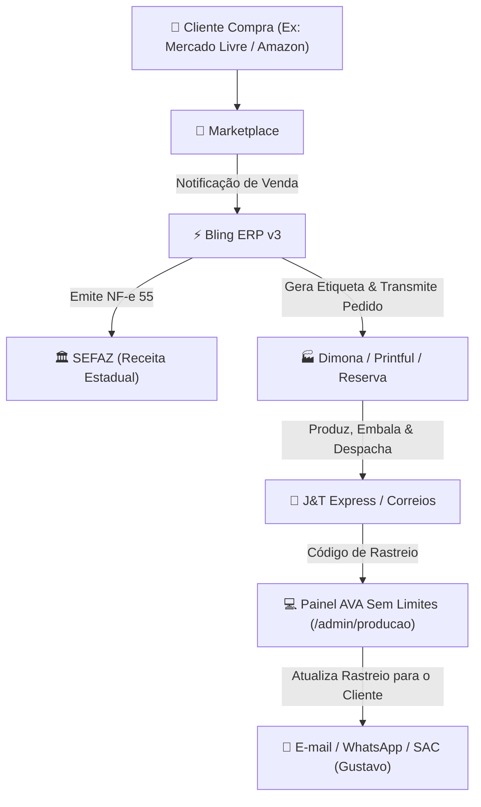

# 🛒 MATRIZ DOS 10 CANAIS DE VENDA (VITRINES DIGITAIS)
**Departamentos Responsáveis:**  
* Depto 06 · Marketing & Vendas (Tripoint / Genera)  
* Depto 08 · Financeiro (Flávio) — Conciliação de Repasses e Taxas  
**Status:** 📋 Mapeamento de Credenciamento & Arquitetura de Distribuição

---

## 🎯 1. Filosofia Multi-Canal da AVA Sem Limites

Para não ficarmos reféns de um único algoritmo ou plataforma, a AVA opera sob uma estratégia de **onipresença controlada**:
* O estoque é virtual (PoD).
* As vendas caem centralizadas no **Bling ERP v3**.
* O produto é despachado pelo fornecedor direto ao consumidor.
* Nenhum sócio fica impedido de acessar os dados de faturamento de nenhum canal.

---

## 📊 2. Matriz Comparativa das 10 Vitrines

| # | Canal / Marketplace | Titular | Modelo Logístico | Comissão Média | Prazo de Repasse | Status de Integração |
| :-: | :--- | :---: | :---: | :---: | :---: | :---: |
| **01** | **Loja Oficial AVA** (`ava-vitoria.com.br`) | Genera | Dropshipping Próprio | **~3,9% (Gateway)** | D+2 (PIX/Cartão) | 🟢 **100% Ativa** |
| **02** | **Mercado Livre** | Tripoint / Genera | Coleta / Envios PoD | 12% a 17% | D+14 | 🟡 Em homologação via Bling |
| **03** | **Amazon Brasil** | Tripoint / Genera | FBM (Envio pelo Vendedor) | 15% | Quinzenal | 🟡 Cadastro de Marca (Brand Registry) |
| **04** | **Shopee** | Tripoint / Genera | Shopee Envios / Coleta | 14% + R$ 4,00 | D+7 pós-entrega | ⚪ Em estruturação |
| **05** | **Magalu Marketplace** | Flávio / Genera | Magalu Entregas | 16% | D+30 | ⚪ Ficha cadastral aberta |
| **06** | **TikTok Shop** | Tripoint | Envio Direto PoD | 5% a 8% | Semanal | ⚪ Aguardando abertura do recurso |
| **07** | **Instagram / Meta Commerce** | Tripoint | Checkout no Site AVA | 0% (Tráfego Direto) | Imediato via Site | 🟢 Catálogo sincronizado |
| **08** | **Google Shopping** | Tripoint | Merchant Center | Custo por Clique (CPC) | Imediato via Site | 🟢 Feed de produtos ativo |
| **09** | **Shein Brasil / Enjoei** | Genera | Envio Etiqueta Reversa | 16% a 20% | D+15 pós-venda | ⚪ Em análise de viabilidade |
| **10** | **B2B Corporativo (Reserva INK)** | Genera | Produção em Lote Direta | **Margem AVA (40%+)** | 50% Sinal / 50% Faturado | 🟢 **Pronto no Admin** |

---

## 🔐 3. Padrão de Ficha Cadastral de Acesso (Segurança & Transparência)

Para cada novo canal credenciado, deve-se criar uma subpasta neste diretório (`docs/INTEGRACOES/CANAIS_DE_VENDA/<NOME_DO_CANAL>/`) contendo:

1. **`CREDENCIAMENTO.md`:**
   * URL do Portal do Vendedor (Seller Center).
   * E-mail e usuário mestre de login.
   * Telefone de verificação em duas etapas (2FA).
   * Titular responsável pela custódia do acesso.
2. **`PARAMETROS_API.md`:**
   * Token de integração com o Bling ERP.
   * Regras de precificação automática (acréscimo da comissão do marketplace no preço da loja).
   * Template de descrição de produto aprovado nas diretrizes do canal.

---

## 🔄 4. Fluxo de Roteamento de Vendas

