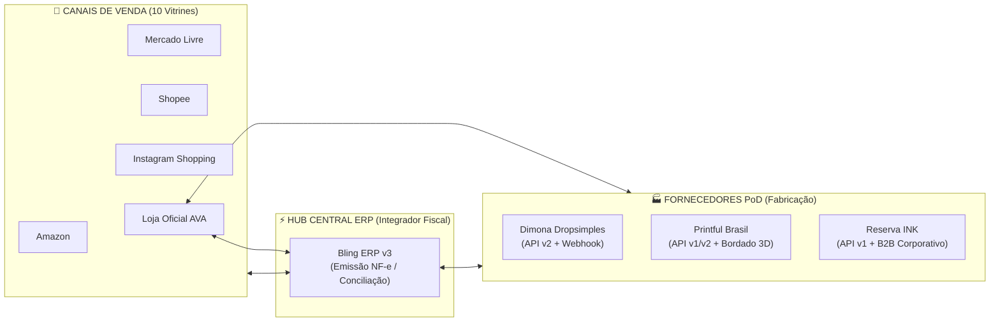

# 🔌 MATRIZ CENTRAL DE INTEGRAÇÕES & GOVERNANÇA — AVA SEM LIMITES

Este diretório é o **Repositório Soberano de Credenciais, Especificações Técnicas e Manuais de Integração** da AVA Sem Limites.

> [!IMPORTANT]
> **LEI DE TRANSPARÊNCIA DA MESA REDONDA:**
> Nenhum sócio pode ficar "trancado para fora" de nenhum departamento. Toda integração com fornecedores, gateways, ERP e canais de venda deve ter sua documentação, e-mails de acesso, titulares e especificações de API registrados de forma padronizada neste repositório.

---

## 🗺️ Arquitetura das Camadas de Integração

---

## 📂 Organização das Pastas

### 1. 🏭 [FORNECEDORES/](./FORNECEDORES)
* **[DIMONA/](./FORNECEDORES/DIMONA):** API REST v2, Catálogo de 975 SKUs, Planilha de Importação em Lote, Pedido de Amostras `#755-460-927`, Danfe Olist e Webhook ativo.
* **[PRINTFUL/](./FORNECEDORES/PRINTFUL):** Especificação completa `openapi.json` (OpenAPI 3.0), Token Bearer no `.env`, Catálogo de Bonés High Profile com Bordado 3D e malhas internacionais.
* **[RESERVA_INK/](./FORNECEDORES/RESERVA_INK):** Especificação oficial `api-1.yaml` (`api.reserva.ink`), Tabelas de Custos, Planos e Estratégia B2B Corporativa (Uniformes e Propaganda).

### 2. ⚡ [HUB_ERP_BLING/](./HUB_ERP_BLING)
* O coração que liga os fornecedores aos canais de venda. Emissão de NF-e (Modelo 55), conciliação com o MEI/Simples Nacional do Flávio e geração de etiquetas de envio.

### 3. 🛒 [CANAIS_DE_VENDA/](./CANAIS_DE_VENDA)
* As 10 Vitrines Oficiais de Vendas (Amazon, Mercado Livre, Shopee, Google Shopping, Meta Commerce, etc.) com seus formulários de credenciamento, titulares responsáveis e regras de comissão.
