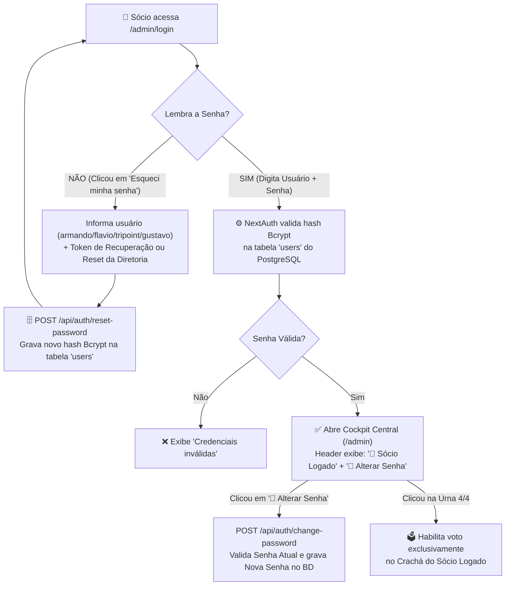

# 🔐 PLANO DE IMPLANTAÇÃO — SISTEMA DE LOGIN INDIVIDUAL DOS 4 SÓCIOS, TROCA & RECUPERAÇÃO DE SENHA NO BD

> **Pilar de Governança Startup:** Independência operacional, rastreabilidade de voto na Urna 4/4 e proteção societária contra sucessão, venda de cotas, esquecimento de senha ou acessos indevidos.  
> **Agentes Vinculados:** `Sentinel Security` (Depto 02 · Engenharia) & `Cobrador de Consenso 4/4` (Diretoria Executiva).

---

## 🔍 1. Diagnóstico do que JÁ EXISTE no Código Hoje (80% da Fundação Pronta!)

1. **Tabela `users` no PostgreSQL ([`prisma/schema.prisma`](file:///home/artz/Documentos/Antigravity/Ava-Vitoria/prisma/schema.prisma#L102-L110)):** Já existe com `id`, `username`, `password` (hash) e timestamps.
2. **Motor de Autenticação NextAuth + Bcrypt ([`src/app/api/auth/[...nextauth]/route.ts`](file:///home/artz/Documentos/Antigravity/Ava-Vitoria/src/app/api/auth/%5B...nextauth%5D/route.ts)):** Já autentica consultando o PostgreSQL (`prisma.user.findUnique`) e validando o hash criptográfico com `bcrypt.compare`.
3. **Portaria de Rotas ([`src/middleware.ts`](file:///home/artz/Documentos/Antigravity/Ava-Vitoria/src/middleware.ts)):** Já bloqueia qualquer acesso não logado a `/admin` e `/admin/*`, redirecionando para `/admin/login`.
4. **Tela de Login ([`src/app/admin/login/page.tsx`](file:///home/artz/Documentos/Antigravity/Ava-Vitoria/src/app/admin/login/page.tsx)):** Já existe e funciona.

### ⚠️ O que falta hoje (e que vamos construir na prioridade #1):
1. **Só existe 1 usuário genérico (`admin` / `admin123`):** Os 4 sócios (`armando`, `flavio`, `tripoint`, `gustavo`) ainda não possuem seus registros individuais na tabela `users`.
2. **Não existe botão nem rota de "Alterar Minha Senha" logado no painel.**
3. **Não existe recurso de "Esqueci Minha Senha / Recuperação de Senha" na tela de login.**
4. **O Cabeçalho (`AdminHeader.tsx`) não exibe quem está logado nem botão de Trocar Senha / Sair.**

---

## 🎯 2. Como Funcionará a Experiência dos 4 Sócios (Fluxo Completo)

### A. Primeiro Acesso com Senha Inicial Única
O sistema garantirá automaticamente no banco de dados (via *auto-seed* seguro que só cria se o usuário ainda não existir) as **4 contas societárias nominais**, todas iniciando com uma mesma senha padrão de 1º acesso (`admin123` / `ava2026`):

| Usuário de Login (`username`) | Nome Exibido no Painel | Crachá Vinculado na Urna 4/4 | Departamentos Titulares |
| :--- | :--- | :---: | :--- |
| **`armando`** | Armando (*Genera*) | `Armando` | `02 · Engenharia` & `03 · Produção` |
| **`flavio`** | Flávio | `Flavio` | `01 · Jurídico` & `08 · Financeiro` |
| **`tripoint`** | Tripoint | `Tripoint` | `06 · Marketing` & `07 · Atelier` |
| **`gustavo`** | Gustavo | `Gustavo` | `04 · Atendimento` & `05 · Vendas` |

### B. Alteração de Senha Pessoal Logado no Painel (`[ 🔑 Alterar Senha ]`)
No topo direito do [`AdminHeader.tsx`](file:///home/artz/Documentos/Antigravity/Ava-Vitoria/src/app/admin/AdminHeader.tsx), o sócio vê seu nome (`👤 Armando (Genera)`) e clica em **`[ 🔑 Alterar Senha ]`**:
* Informa a **Senha Atual** + **Nova Senha Pessoal**.
* A rota `POST /api/auth/change-password` valida a senha atual com `bcrypt.compare`, gera o novo hash com `bcrypt.hash(novaSenha, 10)` e grava (`UPDATE`) na tabela `users` do PostgreSQL.

### C. Recurso de Recuperação de Senha (`"Esqueci minha senha?"`) — Dupla Camada de Segurança
Hoje esse recurso **ainda não existe** na tela [`/admin/login`](file:///home/artz/Documentos/Antigravity/Ava-Vitoria/src/app/admin/login/page.tsx), e vamos implementá-lo com **2 vias complementares** para garantir que nenhum sócio jamais fique trancado para fora:

1. **Via 1 — Na Própria Tela de Login (`"Esqueci minha senha"`):**
   * Abaixo do botão "Acessar" em `/admin/login`, haverá o link **`Esqueci minha senha`**.
   * Ao clicar, o sócio digita seu usuário (`armando`, `flavio`, `tripoint` ou `gustavo`) e escolhe:
     * **Envio de Código/Token de Recuperação por E-mail/WhatsApp** cadastrado do sócio; **OU**
     * **Código Mestre de Recuperação Societária** (`RECOVERY_MASTER_KEY` configurado no `.env` da empresa), permitindo redefinir a senha na hora mesmo se estiver sem acesso ao e-mail.
2. **Via 2 — Reset Colegiado na Sala da Diretoria (`/admin/diretoria`):**
   * Caso um sócio esqueça a senha e peça ajuda no grupo dos sócios, qualquer sócio administrador logado pode clicar em **"🔄 Resetar Senha para o Padrão Inicial"** ao lado do nome daquele sócio em `/admin/diretoria`, restaurando a senha dele para a senha de 1º acesso em 1 segundo.

---

## 🔄 3. Fluxograma Completo (Login, Troca de Senha, Recuperação e Voto)

---

## 🛠️ 4. Roteiro Cirúrgico de Implementação

1. **Passo 1 (`src/lib/ensurePartnerUsers.ts`):** Auto-seed seguro dos 4 usuários (`armando`, `flavio`, `tripoint`, `gustavo`) na tabela `users`.
2. **Passo 2 (`src/app/api/auth/change-password/route.ts`):** API para o sócio logado alterar sua senha no PostgreSQL.
3. **Passo 3 (`src/app/api/auth/reset-password/route.ts`):** API de recuperação de senha (para a tela de login `"Esqueci minha senha"` e botão de Reset de Emergência na Diretoria).
4. **Passo 4 (`src/app/admin/login/page.tsx`):** Adicionar o modal/modo `"Esqueci minha senha?"` na tela de login e corrigir o redirecionamento padrão para `/admin`.
5. **Passo 5 (`src/app/admin/AdminHeader.tsx` & `AdminCockpitClient.tsx`):** Exibir crachá do sócio logado, modal `"🔑 Alterar Senha"`, botão `"Sair"` e trava individual do voto na Urna 4/4.
