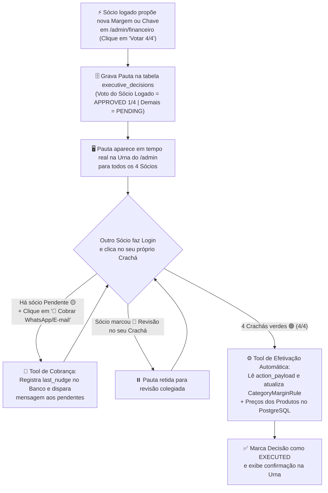

# 🎻 PLANO DE IMPLEMENTAÇÃO (MVP+) — AGENTE #01: COBRADOR DE CONSENSO 4/4

> **ID no Sistema:** `cobrador_consenso`  
> **Camada / Departamento:** `🏛️ Diretoria Executiva (Conselho dos 4 Sócios)`  
> **Status no Painel:** `🟢 Em Atividade`  
> **Pilar de Governança Startup:** **1 Sócio = 1 Login Individual = 1 Voto Soberano Inviolável** (Integrado ao [Plano de Login Societário](../00_Sistema_Login_Societario_4_Socios/PLANO_IMPLEMENTACAO.md)).

---

## 🧠 1. Modelo (Motor de Raciocínio & Decisão)
* **Natureza do Motor:** Híbrido (**Motor Determinístico de Regras TypeScript** + **LLM Leve opcional** como `Gemini Flash` para redigir resumos executivos da pauta no WhatsApp/E-mail).
* **Por que Híbrido?** A validação de quem está votando, a contagem de votos (`4/4`) e a trava de segurança de preços exigem regra determinística exata (`if (session.username === badgeOwner)` e `if (approvedCount === 4)`), sem margem para falha.

---

## 📜 2. Instruções e Persona (System Prompt & Regras de Comportamento)
* **Persona:** Secretário Executivo e Cartório Digital Imparcial da Mesa Redonda da AVA Sem Limites.
* **Regras Inegociáveis (Guardrails):**
  1. **Jamais aplicar uma alteração de margem na loja pública antes do voto `4/4`.**
  2. **Inviolabilidade Individual do Voto:** Cada sócio logado (`armando`, `flavio`, `tripoint`, `gustavo`) só pode alterar o seu próprio crachá de voto na Urna. Nenhum sócio pode votar em nome de outro.
  3. **Cobrança Cirúrgica:** Nunca cobrar quem já votou `🟢 Aprovou`. Enviar o lembrete apenas para os sócios que estão com status `🟡 Pendente`.

---

## 🧰 3. Ferramentas (`Tools` / Conectores & Ações)
1. **`tool_create_decision_proposal` (`POST /api/decisions`):**
   * Recebe uma proposta (ex.: vinda de `/admin/financeiro` ao clicar em `🗳️ Votar 4/4`) e a coloca na Urna em estado `VOTING`, já com o voto do sócio proponente marcado como `APPROVED` (`1/4`) e os demais 3 sócios como `PENDING`, **sem alterar** o preço da vitrine ainda.
2. **`tool_cast_partner_vote` (`POST /api/decisions/[id]/vote`):**
   * Verifica na sessão JWT do NextAuth qual sócio está logado (`armando`, `flavio`, `tripoint`, `gustavo`) e grava o voto exclusivamente no crachá daquele sócio no PostgreSQL.
3. **`tool_execute_approved_decision` (Gatilho Interno Automático no 4/4):**
   * Assim que o 4º crachá fica `🟢 APPROVED`, aciona automaticamente o [`pricingEngine.ts`](file:///home/artz/Documentos/Antigravity/Ava-Vitoria/src/lib/pricingEngine.ts) para gravar a nova margem em `CategoryMarginRule` e recalcular os preços dos produtos da categoria na vitrine.
4. **`tool_nudge_pending_partners` (`POST /api/decisions/[id]/nudge`):**
   * Monta a mensagem com o resumo da pauta e dispara para os sócios pendentes via WhatsApp e E-mail, registrando o carimbo de data/hora (`last_nudge_at`) no banco.

---

## 🗄️ 4. Memória e Contexto (Persistência & Base de Conhecimento)
1. **Tabela PostgreSQL `User` (`users` no [`schema.prisma`](file:///home/artz/Documentos/Antigravity/Ava-Vitoria/prisma/schema.prisma#L102-L110)):**
   * Contém os 4 logins nominais (`armando`, `flavio`, `tripoint`, `gustavo`) com suas respectivas senhas criptografadas em `bcrypt` no banco de dados.
2. **Tabela PostgreSQL `ExecutiveDecision` (`executive_decisions` no [`schema.prisma`](file:///home/artz/Documentos/Antigravity/Ava-Vitoria/prisma/schema.prisma)):**
   * `id`, `depto`, `tag`, `title`, `description`, `action_primary`, `action_type`, `action_payload` (`JsonB`), `votes` (`JsonB`), `status` (`"VOTING"` | `"EXECUTED"` | `"ARCHIVED"`), `last_nudge`, `created_at`, `updated_at`.
3. **Configuração `partners_contacts` em `SiteSettings`:**
   * JSON guardando o WhatsApp e E-mail de `Armando`, `Flávio`, `Tripoint` e `Gustavo`.

---

## ⚡ 5. Gatilhos & Human-in-the-Loop (Orquestração)
* **Gatilho de Entrada:** Clique no botão `🗳️ Votar 4/4` em [`/admin/financeiro`](file:///home/artz/Documentos/Antigravity/Ava-Vitoria/src/app/admin/financeiro/page.tsx) (ou criação de pauta estratégica).
* **Human-in-the-Loop:** Os 4 crachás autenticados na Fila de Decisões do [`/admin`](file:///home/artz/Documentos/Antigravity/Ava-Vitoria/src/app/admin/AdminCockpitClient.tsx).
* **Gatilho de Saída:** Placar `4/4` alcançado ➔ Execução automática da mudança no banco + selo verde `✅ CONSENSO 4/4 ALCANÇADO`.

---

## 🔄 6. Fluxograma do Processo (BPMN)

---

## 🛠️ 7. Roteiro Cirúrgico de Implementação (Do Estado Atual para Funcional MVP+)

1. **Passo 1 (Login Societário & Troca de Senha):** Executar o [Plano 00 — Sistema de Login dos 4 Sócios](../00_Sistema_Login_Societario_4_Socios/PLANO_IMPLEMENTACAO.md).
2. **Passo 2 (Banco de Dados da Urna):** Adicionar o model `ExecutiveDecision` no [`prisma/schema.prisma`](file:///home/artz/Documentos/Antigravity/Ava-Vitoria/prisma/schema.prisma) e sincronizar via `npx prisma db push`.
3. **Passo 3 (API da Urna Autenticada):** Criar a rota `src/app/api/decisions/route.ts` validando via `getServerSession` que cada sócio só vota no próprio crachá e disparando o `pricingEngine.ts` quando atingir `4/4`.
4. **Passo 4 (Conexão do Financeiro & Cockpit):** Conectar [`src/app/admin/financeiro/page.tsx`](file:///home/artz/Documentos/Antigravity/Ava-Vitoria/src/app/admin/financeiro/page.tsx) e [`src/app/admin/AdminCockpitClient.tsx`](file:///home/artz/Documentos/Antigravity/Ava-Vitoria/src/app/admin/AdminCockpitClient.tsx) à API `/api/decisions`.
