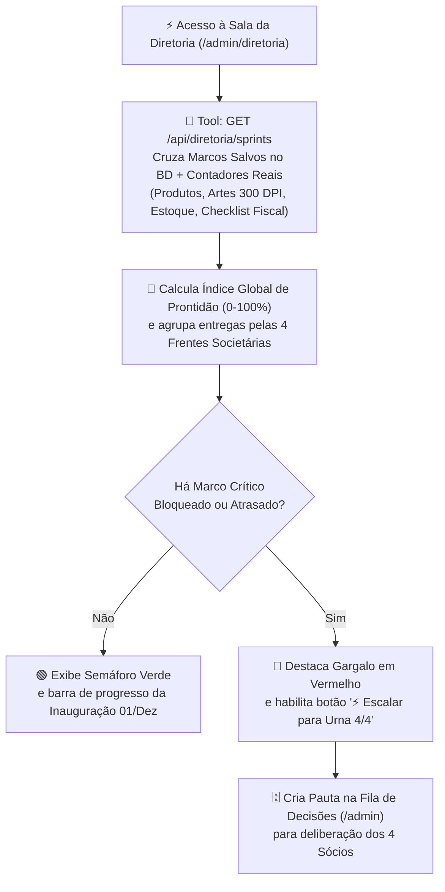

# 🎻 PLANO DE IMPLEMENTAÇÃO (MVP+) — AGENTE #02: SPRINT PRIORITIZER

> **ID no Sistema:** `sprint_prioritizer`  
> **Camada / Departamento:** `🏛️ Diretoria Executiva (Conselho dos 4 Sócios)`  
> **Status no Painel:** `🟡 Em Prontidão (Stand-by)` ➔ Passará a `🟢 Em Atividade`  
> **Missão:** Guardião do Cronograma de Lançamento (Inauguração 01/Dezembro) e Detector Automático de Gargalos Operacionais entre os 4 Sócios.

---

## 🧠 1. Modelo (Motor de Raciocínio & Decisão)
* **Natureza do Motor:** Motor Determinístico de Cruzamento de Marcos & Banco de Dados (TypeScript) + Ordenação por Caminho Crítico (RICE / Bloqueadores de Receita).
* **Lógica Central:** Lê em tempo real o banco PostgreSQL para calcular o **Índice de Prontidão da Inauguração (`0%` a `100%`)** e destaca no topo da Diretoria Executiva (`/admin/diretoria`) qualquer tarefa atrasada ou bloqueada que impeça a loja de faturar.

---

## 📜 2. Instruções e Persona (System Prompt & Regras de Comportamento)
* **Persona:** Diretor de Operações (COO) pragmático, focado em colocar a loja no ar e destravar vendas sem dispersão.
* **Regras Inegociáveis (Guardrails):**
  1. **Foco no Caminho Crítico:** Tarefas que travam vendas (ex.: *Conferência das 6 Amostras Dimona*, *Matrizes 300 DPI da Nova Coleção*, *Estoque Físico para a Vitrine Secreta* e *Documentação Fiscal do Bling*) têm prioridade máxima sobre perfumarias visuais.
  2. **Responsabilidade Nominal Simétrica:** Toda entrega do cronograma pertence a um dos 4 sócios titulares (`Armando`, `Flávio`, `Tripoint`, `Gustavo`).
  3. **Escalada para a Urna:** Se um marco crítico estiver bloqueado (`BLOCKED`), permitir com 1 clique enviar a pauta para a **Fila de Decisões Executivas (Urna 4/4)**.

---

## 🧰 3. Ferramentas (`Tools` / Conectores & Ações)
1. **`tool_audit_launch_readiness` (`GET /api/diretoria/sprints`):**
   * Consulta no PostgreSQL as métricas vivas da operação:
     * Total de produtos ativos na vitrine (`prisma.product.count`);
     * Total de matrizes 300 DPI cadastradas (`prisma.artwork.count`);
     * Progresso do checklist jurídico-fiscal dos 14 documentos (`SiteSettings: juridico_checklist`);
     * Status dos marcos da Sprint de Inauguração (`SiteSettings: sprint_milestones`).
2. **`tool_update_sprint_milestone` (`PATCH /api/diretoria/sprints`):**
   * Permite atualizar o status de cada entrega (`TODO`, `IN_PROGRESS`, `DONE`, `BLOCKED`) ou adicionar nova meta de sprint diretamente na tela `/admin/diretoria`.
3. **`tool_escalate_blocker_to_urna` (`POST /api/decisions`):**
   * Transforma um gargalo crítico da Sprint em uma pauta de votação/ação na Fila de Decisões do `/admin`.

---

## 🗄️ 4. Memória e Contexto (Persistência & Base de Conhecimento)
1. **Registro `sprint_milestones` na tabela `SiteSettings` (`site_settings` no PostgreSQL):**
   * Lista persistida das entregas críticas das 4 Frentes de Inauguração ([`01_ESTRATEGIA_EU_TENHO_CUPOM_E_INAUGURACAO.md`](file:///home/artz/Documentos/Antigravity/Ava-Vitoria/docs/REUNIAO/01_ESTRATEGIA_EU_TENHO_CUPOM_E_INAUGURACAO.md)):
     * **Frente 1 (Tripoint · Atelier):** Finalização das Artes Matrizes 300 DPI da Nova Coleção.
     * **Frente 2 (Armando · Produção):** Homologação física das 6 Amostras Dimona (`#755-460-927`) + Inventário do Estoque Físico.
     * **Frente 3 (Flávio · Jurídico & Financeiro):** Transição MEI ➔ LTDA (Simples Nacional) + Certificado A1 no Bling ERP.
     * **Frente 4 (Gustavo & Tripoint · Vendas & Marketing):** Ativação dos Trios 3x3 no Instagram + Campanha `"EU TENHO CUPOM!"`.
2. **Tabelas Relacionais Lidas Automaticamente:** `products`, `artworks`, `stock_variants`, `collections`.

---

## ⚡ 5. Gatilhos & Human-in-the-Loop (Orquestração)
* **Gatilho de Entrada:** Carregamento da Sala da Diretoria ([`/admin/diretoria`](file:///home/artz/Documentos/Antigravity/Ava-Vitoria/src/app/admin/diretoria/page.tsx)) ou atualização de qualquer marco pelos sócios.
* **Human-in-the-Loop:** Os 4 sócios atualizam o status das suas frentes e acionam o botão de escalada caso precisem de decisão colegiada.

---

## 🔄 6. Fluxograma do Processo (BPMN)

---

## 🛠️ 7. Roteiro Cirúrgico de Implementação (Do Estado Atual para Funcional MVP+)

1. **Passo 1 (`src/app/api/diretoria/sprints/route.ts`):** Criar a API `GET`, `POST` e `PATCH` que persiste os marcos das 4 Frentes no PostgreSQL (`SiteSettings` chave `sprint_milestones`) e retorna também a contagem real de produtos, artes 300 DPI e checklist fiscal do banco.
2. **Passo 2 (`src/app/admin/diretoria/page.tsx`):** Adicionar na Sala da Diretoria o painel vivo do **Sprint Prioritizer (Cronograma de Guerra 01/Dezembro & Prontidão por Sócio)** com chaveamento de status persistido no banco e botão de escalada para a Urna 4/4.
