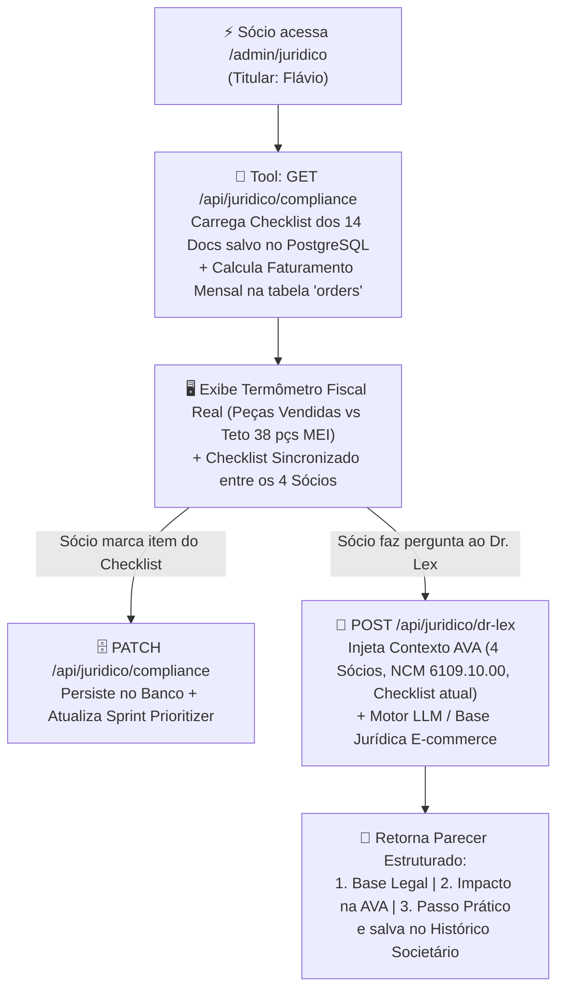

# 🎻 PLANO DE IMPLEMENTAÇÃO (MVP+) — AGENTE #03: DR. LEX

> **ID no Sistema:** `dr_lex`  
> **Camada / Departamento:** `01 · Jurídico & Compliance (Titular: Flávio)`  
> **Status no Painel:** `🟢 Em Atividade`  
> **Missão:** Consultor Jurídico, Fiscal e Societário da AVA Sem Limites, Guardião do Teto Tributário (MEI 38 peças/mês vs. LTDA Simples Nacional), do Checklist dos 14 Documentos e de Contratos/CDC/LGPD/INPI.

---

## 🧠 1. Modelo (Motor de Raciocínio & Decisão)
* **Natureza do Motor:** Híbrido (**Motor de Regras Fiscais & Persistência em Tempo Real** + **API Consultiva LLM / Base Jurídica Expandida de E-commerce**).
* **Por que Híbrido?**
  1. O **Termômetro Fiscal do Limite do MEI** precisa somar o faturamento real dos pedidos pagos na tabela `orders` do PostgreSQL e comparar matematicamente com o teto mensal de `R$ 6.750,00` (`38 peças × R$ 180,00`) e anual de `R$ 81.000,00`.
  2. O **Consultor Jurídico (`POST /api/juridico/dr-lex`)** precisa responder dúvidas reais de Flávio e dos demais sócios com base na legislação brasileira (CDC Art. 49 e Art. 26, LGPD Lei 13.709/18, Lei das Sociedades LTDA no Código Civil, INPI Classes NCL 25 e 35, ICMS/SEFAZ-ES e regras fiscais de industrialização/PoD da Dimona), podendo usar a chave `GEMINI_API_KEY` quando disponível ou um motor de conhecimento jurídico completo da AVA como fallback instantâneo.

---

## 📜 2. Instruções e Persona (System Prompt & Regras de Comportamento)
* **Persona:** Advogado Empresarial, Tributarista e Especialista em Direito Digital e Moda (Streetwear / Print on Demand) no Espírito Santo (JUCEES / SEFAZ-ES).
* **Regras Inegociáveis (Guardrails):**
  1. **Defesa da Igualdade Societária (25% × 4):** Sempre orientar cláusulas de Contrato Social que preservem a divisão simétrica entre Armando, Flávio, Tripoint e Gustavo, incluindo cláusulas de *Shotgun / Direito de Preferência*, sucessão e *Vesting / Lock-up*.
  2. **Vigilância Tributária:** Alertar preventivamente sempre que o volume de vendas ou compras de insumos PoD (CFOP de remessa/venda da Dimona) se aproximar do limite do MEI.
  3. **Conformidade CDC & LGPD:** Garantir que as páginas públicas (`/politica-de-devolucao`, `/politica-de-privacidade`, `/termos-e-condicoes`) reflitam exatamente o que é praticado no SAC.
  4. **Reforma Tributária do Consumo (RTC — LC 214/2025 · Ref. `ReceitaFederal/calculadora-rtc-simples-nacional`):** Orientar o vínculo obrigatório entre o NCM `6109.10.00` e o código `cClassTrib`/`CST` de CBS e IBS no Bling ERP v3 (prevenindo a rejeição `REG-011` na NF-e 55 em 2027) e a estratégia híbrida do Simples Nacional (recolhimento unificado via DAS no varejo B2C vs. análise de crédito integral de IBS/CBS em grandes contratos corporativos B2B da frente Reserva INK).

---

## 🧰 3. Ferramentas (`Tools` / Conectores & Ações)
1. **`tool_persist_compliance_checklist` (`GET` & `PATCH /api/juridico/compliance`):**
   * Lê e grava no banco de dados PostgreSQL (`SiteSettings` chave `juridico_checklist`) o estado real dos **14 documentos fiscais, bancários e digitais** para que o progresso marcado por Flávio nunca se perca ao atualizar a página.
2. **`tool_monitor_mei_revenue_ceiling` (Integrado a `GET /api/juridico/compliance`):**
   * Soma os pedidos da tabela `orders` no mês corrente e calcula quantas peças restam antes de atingir o teto de 38 peças/mês do MEI (`R$ 6.750,00/mês`), exibindo um termômetro fiscal vivo em [`/admin/juridico`](file:///home/artz/Documentos/Antigravity/Ava-Vitoria/src/app/admin/juridico/page.tsx).
3. **`tool_consult_dr_lex` (`POST /api/juridico/dr-lex`):**
   * Recebe a pergunta jurídica do sócio, injeta o contexto societário e fiscal da AVA Sem Limites (Contrato 4 sócios, status atual dos 14 documentos no banco, NCM `6109.10.00`, regras Dimona/Reserva, INPI Classes 25/35, CDC e LGPD) e retorna um parecer jurídico estruturado (Fundamento Legal + Aplicação na AVA + Ação Recomendada), salvando também o histórico de pareceres no banco.

---

## 🗄️ 4. Memória e Contexto (Persistência & Base de Conhecimento)
1. **Registro `juridico_checklist` na tabela `SiteSettings` (`site_settings` no PostgreSQL):**
   * Persiste os 14 itens documentais (`checked: true/false`, `updated_by`, `updated_at`).
2. **Registro `dr_lex_history` na tabela `SiteSettings`:**
   * Mantém o histórico das últimas consultas jurídicas feitas pelos sócios para consulta rápida de todos.
3. **Tabela `orders` (`schema.prisma`):**
   * Consultada para medir o faturamento acumulado frente ao teto fiscal (MEI vs. Simples Nacional Anexo I).
4. **Base Documental Interna (`docs/REUNIAO/02_CHECKLIST_DOCUMENTACAO_BLING_E_10_CANAIS.md`):**
   * Contexto normativo de referência do agente.

---

## ⚡ 5. Gatilhos & Human-in-the-Loop (Orquestração)
* **Gatilho 1 (Checklist):** Sócio marca/desmarca um dos 14 documentos em `/admin/juridico` ➔ grava imediatamente no PostgreSQL e atualiza o índice de prontidão lido pelo `Sprint Prioritizer`.
* **Gatilho 2 (Consulta Jurídica):** Sócio envia pergunta no formulário do `Dr. Lex` em `/admin/juridico` ➔ API processa e grava o parecer.
* **Gatilho 3 (Alerta Fiscal):** Faturamento mensal se aproxima do teto do MEI ➔ `Dr. Lex` sinaliza alerta vermelho na tela e na Urna 4/4.

---

## 🔄 6. Fluxograma do Processo (BPMN)

---

## 🛠️ 7. Roteiro Cirúrgico de Implementação (Do Estado Atual para Funcional MVP+)

1. **Passo 1 (Diagnóstico do Gap Atual em [`/admin/juridico/page.tsx`](file:///home/artz/Documentos/Antigravity/Ava-Vitoria/src/app/admin/juridico/page.tsx)):**
   * Hoje o checklist dos 14 itens está apenas em memória local (`useState`) — se der `F5`, perde o que foi marcado.
   * Hoje o chat do `Dr. Lex` é um `if/else` local no navegador com apenas 3 frases prontas.
2. **Passo 2 (`src/app/api/juridico/compliance/route.ts`):** Criar a API para persistir os 14 itens do checklist no PostgreSQL (`SiteSettings`) e retornar o termômetro fiscal real lendo a tabela `orders`.
3. **Passo 3 (`src/app/api/juridico/dr-lex/route.ts`):** Criar a rota de inteligência jurídica do `Dr. Lex` com suporte a LLM (`GEMINI_API_KEY` se configurada no `.env`) + matriz jurídica especializada completa (Sociedade LTDA 4 sócios, Sucessão/Venda de Cotas, Simples Nacional Anexo I, ICMS-ES, INPI Classes 25/35, CDC Art. 49/26, LGPD, Contratos PoD Dimona/Bling) e persistência do histórico de consultas no banco.
4. **Passo 4 (`src/app/admin/juridico/page.tsx`):** Conectar o checklist e o chat do `Dr. Lex` às rotas reais do PostgreSQL.
