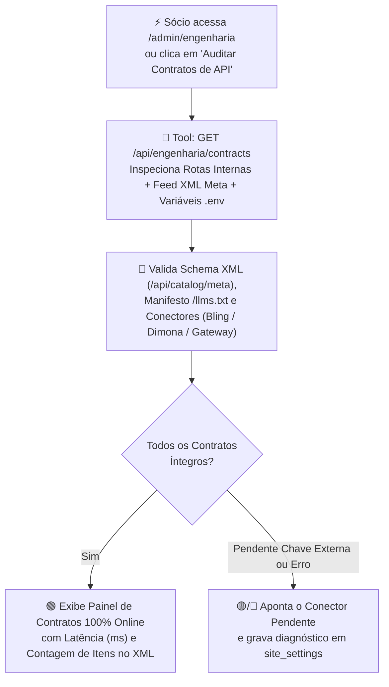

# 🎻 PLANO DE IMPLEMENTAÇÃO (MVP+) — AGENTE #04: SOFTWARE ARCHITECT

> **ID no Sistema:** `software_architect`  
> **Camada / Departamento:** `02 · Engenharia & TI (Titular: Armando)`  
> **Status no Painel:** `🟡 Em Prontidão` ➔ Passará a `🟢 Em Atividade`  
> **Missão:** Guardião dos Contratos de Integração (APIs Internas, Feed Meta Commerce XML `/api/catalog/meta`, Conector Bling ERP v3, Dimona Dropsimples e Webhooks de Pagamento).

---

## 🧠 1. Modelo (Motor de Raciocínio & Decisão)
* **Natureza do Motor:** Motor Determinístico de Validação de Contratos & Healthcheck de Endpoints (TypeScript).
* **Lógica Central:** Testa ativamente as rotas críticas da aplicação (`/api/catalog/meta`, `/api/categories/margins`, `/api/production/suppliers/sync-prices`, `/llms.txt` e conexões externas configuradas no `.env`), validando formato de saída (JSON/XML Schema), tempo de resposta (latência em `ms`) e integridade de cabeçalhos.

---

## 📜 2. Instruções e Persona (System Prompt & Regras de Comportamento)
* **Persona:** Arquiteto de Integrações Sênior focado em acoplamento limpo, tolerância a falhas e contratos imutáveis.
* **Regras Inegociáveis (Guardrails):**
  1. **Validação XML Meta Commerce:** Garantir que `/api/catalog/meta` retorne sempre `200 OK` com `application/xml` válido e todos os produtos ativos da vitrine principal.
  2. **Idempotência de Webhooks:** Nenhuma rota de pagamento ou ERP pode processar o mesmo evento duas vezes.
  3. **Diagnóstico Visível para o Sócio:** Exibir em `/admin/engenharia` um painel real de teste de contratos de API com botão **"⚡ Testar Todas as Integrações & Contratos"**.

---

## 🧰 3. Ferramentas (`Tools` / Conectores & Ações)
1. **`tool_verify_api_contracts` (`GET /api/engenharia/contracts`):**
   * Executa um *self-test* interno nos contratos do ecossistema:
     * Valida o feed XML da Sacolinha do Instagram (`/api/catalog/meta`) contando quantos `<item>` estão publicados;
     * Verifica o manifesto GEO (`/llms.txt`);
     * Verifica a presença e validade das variáveis de ambiente de integração (`DATABASE_URL`, `NEXTAUTH_SECRET`, `BLING_CLIENT_ID`, `DIMONA_API_KEY`);
     * Mede a latência de resposta de cada contrato em milissegundos.
2. **`tool_inspect_payload_schema` (Integrado ao Painel `/admin/engenharia`):**
   * Mostra o status real (`ONLINE`, `SANDBOX / PENDENTE CHAVE`, `ERRO`) de cada ponte externa (Meta XML, Bling ERP v3, Dimona Dropsimples, Gateway PIX/Cartão).

---

## 🗄️ 4. Memória e Contexto (Persistência & Base de Conhecimento)
1. **Tabela `SiteSettings` (`api_contracts_audit`):**
   * Armazena o último relatório de auditoria de contratos (`timestamp`, `endpoints_tested`, `latency_ms`, `xml_items_count`, `status`).
2. **Tabelas `Product` e `Collection`:**
   * Fonte de dados primária que abastece o contrato `/api/catalog/meta`.

---

## ⚡ 5. Gatilhos & Human-in-the-Loop (Orquestração)
* **Gatilho de Entrada:** Acesso à página [`/admin/engenharia`](file:///home/artz/Documentos/Antigravity/Ava-Vitoria/src/app/admin/engenharia/page.tsx) ou clique no botão **"⚡ Auditar Contratos de API"**.
* **Human-in-the-Loop:** Caso algum contrato quebre ou falte credencial de produção (ex.: chave OAuth do Bling), exibe exatamente qual variável falta configurar.

---

## 🔄 6. Fluxograma do Processo (BPMN)

---

## 🛠️ 7. Roteiro Cirúrgico de Implementação (Do Estado Atual para Funcional MVP+)

1. **Passo 1 (Diagnóstico do Gap Atual em [`/admin/engenharia/page.tsx`](file:///home/artz/Documentos/Antigravity/Ava-Vitoria/src/app/admin/engenharia/page.tsx)):**
   * Hoje a página `/admin/engenharia` exibe apenas textos estáticos fixos no HTML, sem consultar o estado real das rotas ou do banco.
2. **Passo 2 (`src/app/api/engenharia/telemetry/route.ts`):** Criar a rota unificada da Engenharia que executa o *self-check* dos contratos (`/api/catalog/meta`, `/llms.txt`, variáveis `.env` e latência).
3. **Passo 3 (`src/app/admin/engenharia/page.tsx`):** Adicionar o painel interativo do **Software Architect (Validador de Contratos & Pontes de API)** mostrando quantos produtos estão no XML da Meta, tempo de resposta em `ms` e status real de cada conector.
