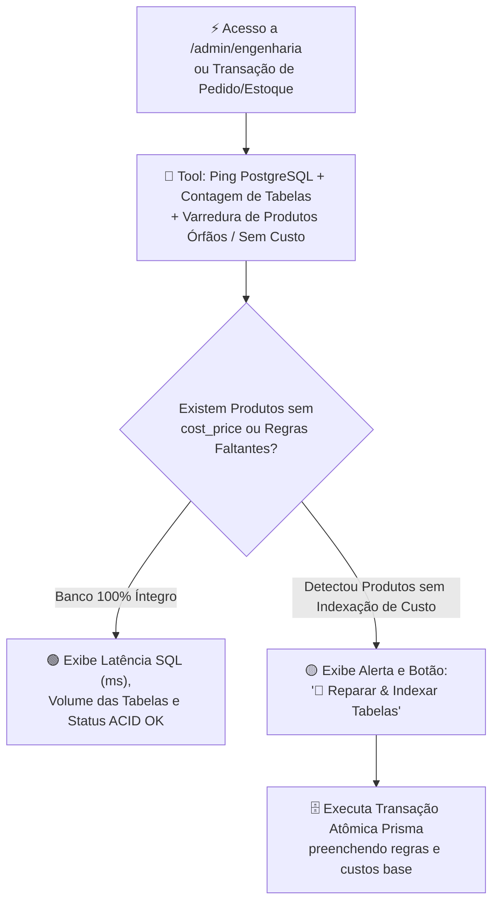

# 🎻 PLANO DE IMPLEMENTAÇÃO (MVP+) — AGENTE #05: DATABASE OPTIMIZER

> **ID no Sistema:** `database_optimizer`  
> **Camada / Departamento:** `02 · Engenharia & TI (Titular: Armando)`  
> **Status no Painel:** `🟢 Em Atividade`  
> **Missão:** Guardião da Integridade Relacional PostgreSQL, Prevenção de *Overselling* (Transações ACID `FOR UPDATE`) e Diagnóstico Vivo das Tabelas no Painel de Engenharia.

---

## 🧠 1. Modelo (Motor de Raciocínio & Decisão)
* **Natureza do Motor:** Motor Determinístico Transacional SQL/Prisma (PostgreSQL ACID).
* **Lógica Central:**
  1. Garante bloqueio pessimista (`SELECT ... FOR UPDATE` / transação atômica `$transaction`) em qualquer baixa de estoque físico (`StockVariant`), impedindo venda duplicada da mesma peça.
  2. Audita em tempo real a saúde do banco PostgreSQL: contagem de registros por tabela, detecção de produtos órfãos (sem imagem ou sem preço de custo indexado) e latência de query (`SELECT 1`).

---

## 📜 2. Instruções e Persona (System Prompt & Regras de Comportamento)
* **Persona:** DBA PostgreSQL e Engenheiro de Confiabilidade de Dados focado em consistência zero-perda.
* **Regras Inegociáveis (Guardrails):**
  1. **Zero Overselling:** Nenhuma baixa de estoque físico pode ocorrer fora de uma transação atômica `prisma.$transaction`.
  2. **Auditoria de Integridade de Catálogo:** Sinalizar imediatamente produtos ativos que estejam sem imagem 9:16 cadastrada ou sem vínculo com regra de margem (`CategoryMarginRule`).

---

## 🧰 3. Ferramentas (`Tools` / Conectores & Ações)
1. **`tool_audit_database_health` (`GET /api/engenharia/telemetry`):**
   * Mede o tempo de ping real do PostgreSQL (`ms`);
   * Conta os registros reais das tabelas (`products`, `collections`, `stock_variants`, `orders`, `artworks`, `category_margin_rules`, `supplier_catalog_items`, `users`);
   * Verifica anomalias relacionais (ex.: produtos sem imagens, variantes com estoque zerado, produtos sem `cost_price`).
2. **`tool_repair_catalog_integrity` (`POST /api/engenharia/telemetry`):**
   * Sincroniza automaticamente as regras padrão de margem (`ensureDefaultMarginRules`) e preenche `cost_price` / `cost_baseline` padrão nos produtos que ainda estiverem com custo nulo no banco.

---

## 🗄️ 4. Memória e Contexto (Persistência & Base de Conhecimento)
* **Todas as Tabelas do Schema Prisma ([`prisma/schema.prisma`](file:///home/artz/Documentos/Antigravity/Ava-Vitoria/prisma/schema.prisma)):**
  * `SiteSettings`, `Product`, `ProductImage`, `StockVariant`, `Order`, `OrderItem`, `User`, `MediaAsset`, `Collection`, `Artwork`, `CategoryMarginRule`, `SupplierCatalogItem`.

---

## ⚡ 5. Gatilhos & Human-in-the-Loop (Orquestração)
* **Gatilho 1 (Em Tempo Real no Checkout):** Toda criação de pedido aciona a trava ACID do `Database Optimizer`.
* **Gatilho 2 (No Painel `/admin/engenharia`):** Inspeciona a saúde das tabelas e permite rodar **"🔧 Otimizar & Reparar Indexação de Custos no BD"** com 1 clique.

---

## 🔄 6. Fluxograma do Processo (BPMN)

---

## 🛠️ 7. Roteiro Cirúrgico de Implementação (Do Estado Atual para Funcional MVP+)

1. **Passo 1 (`src/app/api/engenharia/telemetry/route.ts`):** Implementar a query de diagnóstico real do PostgreSQL (tempo de resposta em `ms`, contadores de todas as tabelas e detector de produtos não indexados) + ação `POST` de auto-reparo/indexação.
2. **Passo 2 (`src/app/admin/engenharia/page.tsx`):** Exibir no card do Banco de Dados os números reais ao vivo do PostgreSQL e o botão de reparo/indexação do `Database Optimizer`.
