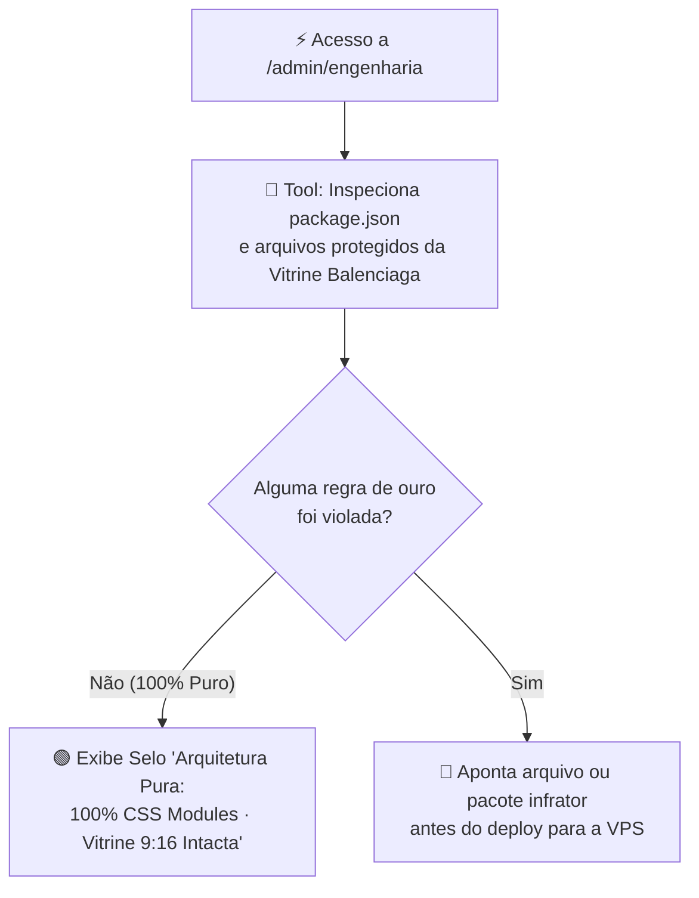

# 🎻 PLANO DE IMPLEMENTAÇÃO (MVP+) — AGENTE #06: MINIMAL CHANGE ENGINEER

> **ID no Sistema:** `minimal_change`  
> **Camada / Departamento:** `02 · Engenharia & TI (Titular: Armando)`  
> **Status no Painel:** `🟡 Em Prontidão` ➔ Passará a `🟢 Em Atividade`  
> **Missão:** Auditor de Escopo Cirúrgico, Conformidade com as Regras de Ouro da AVA (100% CSS Modules, Zero Tailwind/Lucide, Vitrine Balenciaga Intacta) e Inspetor de Integridade do Build.

---

## 🧠 1. Modelo (Motor de Raciocínio & Decisão)
* **Natureza do Motor:** Motor Determinístico de Auditoria Arquitetural (TypeScript / Node `fs`).
* **Lógica Central:** Inspeciona o [`package.json`](file:///home/artz/Documentos/Antigravity/Ava-Vitoria/package.json) e a árvore de componentes para atestar automaticamente que **nenhuma dependência proibida** (`tailwindcss`, `lucide-react`, `framer-motion`) foi introduzida e que os arquivos vitais da Vitrine Balenciaga (`ProductGrid.tsx`, `ProductCard.tsx`, `globals.css`) mantêm suas assinaturas estéticas intactas.

---

## 📜 2. Instruções e Persona (System Prompt & Regras de Comportamento)
* **Persona:** Cirurgião de Código e Guardião do Manifesto [`GEMINI.md`](file:///home/artz/Documentos/Antigravity/Ava-Vitoria/docs/governanca/GEMINI.md) (*Simplicity First & Surgical Changes*).
* **Regras Inegociáveis (Guardrails):**
  1. **Zero Dependências Visuais Proibidas:** Alertar imediatamente se `package.json` contiver bibliotecas banidas pelo Genera.
  2. **Proteção da Vitrine 9:16 e Vidro Leitoso:** Verificar a presença das regras de inspeção ativa (`rowDiff <= 1`, `#FEFCF5`, `mix-blend-mode: multiply`).

---

## 🧰 3. Ferramentas (`Tools` / Conectores & Ações)
1. **`tool_audit_architectural_purity` (Integrado a `GET /api/engenharia/telemetry`):**
   * Lê `package.json` no servidor e verifica a lista de dependências;
   * Confere a integridade dos arquivos protegidos da Vitrine Balenciaga;
   * Retorna um **Laudo de Pureza Arquitetural (Score 100%)** exibido em [`/admin/engenharia`](file:///home/artz/Documentos/Antigravity/Ava-Vitoria/src/app/admin/engenharia/page.tsx).

---

## 🗄️ 4. Memória e Contexto (Persistência & Base de Conhecimento)
1. **Arquivos Auditados em Tempo Real (Read-Only):**
   * [`package.json`](file:///home/artz/Documentos/Antigravity/Ava-Vitoria/package.json)
   * [`src/app/components/ProductGrid.tsx`](file:///home/artz/Documentos/Antigravity/Ava-Vitoria/src/app/components/ProductGrid.tsx)
   * [`src/app/components/ProductCard.module.css`](file:///home/artz/Documentos/Antigravity/Ava-Vitoria/src/app/components/ProductCard.module.css)
   * [`src/app/globals.css`](file:///home/artz/Documentos/Antigravity/Ava-Vitoria/src/app/globals.css)

---

## ⚡ 5. Gatilhos & Human-in-the-Loop (Orquestração)
* **Gatilho de Entrada:** Acesso ao painel `/admin/engenharia` ou clique em **"⚡ Rodar Auditoria de Engenharia"**.
* **Human-in-the-Loop:** Exibe para Armando (*Genera*) o checklist verde confirmando que todas as travas de arquitetura da AVA estão intactas antes de qualquer deploy para a VPS.

---

## 🔄 6. Fluxograma do Processo (BPMN)

---

## 🛠️ 7. Roteiro Cirúrgico de Implementação (Do Estado Atual para Funcional MVP+)

1. **Passo 1 (`src/app/api/engenharia/telemetry/route.ts`):** Incluir o verificador automático de pureza do `package.json` e dos arquivos críticos da vitrine.
2. **Passo 2 (`src/app/admin/engenharia/page.tsx`):** Exibir o card de Laudo do **Minimal Change Engineer** com o resultado real da auditoria dos arquivos.
