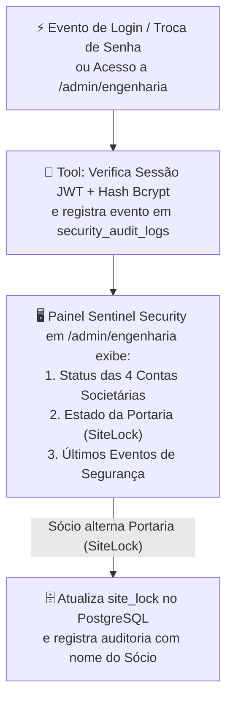

# 🎻 PLANO DE IMPLEMENTAÇÃO (MVP+) — AGENTE #07: SENTINEL SECURITY

> **ID no Sistema:** `sentinel_security`  
> **Camada / Departamento:** `02 · Engenharia & TI (Titular: Armando)`  
> **Status no Painel:** `🟢 Em Atividade`  
> **Missão:** Segurança Cibernética, Auditoria de Logins dos 4 Sócios, Proteção contra Força Bruta, Validação HMAC de Webhooks e Controle Direto da Portaria Digital (`SiteLock`).

---

## 🧠 1. Modelo (Motor de Raciocínio & Decisão)
* **Natureza do Motor:** Motor Determinístico Criptográfico & Guardião de Sessões (`bcrypt` + `NextAuth JWT` + Auditor de Eventos de Segurança no PostgreSQL).
* **Lógica Central:**
  1. Registra cada login bem-sucedido, tentativa falha de senha ou alteração de senha dos 4 sócios (`armando`, `flavio`, `tripoint`, `gustavo`) em um log de segurança persistido no banco (`security_audit_logs`).
  2. Controla o estado da **Portaria da Loja (`SiteLock`)** diretamente no painel de Engenharia e monitora o status do HTTPS/SSL e da chave `NEXTAUTH_SECRET`.

---

## 📜 2. Instruções e Persona (System Prompt & Regras de Comportamento)
* **Persona:** Chefe de Segurança da Informação (CISO) da AVA Sem Limites.
* **Regras Inegociáveis (Guardrails):**
  1. **Senhas 100% Criptografadas:** Nenhuma senha é salva em texto puro; uso estrito de `bcrypt` (10 rounds).
  2. **Rastreabilidade de Acessos:** Todo login ou troca de senha grava quem acessou e o carimbo de data/hora.
  3. **Controle Rápido da Portaria (`SiteLock`):** Permitir ativar/desativar o cadeado de pré-lançamento da loja pública com 1 clique.

---

## 🧰 3. Ferramentas (`Tools` / Conectores & Ações)
1. **`tool_record_security_event` (Hook interno nas rotas `/api/auth/*`):**
   * Registra no PostgreSQL (`SiteSettings: security_audit_logs`) eventos como: `LOGIN_SUCCESS`, `LOGIN_FAILED`, `PASSWORD_CHANGED`, `PASSWORD_RESET`, `SITELOCK_TOGGLED`.
2. **`tool_get_security_posture` (Integrado a `GET /api/engenharia/telemetry`):**
   * Lista as contas ativas na tabela `users` (mostrando quais dos 4 sócios já estão cadastrados e quando atualizaram suas senhas pela última vez — sem jamais expor os hashes!).
   * Lê o estado atual do `SiteLock` (Loja Aberta ao Público vs. Portaria Trancada com Senha VIP).
   * Retorna os últimos logs de segurança registrados.

---

## 🗄️ 4. Memória e Contexto (Persistência & Base de Conhecimento)
1. **Tabela `User` (`users` no PostgreSQL):** Contas individuais dos 4 sócios (`armando`, `flavio`, `tripoint`, `gustavo`).
2. **Tabela `SiteSettings`:**
   * Chave `site_lock` (configuração da Portaria Digital da loja pública).
   * Chave `security_audit_logs` (últimos 50 eventos de segurança e autenticação da sociedade).

---

## ⚡ 5. Gatilhos & Human-in-the-Loop (Orquestração)
* **Gatilho 1 (Autenticação):** Qualquer tentativa de login, troca ou recuperação de senha aciona o registro do `Sentinel Security`.
* **Gatilho 2 (Painel `/admin/engenharia`):** Exibe o quadro de contas dos 4 sócios, o status da Portaria (`SiteLock`) e o log de auditoria de acessos.

---

## 🔄 6. Fluxograma do Processo (BPMN)

---

## 🛠️ 7. Roteiro Cirúrgico de Implementação (Do Estado Atual para Funcional MVP+)

1. **Passo 1 (`src/lib/securityLogger.ts`):** Criar utilitário leve que grava eventos de login/troca de senha na chave `security_audit_logs` da tabela `SiteSettings`.
2. **Passo 2 (`src/app/api/engenharia/telemetry/route.ts`):** Retornar a lista de usuários societários (sem senha), status do `SiteLock` e últimos logs do `Sentinel Security`.
3. **Passo 3 (`src/app/admin/engenharia/page.tsx`):** Exibir o painel vivo do **Sentinel Security** com o log de acessos dos 4 sócios e controle rápido da Portaria Digital.
