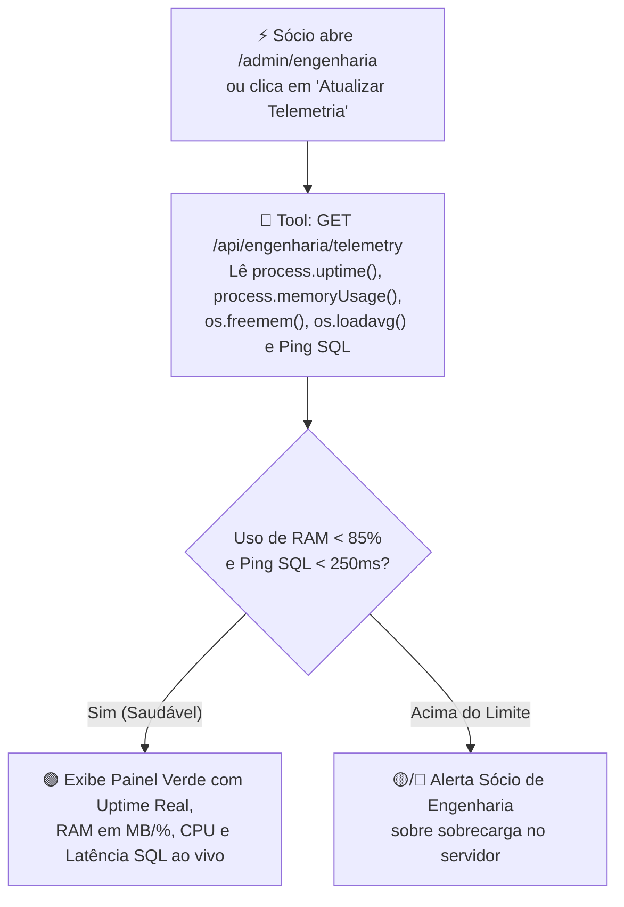

# 🎻 PLANO DE IMPLEMENTAÇÃO (MVP+) — AGENTE #08: TELEMETRIA DE INFRAESTRUTURA

> **ID no Sistema:** `telemetria_infra`  
> **Camada / Departamento:** `02 · Engenharia & TI (Titular: Armando)`  
> **Status no Painel:** `🟢 Em Atividade`  
> **Missão:** Monitoramento em Tempo Real da Saúde do Servidor (Memória RAM Node.js, Uptime do Processo PM2 `ava-vitoria`, Latência PostgreSQL, Versão do Node e Disponibilidade na VPS Contabo `31.220.102.2`).

---

## 🧠 1. Modelo (Motor de Raciocínio & Decisão)
* **Natureza do Motor:** Coletor Determinístico de Telemetria do Sistema Operacional e Runtime Node.js (`os` e `process` nativos do Node.js).
* **Lógica Central:** Coleta métricas reais de execução do servidor a cada requisição ao painel `/admin/engenharia`: consumo de memória (`process.memoryUsage()`), memória livre/total da VPS (`os.freemem()` / `os.totalmem()`), tempo contínuo no ar (`process.uptime()`), carga de CPU (`os.loadavg()`) e latência do banco.

---

## 📜 2. Instruções e Persona (System Prompt & Regras de Comportamento)
* **Persona:** Engenheiro de Confiabilidade de Site (SRE) mantendo o cockpit da VPS Contabo transparente para Armando (*Genera*).
* **Regras Inegociáveis (Guardrails):**
  1. **Zero Comandos Perigosos:** Coletar telemetria estritamente via APIs nativas do Node.js (`process` e `os`), sem rodar comandos shell destrutivos.
  2. **Alerta de Saturação:** Se o uso de RAM da VPS ultrapassar `85%` ou a latência do PostgreSQL passar de `250ms`, destacar o indicador em amarelo/vermelho.

---

## 🧰 3. Ferramentas (`Tools` / Conectores & Ações)
1. **`tool_collect_runtime_metrics` (`GET /api/engenharia/telemetry`):**
   * Lê em tempo real do servidor:
     * `uptimeSeconds` / `uptimeFormatted` (há quanto tempo o servidor Next.js/PM2 está rodando sem cair);
     * `nodeVersion` e `platform` (`linux`);
     * `memoryRssMb` e `heapUsedMb` do processo `ava-vitoria`;
     * `systemRamUsedPercent` da máquina/VPS;
     * `cpuLoad1m` e `cpuCores`.

---

## 🗄️ 4. Memória e Contexto (Persistência & Base de Conhecimento)
* **Runtime do Servidor (`process` & `os`)** + histórico do último check salvo em `SiteSettings` (`infra_last_heartbeat`).

---

## ⚡ 5. Gatilhos & Human-in-the-Loop (Orquestração)
* **Gatilho de Entrada:** Abertura de [`/admin/engenharia`](file:///home/artz/Documentos/Antigravity/Ava-Vitoria/src/app/admin/engenharia/page.tsx) ou clique no botão **"🔄 Atualizar Telemetria da VPS"**.
* **Human-in-the-Loop:** Mostra para Armando os indicadores reais de saúde da máquina sem precisar abrir terminal SSH.

---

## 🔄 6. Fluxograma do Processo (BPMN)

---

## 🛠️ 7. Roteiro Cirúrgico de Implementação (Do Estado Atual para Funcional MVP+)

1. **Passo 1 (`src/app/api/engenharia/telemetry/route.ts`):** Implementar a coleta nativa com os módulos `os` e `process` do Node.js + ping do Prisma.
2. **Passo 2 (`src/app/admin/engenharia/page.tsx`):** Substituir os textos fixos do card de Infraestrutura pelos medidores ao vivo de Uptime, RAM, CPU e Latência SQL com botão de atualização instantânea.
