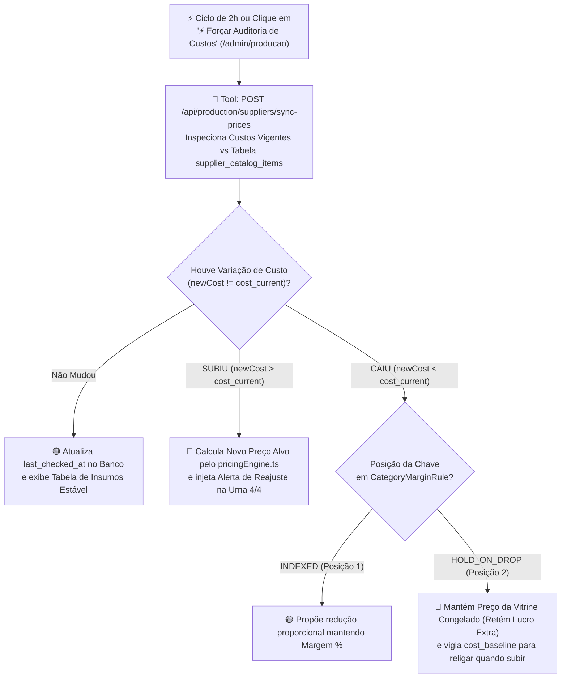

# 🎻 PLANO DE IMPLEMENTAÇÃO (MVP+) — AGENTE #09: AUDITOR DE PREÇOS MULTI-SUPPLIER (2 HORAS)

> **ID no Sistema:** `auditor_precos`  
> **Camada / Departamento:** `03 · Produção & Fornecedores (Titular: Armando)`  
> **Status no Painel:** `🟢 Em Atividade`  
> **Missão:** Auditar a cada 2 horas os custos dos insumos nos fornecedores homologados (Dimona Dropsimples, Reserva INK, etc.), acionar a regra da **Chave de 2 Posições** (`INDEXED` vs. `HOLD_ON_DROP`) e enviar alertas ou propostas de reajuste para a **Urna 4/4**.

---

## 🧠 1. Modelo (Motor de Raciocínio & Decisão)
* **Natureza do Motor:** Motor Determinístico de Auditoria & Reindexação Financeira ([`src/lib/pricingEngine.ts`](file:///home/artz/Documentos/Antigravity/Ava-Vitoria/src/lib/pricingEngine.ts) + [`src/app/api/production/suppliers/sync-prices/route.ts`](file:///home/artz/Documentos/Antigravity/Ava-Vitoria/src/app/api/production/suppliers/sync-prices/route.ts)).
* **Lógica Central:**
  1. Compara o custo lido do fornecedor (`newCost`) com o `cost_current` e o `cost_baseline` gravados na tabela `SupplierCatalogItem`.
  2. **Se o custo SUBIU (`newCost > cost_current`):** Protege a empresa na hora recalculando o preço sugerido pela margem da categoria (`CategoryMarginRule`) e abrindo alerta prioritário na **Fila de Decisões Executivas (Urna 4/4)**.
  3. **Se o custo CAIU (`newCost < cost_current`):** Consulta a **Chave de 2 Posições** da categoria:
     * Posição 1 (`INDEXED`): Propõe redução proporcional do preço na vitrine mantendo a margem %.
     * Posição 2 (`HOLD_ON_DROP`): Congela o preço da vitrine para reter o lucro extra e guarda o `cost_baseline` para religar a indexação automaticamente assim que a promoção do fornecedor acabar.

---

## 📜 2. Instruções e Persona (System Prompt & Regras de Comportamento)
* **Persona:** Auditor de Custos Industriais e Guardião da Margem Bruta da AVA Sem Limites.
* **Regras Inegociáveis (Guardrails):**
  1. **Tolerância Zero à Erosão de Margem:** Nenhum aumento de custo da fábrica pode passar despercebido.
  2. **Transparência na Tabela de Fornecedores:** Exibir em [`/admin/producao`](file:///home/artz/Documentos/Antigravity/Ava-Vitoria/src/app/admin/producao/page.tsx) (Aba 2: *Multi-Supplier Hub*) a tabela viva dos itens auditados (`SupplierCatalogItem`) com `Custo Atual`, `Custo Baseline`, `Horário da Última Checagem` e simulador de variação de custo para testes da Diretoria.

---

## 🧰 3. Ferramentas (`Tools` / Conectores & Ações)
1. **`tool_sync_supplier_prices` (`GET` & `POST /api/production/suppliers/sync-prices`):**
   * Consulta os itens na tabela `supplier_catalog_items` (semeando automaticamente a partir de [`src/lib/suppliers.ts`](file:///home/artz/Documentos/Antigravity/Ava-Vitoria/src/lib/suppliers.ts) se estiver vazia);
   * Verifica páginas públicas configuradas em `public_source_url` (ou recebe atualização manual/simulada de tabela de fornecedor);
   * Executa `evaluateSupplierPriceChange` de [`src/lib/pricingEngine.ts`](file:///home/artz/Documentos/Antigravity/Ava-Vitoria/src/lib/pricingEngine.ts);
   * Atualiza `cost_current`, `last_checked_at` e `last_changed_at` no PostgreSQL.
2. **`tool_alert_urna_on_cost_shift` (Integração com `ExecutiveDecision`):**
   * Quando detecta alteração de custo em um insumo ativo (ex.: *T-Shirt Prime 180g* ou *Oversized 220g*), registra automaticamente o alerta na Fila de Decisões do `/admin`.

---

## 🗄️ 4. Memória e Contexto (Persistência & Base de Conhecimento)
1. **Tabela `SupplierCatalogItem` (`supplier_catalog_items` no PostgreSQL):**
   * `supplier_code`, `item_code`, `item_name`, `print_mode`, `cost_current`, `cost_baseline`, `last_checked_at`, `last_changed_at`.
2. **Tabela `CategoryMarginRule` (`category_margin_rules`):**
   * Define `target_margin_percent` e `drop_indexing_mode` (`INDEXED` | `HOLD_ON_DROP`).
3. **Catálogo Base [`src/lib/suppliers.ts`](file:///home/artz/Documentos/Antigravity/Ava-Vitoria/src/lib/suppliers.ts).**

---

## ⚡ 5. Gatilhos & Human-in-the-Loop (Orquestração)
* **Gatilho 1:** Ciclo automático de 2 horas (ou carregamento da aba *Multi-Supplier Hub* em `/admin/producao`).
* **Gatilho 2:** Clique no botão **"⚡ Forçar Auditoria de Custos"** ou edição de custo de insumo em `/admin/producao`.
* **Human-in-the-Loop:** Os 4 sócios visualizam a tabela auditada e deliberam na Urna 4/4 quando há variação relevante.

---

## 🔄 6. Fluxograma do Processo (BPMN)

---

## 🛠️ 7. Roteiro Cirúrgico de Implementação (Do Estado Atual para Funcional MVP+)

1. **Passo 1 (Diagnóstico do Gap Atual):**
   * A rota `/api/production/suppliers/sync-prices` já existe e grava na tabela `SupplierCatalogItem`, porém a página [`/admin/producao/page.tsx`](file:///home/artz/Documentos/Antigravity/Ava-Vitoria/src/app/admin/producao/page.tsx) ainda não lista na tela os itens reais da tabela `SupplierCatalogItem` nem aciona `evaluateSupplierPriceChange` quando um custo muda.
2. **Passo 2 (`src/app/api/production/suppliers/sync-prices/route.ts`):** Conectar a variação de preço real/simulada ao `evaluateSupplierPriceChange` (`pricingEngine.ts`) e criar alerta automático na tabela `ExecutiveDecision` quando houver mudança de custo.
3. **Passo 3 (`src/app/admin/producao/page.tsx`):** Exibir na aba *Multi-Supplier Hub* a tabela completa dos insumos vindos do PostgreSQL (`GET /api/production/suppliers/sync-prices`) com opção de atualizar/testar variação de custo de qualquer malha e ver o reflexo imediato do `Auditor de Preços`.
