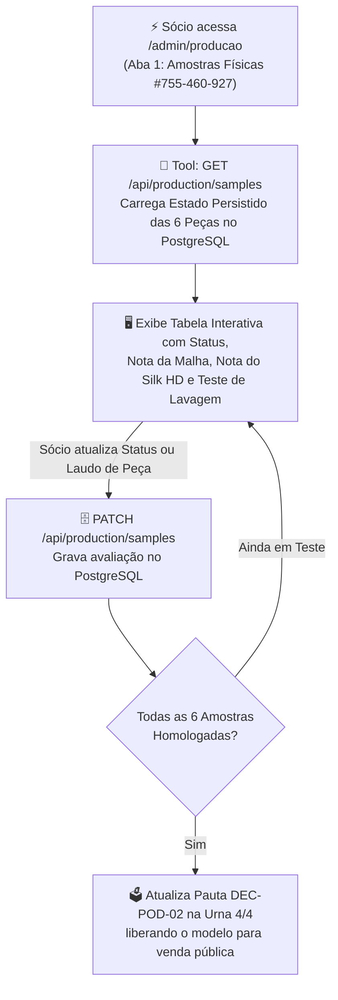

# 🎻 PLANO DE IMPLEMENTAÇÃO (MVP+) — AGENTE #10: GESTOR DE AMOSTRAS FÍSICAS POD

> **ID no Sistema:** `gestor_amostras`  
> **Camada / Departamento:** `03 · Produção & Fornecedores (Titular: Armando)`  
> **Status no Painel:** `🟡 Em Prontidão` ➔ Passará a `🟢 Em Atividade`  
> **Missão:** Gerenciar o ciclo de vida e o Laudo Técnico de Homologação das 6 Amostras Físicas do Pedido Oficial Dimona (`#755-460-927`, pago via PIX `R$ 472,80`), além do Kanban de Pedidos PoD no banco de dados.

---

## 🧠 1. Modelo (Motor de Raciocínio & Decisão)
* **Natureza do Motor:** Motor Determinístico de Controle de Qualidade Fabril & Persistência de Laudos (TypeScript + PostgreSQL).
* **Lógica Central:**
  1. Controla item a item as 6 peças físicas encomendadas na Dimona (Oversized Preta G, Prime Branca G, Estonada Chumbo GG, Quality Vinho GG, Boné Prime Preto e Boné Americano Branco).
  2. Permite que Armando e os sócios registrem no banco de dados o **Código de Rastreio**, o **Status de Entrega**, a **Nota da Malha (1 a 5 estrelas)**, a **Nota da Estampa Silk HD (1 a 5 estrelas)** e o **Laudo do Teste de Lavagem**.
  3. Quando as 6 peças forem avaliadas e aprovadas na chegada da caixa, atualiza automaticamente a pauta `DEC-POD-02` na **Urna de Votação 4/4**.

---

## 📜 2. Instruções e Persona (System Prompt & Regras de Comportamento)
* **Persona:** Inspetor de Qualidade Têxtil e Estamparia Industrial (Silk HD / DTG).
* **Regras Inegociáveis (Guardrails):**
  1. **Nenhuma Malha Vai à Vitrine no Escuro:** Registrar histórico permanente de cada amostra física testada pela sociedade.
  2. **Regra do Genera para Estamparia:** Proibir DTF em camisetas e regatas (exclusivo Silk HD/DTG direto na fibra); permitir DTF apenas nos Bonés.

---

## 🧰 3. Ferramentas (`Tools` / Conectores & Ações)
1. **`tool_manage_physical_samples` (`GET` & `PATCH /api/production/samples`):**
   * Lê e grava no PostgreSQL (`SiteSettings: dimona_samples_755460927`) o status individual, notas de malha/estampa, observações de lavagem e código de rastreio das 6 peças do pedido `#755-460-927`.
2. **`tool_submit_quality_verdict_to_urna` (`POST /api/decisions`):**
   * Envia o resumo do laudo técnico das 6 amostras para homologação final dos 4 sócios na Urna.

---

## 🗄️ 4. Memória e Contexto (Persistência & Base de Conhecimento)
1. **Registro `dimona_samples_755460927` na tabela `SiteSettings` (`site_settings` no PostgreSQL):**
   * Armazena as 6 peças com `item`, `product`, `color`, `size`, `front`, `back`, `status` (`Em Produção`, `Em Trânsito`, `Entregue`, `Homologada`, `Reprovada`), `gradeMalha`, `gradeEstampa`, `washTestNotes` e `trackingCode`.
2. **Documento Base:** [`docs/Fornecedores/REGISTRO_PEDIDO_AMOSTRAS_DIMONA.md`](file:///home/artz/Documentos/Antigravity/Ava-Vitoria/docs/Fornecedores/REGISTRO_PEDIDO_AMOSTRAS_DIMONA.md).
3. **Tabela `Order` (`orders`):** Alimenta o Kanban PoD de 5 etapas na Aba 3 de `/admin/producao`.

---

## ⚡ 5. Gatilhos & Human-in-the-Loop (Orquestração)
* **Gatilho de Entrada:** Acesso à Aba 1 (*Amostras Físicas #755-460-927*) ou Aba 3 (*Kanban PoD*) em [`/admin/producao`](file:///home/artz/Documentos/Antigravity/Ava-Vitoria/src/app/admin/producao/page.tsx).
* **Human-in-the-Loop:** Armando altera o status de entrega e preenche as notas de toque, Silk HD e teste de lavagem assim que a caixa da Dimona chegar em Jardim da Penha (Vitória/ES).

---

## 🔄 6. Fluxograma do Processo (BPMN)

---

## 🛠️ 7. Roteiro Cirúrgico de Implementação (Do Estado Atual para Funcional MVP+)

1. **Passo 1 (Diagnóstico do Gap Atual em [`/admin/producao/page.tsx`](file:///home/artz/Documentos/Antigravity/Ava-Vitoria/src/app/admin/producao/page.tsx)):**
   * Hoje a lista `DIMONA_SAMPLES` (linhas 8 a 15) é uma constante estática somente-leitura, sem seletores para atualizar o status quando a encomenda chegar nem campos para dar nota à malha e à estampa.
   * E a aba *Kanban de Pedidos PoD* está fixa com o texto `"Nenhum pedido nesta coluna"`, sem ler a tabela `orders` do PostgreSQL.
2. **Passo 2 (`src/app/api/production/samples/route.ts`):** Criar a API `GET` e `PATCH` que persiste as avaliações das 6 amostras no PostgreSQL e retorna também os pedidos reais da tabela `orders` agrupados pelas 5 colunas do Kanban PoD.
3. **Passo 3 (`src/app/admin/producao/page.tsx`):** Tornar a tabela das 6 amostras 100% interativa e persistida no banco (permitindo editar status, rastreio, avaliação de malha e estampa) e alimentar o Kanban PoD com dados reais do banco.
