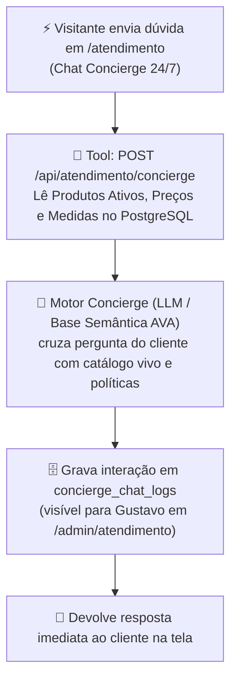

# 🎻 PLANO DE IMPLEMENTAÇÃO (MVP+) — AGENTE #11: CONCIERGE VIRTUAL 24/7

> **ID no Sistema:** `concierge_virtual`  
> **Camada / Departamento:** `04 · Atendimento & SAC (Titular: Gustavo)`  
> **Status no Painel:** `🟢 Em Atividade`  
> **Missão:** Atender visitantes 24/7 na Central Pública [`/atendimento`](file:///home/artz/Documentos/Antigravity/Ava-Vitoria/src/app/atendimento/page.tsx), consultando o catálogo real de produtos, preços, medidas e políticas da AVA Sem Limites no PostgreSQL, além de registrar o log de conversas para o sócio Gustavo em [`/admin/atendimento`](file:///home/artz/Documentos/Antigravity/Ava-Vitoria/src/app/admin/atendimento/page.tsx).

---

## 🧠 1. Modelo (Motor de Raciocínio & Decisão)
* **Natureza do Motor:** Híbrido (**Consulta em Tempo Real ao Catálogo PostgreSQL `Product`** + **LLM `GEMINI_API_KEY` / Motor Semântico Expandido de Moda & Atendimento**).
* **Por que Híbrido?**
  1. Se o cliente perguntar *"Quais camisetas estão disponíveis e quanto custam?"* ou *"Tem tamanho GG?"*, o agente precisa ler os produtos reais ativos da vitrine no PostgreSQL (`prisma.product.findMany`), nunca chutando preços ou nomes inexistentes.
  2. Para dúvidas abertas de estilo, caimento (`Oversized 220g` vs. `Prime 180g Pele de Pêssego` vs. `Estonada 30.1`), lavagem do Silk HD, prazos de produção sob demanda e política de trocas (CDC Art. 49), responde com elegância de boutique de luxo.

---

## 📜 2. Instruções e Persona (System Prompt & Regras de Comportamento)
* **Persona:** Concierge de Alta Costura Streetwear da AVA Sem Limites. Tom polido, prestativo, objetivo e sofisticado.
* **Regras Inegociáveis (Guardrails):**
  1. **Fidelidade ao Catálogo Ativo:** Citar apenas preços, modelagens e coleções reais da loja.
  2. **Encaminhamento para Trocas:** Se o cliente relatar que já comprou e quer trocar ou acionar garantia, orientá-lo imediatamente a usar a aba **"Trocas & Devoluções"** na mesma página (`/atendimento`), que aciona o `Agente Discriminador SAC`.
  3. **Registro de Telemetria:** Salvar o histórico resumido dos atendimentos no banco para que o sócio Gustavo acompanhe as principais dúvidas dos clientes em `/admin/atendimento`.

---

## 🧰 3. Ferramentas (`Tools` / Conectores & Ações)
1. **`tool_answer_customer_inquiry` (`POST /api/atendimento/concierge`):**
   * Recebe a mensagem do cliente vinda de [`/atendimento`](file:///home/artz/Documentos/Antigravity/Ava-Vitoria/src/app/atendimento/page.tsx);
   * Consulta no PostgreSQL a coleção ativa na vitrine (`active_collection_id`) e seus produtos/preços/tamanhos;
   * Formula a resposta precisa (via Gemini API se configurada ou motor semântico completo de produtos + FAQ da AVA);
   * Registra a interação no log de atendimentos (`concierge_chat_logs` em `SiteSettings`).

---

## 🗄️ 4. Memória e Contexto (Persistência & Base de Conhecimento)
1. **Tabelas `Product`, `Collection` e `StockVariant` (`schema.prisma`):** Catálogo vivo com nomes, preços, tabela de medidas (`size_chart`) e descrições.
2. **Registro `concierge_chat_logs` em `SiteSettings`:** Últimas interações de clientes atendidos pelo Concierge 24/7 para visualização no painel `/admin/atendimento`.

---

## ⚡ 5. Gatilhos & Human-in-the-Loop (Orquestração)
* **Gatilho de Entrada:** Visitante envia pergunta no chat da página pública [`/atendimento`](file:///home/artz/Documentos/Antigravity/Ava-Vitoria/src/app/atendimento/page.tsx).
* **Human-in-the-Loop:** Gustavo e os demais sócios visualizam em [`/admin/atendimento`](file:///home/artz/Documentos/Antigravity/Ava-Vitoria/src/app/admin/atendimento/page.tsx) o contador real e as últimas perguntas respondidas pelo `Concierge Virtual 24/7`.

---

## 🔄 6. Fluxograma do Processo (BPMN)

---

## 🛠️ 7. Roteiro Cirúrgico de Implementação (Do Estado Atual para Funcional MVP+)

1. **Passo 1 (Diagnóstico do Gap Atual em [`/atendimento/page.tsx`](file:///home/artz/Documentos/Antigravity/Ava-Vitoria/src/app/atendimento/page.tsx)):**
   * Hoje o chat do Concierge (linhas 42 a 67) roda 100% offline no navegador com um `setTimeout` e 4 respostas fixas (`FAQ_KNOWLEDGE`), sem consultar nenhum produto do banco e sem registrar nada para o painel `/admin/atendimento`.
2. **Passo 2 (`src/app/api/atendimento/concierge/route.ts`):** Criar a API do Concierge que lê os produtos ativos do PostgreSQL, responde sobre produtos reais, medidas, preços, frete, lavagem e trocas, e salva o log no banco.
3. **Passo 3 (`src/app/atendimento/page.tsx` & `src/app/admin/atendimento/page.tsx`):** Conectar o chat público à API real e exibir os últimos atendimentos do Concierge no painel administrativo do Depto 04.
