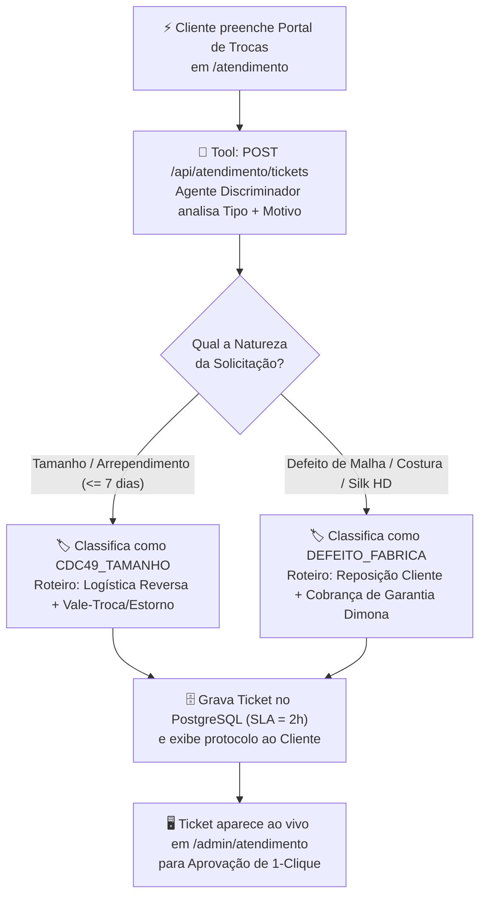

# 🎻 PLANO DE IMPLEMENTAÇÃO (MVP+) — AGENTE #12: AGENTE DISCRIMINADOR SAC

> **ID no Sistema:** `discriminador_sac`  
> **Camada / Departamento:** `04 · Atendimento & SAC (Titular: Gustavo)`  
> **Status no Painel:** `🟡 Em Prontidão` ➔ Passará a `🟢 Em Atividade`  
> **Missão:** Receber os pedidos reais de troca/devolução preenchidos pelos clientes em [`/atendimento`](file:///home/artz/Documentos/Antigravity/Ava-Vitoria/src/app/atendimento/page.tsx), classificar automaticamente a natureza jurídica e operacional (**Via 1: Direito de Arrependimento / Tamanho — Art. 49 CDC 7 dias** vs. **Via 2: Defeito de Fabricação PoD — Art. 26 CDC 90 dias com cobrança de garantia à Dimona**), gravar no PostgreSQL e exibir na fila de [`/admin/atendimento`](file:///home/artz/Documentos/Antigravity/Ava-Vitoria/src/app/admin/atendimento/page.tsx).

---

## 🧠 1. Modelo (Motor de Raciocínio & Decisão)
* **Natureza do Motor:** Motor Determinístico de Triagem Legal & Roteamento de Chamados (TypeScript + PostgreSQL).
* **Lógica Central:**
  1. Ao receber o formulário de troca em `/atendimento`, analisa o `tipo` selecionado (`TAMANHO`, `ARREPENDIMENTO`, `DEFEITO`) e o texto do `motivo`.
  2. **Classificação Automática em 2 Vias:**
     * **`CDC49_TAMANHO` (Arrependimento / Troca de Tamanho em até 7 dias):** Gera recomendação de logística reversa padrão e reposição/estorno.
     * **`DEFEITO_FABRICA` (Vício de Costura, Malha ou Silk HD em até 90 dias):** Marca o chamado com flag de **Ressarcimento Fabril PoD (Dimona/Reserva)** para que a AVA não absorva o prejuízo da peça defeituosa, e exige anexo/link de evidência fotográfica.
  3. Define o prazo de SLA inicial (`2 horas` para ação do sócio titular Gustavo antes do transbordo) e grava o ticket no banco de dados.

---

## 📜 2. Instruções e Persona (System Prompt & Regras de Comportamento)
* **Persona:** Especialista em Triagem de Pós-Venda e Proteção de Margem Operacional.
* **Regras Inegociáveis (Guardrails):**
  1. **Zero Chamado Perdido:** Todo formulário enviado pelo cliente em `/atendimento` deve ser gravado no PostgreSQL e aparecer instantaneamente em `/admin/atendimento`.
  2. **Separação Clara de Custos:** Diferenciar o que é custo comercial da loja (troca de tamanho) do que é responsabilidade industrial do fornecedor PoD (defeito de fabricação).

---

## 🧰 3. Ferramentas (`Tools` / Conectores & Ações)
1. **`tool_create_and_classify_ticket` (`POST /api/atendimento/tickets`):**
   * Recebe os dados do formulário público de trocas (`/atendimento`);
   * Executa a regra do `Agente Discriminador` classificando em `CDC49_TAMANHO` ou `DEFEITO_FABRICA`, calculando o `slaDeadline` (`now + 2 hours`) e atribuindo inicialmente a `Gustavo (Titular 04 · SAC)`;
   * Persiste o chamado no PostgreSQL (`SiteSettings: sac_tickets`) e retorna o protocolo (`#TCK-2026-XX`) para o cliente.
2. **`tool_approve_ticket_1click` (`PATCH /api/atendimento/tickets`):**
   * Permite aprovar a troca com 1 clique em `/admin/atendimento`, gerando o código de autorização de postagem reversa e registrando qual sócio aprovou.

---

## 🗄️ 4. Memória e Contexto (Persistência & Base de Conhecimento)
* **Registro `sac_tickets` na tabela `SiteSettings` (`site_settings` no PostgreSQL):**
  * Lista persistida de chamados contendo: `id`, `client`, `email`, `order`, `type` (`CDC49_TAMANHO` | `DEFEITO_FABRICA`), `classificationNote`, `reason`, `photoUrl`, `assignedPartner`, `createdAt`, `slaDeadline`, `status` (`PENDENTE_APROVACAO`, `APROVADO`, `TRANSBORDADO`), `approvedBy`, `reverseCode`.

---

## ⚡ 5. Gatilhos & Human-in-the-Loop (Orquestração)
* **Gatilho de Entrada:** Cliente clica em **"Enviar Solicitação de Troca"** na página pública [`/atendimento`](file:///home/artz/Documentos/Antigravity/Ava-Vitoria/src/app/atendimento/page.tsx).
* **Human-in-the-Loop:** O chamado já triado aparece em [`/admin/atendimento`](file:///home/artz/Documentos/Antigravity/Ava-Vitoria/src/app/admin/atendimento/page.tsx) pronto para aprovação de 1-clique por Gustavo (ou qualquer sócio via transbordo).

---

## 🔄 6. Fluxograma do Processo (BPMN)

---

## 🛠️ 7. Roteiro Cirúrgico de Implementação (Do Estado Atual para Funcional MVP+)

1. **Passo 1 (Diagnóstico do Gap Atual):**
   * Hoje, quando o cliente envia o formulário de trocas em [`/atendimento/page.tsx`](file:///home/artz/Documentos/Antigravity/Ava-Vitoria/src/app/atendimento/page.tsx#L69-L72) (`handleTrocaSubmit`), o código apenas faz `setTrocaEnviada(true)` na tela do cliente **sem enviar nada para o servidor**!
   * E em [`/admin/atendimento/page.tsx`](file:///home/artz/Documentos/Antigravity/Ava-Vitoria/src/app/admin/atendimento/page.tsx#L18-L39), a lista `INITIAL_TICKETS` é fixa em memória local (`useState`), desconectada do formulário público.
2. **Passo 2 (`src/app/api/atendimento/tickets/route.ts`):** Criar a API `GET`, `POST` e `PATCH` que conecta o formulário público `/atendimento` diretamente ao banco PostgreSQL, executando a classificação do `Agente Discriminador SAC`.
3. **Passo 3 (`src/app/atendimento/page.tsx` & `src/app/admin/atendimento/page.tsx`):** Ligar o formulário público de trocas ao `POST /api/atendimento/tickets` (exibindo o número real do protocolo gerado) e ligar o painel `/admin/atendimento` para listar e aprovar os chamados reais do banco.
