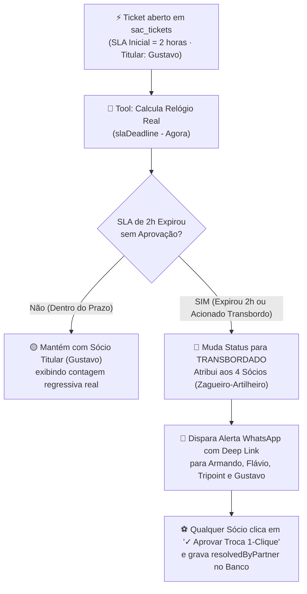

# 🎻 PLANO DE IMPLEMENTAÇÃO (MVP+) — AGENTE #13: ESCALADOR ANTI-OMISSÃO (ZAGUEIRO-ARTILHEIRO)

> **ID no Sistema:** `escalador_omissao`  
> **Camada / Departamento:** `04 · Atendimento & SAC (Titular: Gustavo)`  
> **Status no Painel:** `🟡 Em Prontidão` ➔ Passará a `🟢 Em Atividade`  
> **Missão:** Monitorar o relógio de SLA (2 horas) de todos os chamados abertos em `/admin/atendimento`. Se o sócio titular (Gustavo) não aprovar em até 2 horas, transbordar automaticamente o chamado para os **outros 3 sócios** (`Armando`, `Flávio` e `Tripoint`) sob a **Filosofia do Zagueiro-Artilheiro**, injetando o chamado também na **Fila de Decisões do Cockpit (`/admin`)** e habilitando o disparo de WhatsApp com link direto.

---

## 🧠 1. Modelo (Motor de Raciocínio & Decisão)
* **Natureza do Motor:** Motor Determinístico Temporal de SLA & Transbordo Societário (TypeScript + PostgreSQL).
* **Lógica Central:**
  1. Calcula em tempo real `horasRestantes = (slaDeadline - Date.now()) / 3600000` para cada ticket com status `PENDENTE_APROVACAO`.
  2. Se `horasRestantes <= 0` (ou quando acionado o transbordo preventivo), muda automaticamente o status do ticket para `TRANSBORDADO`, altera o responsável para `"Conselho 4 Sócios (Transbordo Zagueiro-Artilheiro)"` e gera alerta visível para todos os 4 sócios.

---

## 📜 2. Instruções e Persona (System Prompt & Regras de Comportamento)
* **Persona:** Guardião da Reputação da Marca e Líbero da Defesa Societária (*"Nada impede o zagueiro de avançar e marcar o gol para resguardar a empresa"*).
* **Regras Inegociáveis (Guardrails):**
  1. **SLA Zero Vácuo:** Nenhum chamado pode expirar sem que os 4 sócios sejam alertados.
  2. **Qualquer Sócio Pode Marcar o Gol:** Uma vez aberto ou transbordado, qualquer um dos 4 sócios logados pode clicar em `✓ Aprovar Troca 1-Clique`, ficando registrado no banco qual sócio resolveu o chamado.

---

## 🧰 3. Ferramentas (`Tools` / Conectores & Ações)
1. **`tool_check_and_escalate_sla` (Executado automaticamente em `GET /api/atendimento/tickets`):**
   * Verifica todos os tickets pendentes no banco;
   * Calcula o tempo restante real a partir de `createdAt` / `slaDeadline`;
   * Promove automaticamente para `TRANSBORDADO` qualquer ticket cujo prazo de 2h tenha se esgotado.
2. **`tool_dispatch_zagueiro_whatsapp` (`PATCH /api/atendimento/tickets`):**
   * Registra o transbordo no banco, abre o link de WhatsApp (`wa.me`) com o resumo completo do chamado e o link direto para `/admin/atendimento`, e opcionalmente sobe o alerta para a Fila de Decisões do `/admin`.

---

## 🗄️ 4. Memória e Contexto (Persistência & Base de Conhecimento)
* **Registro `sac_tickets` em `SiteSettings` (`site_settings` no PostgreSQL):**
  * Campos controlados por este agente: `createdAt`, `slaDeadline`, `status` (`PENDENTE_APROVACAO` ➔ `TRANSBORDADO` ➔ `APROVADO`), `escalatedAt`, `resolvedByPartner`.

---

## ⚡ 5. Gatilhos & Human-in-the-Loop (Orquestração)
* **Gatilho 1 (Automático Temporal):** Toda leitura da fila de chamados calcula o relógio real decorrido desde a abertura do ticket pelo cliente.
* **Gatilho 2 (Ação Manual / Botão de Transbordo):** Clique em **"📲 Disparar WhatsApp aos 4 Sócios"** em [`/admin/atendimento`](file:///home/artz/Documentos/Antigravity/Ava-Vitoria/src/app/admin/atendimento/page.tsx).
* **Human-in-the-Loop:** Qualquer um dos 4 sócios aprova o chamado em 1 clique.

---

## 🔄 6. Fluxograma do Processo (BPMN)

---

## 🛠️ 7. Roteiro Cirúrgico de Implementação (Do Estado Atual para Funcional MVP+)

1. **Passo 1 (`src/app/api/atendimento/tickets/route.ts`):** Implementar o cálculo real de contagem regressiva de SLA (`slaHoursLeft` calculado dinamicamente sobre o timestamp real do banco) e a transição automática para `TRANSBORDADO`.
2. **Passo 2 (`src/app/admin/atendimento/page.tsx`):** Conectar o botão `📲 Disparar WhatsApp aos 4 Sócios` ao disparo real (persistindo o transbordo no banco e abrindo a mensagem formatada com o protocolo do chamado) e gravar o nome do sócio logado (`session.user.username`) ao clicar em `✓ Aprovar Troca 1-Clique`.
