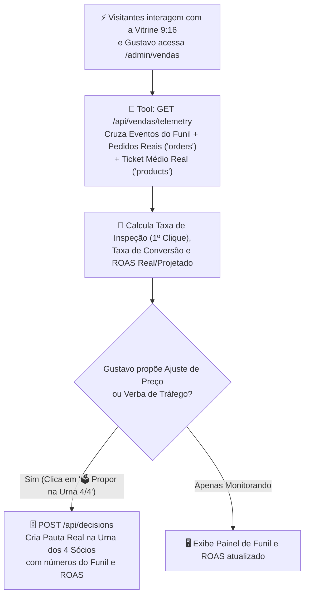

# 🎻 PLANO DE IMPLEMENTAÇÃO (MVP+) — AGENTE #14: ANALISTA DE TRÁFEGO & ROAS

> **ID no Sistema:** `analista_trafego`  
> **Camada / Departamento:** `05 · Vendas & Canais (Titular: Gustavo)`  
> **Status no Painel:** `🟢 Em Atividade`  
> **Missão:** Capturar e analisar o funil real de conversão da loja (Visitas à Vitrine ➔ 1º Clique de Inspeção no Card 9:16 ➔ Abertura da Página do Produto ➔ Adição à Sacola ➔ Pedido Concluído), calcular o ROAS sobre o investimento de tráfego pago e permitir que Gustavo envie propostas comerciais reais para a **Urna de Votação 4/4**.

---

## 🧠 1. Modelo (Motor de Raciocínio & Decisão)
* **Natureza do Motor:** Motor Determinístico de Telemetria de Funil & Matemática de ROAS (TypeScript + PostgreSQL).
* **Lógica Central:**
  1. Contabiliza eventos reais de navegação da vitrine (`VIEW_HOME`, `INSPECT_CARD_1CLICK`, `VIEW_PDP`, `ADD_TO_CART`, `CHECKOUT_PAID`) e cruza com os pedidos reais da tabela `orders` e com o ticket médio real dos produtos ativos na tabela `products`.
  2. Diagnostica automaticamente o gargalo do funil sob a Lei do Genera:
     * **Alta inspeção no 1º clique + Baixa conversão no checkout:** Sinaliza alerta de sensibilidade de preço/frete.
     * **Baixo volume de visitas:** Sinaliza necessidade de tráfego (Trios 3x3 / Impulsionamento Meta Ads).

---

## 📜 2. Instruções e Persona (System Prompt & Regras de Comportamento)
* **Persona:** Head de Growth, Performance e Conversão de E-commerce de Moda.
* **Regras Inegociáveis (Guardrails):**
  1. **Zero Proposta Fantasma:** Quando Gustavo clicar em `🗳️ Propor Ajuste Comercial na Urna (4 Sócios)` em [`/admin/vendas`](file:///home/artz/Documentos/Antigravity/Ava-Vitoria/src/app/admin/vendas/page.tsx), a proposta deve ser gravada de verdade na tabela `ExecutiveDecision` do banco para aparecer na Urna do `/admin` (hoje ela apenas mostra um toast local que desaparece).
  2. **Ticket Médio Real:** O simulador de ROAS deve puxar o ticket médio real dos produtos ativos no PostgreSQL, em vez de usar apenas um valor chumbado.

---

## 🧰 3. Ferramentas (`Tools` / Conectores & Ações)
1. **`tool_track_funnel_telemetry` (`GET` & `POST /api/vendas/telemetry`):**
   * Registra contadores leves de eventos do funil no PostgreSQL (`SiteSettings: funnel_telemetry`) e cruza com a contagem e soma real de `orders` e `products`.
2. **`tool_propose_commercial_campaign_to_urna` (`POST /api/decisions`):**
   * Cria pauta real de ajuste comercial ou orçamento de tráfego pago na Urna de Votação 4/4 com o voto de Gustavo já registrado (`1/4`).

---

## 🗄️ 4. Memória e Contexto (Persistência & Base de Conhecimento)
1. **Tabelas `Order` e `Product` (`schema.prisma`):** Faturamento real, quantidade de pedidos e ticket médio vigente da coleção ativa.
2. **Registro `funnel_telemetry` em `SiteSettings` (`site_settings` no PostgreSQL):** Contadores reais de visitas, 1º clique de inspeção Balenciaga, adições à sacola e orçamento diário configurado (`dailyBudget`).

---

## ⚡ 5. Gatilhos & Human-in-the-Loop (Orquestração)
* **Gatilho 1 (Na Loja Pública):** Interações de inspeção na vitrine e compras alimentam o funil.
* **Gatilho 2 (Em `/admin/vendas`):** Gustavo simula cenários de tráfego pago (ROAS) com dados reais do banco e submete propostas à Urna 4/4.

---

## 🔄 6. Fluxograma do Processo (BPMN)

---

## 🛠️ 7. Roteiro Cirúrgico de Implementação (Do Estado Atual para Funcional MVP+)

1. **Passo 1 (Diagnóstico do Gap Atual em [`/admin/vendas/page.tsx`](file:///home/artz/Documentos/Antigravity/Ava-Vitoria/src/app/admin/vendas/page.tsx)):**
   * Hoje a taxa `34,8%` e o ticket `R$ 169,75` estão chumbados no HTML, e o botão `🗳️ Propor Ajuste Comercial na Urna` (linhas 120-125) apenas exibe um aviso na tela sem criar a pauta na Urna do `/admin`.
2. **Passo 2 (`src/app/api/vendas/telemetry/route.ts`):** Criar a API que retorna métricas reais do banco (`orders`, `products`, `funnel_telemetry`) e persiste as metas de tráfego.
3. **Passo 3 (`src/app/admin/vendas/page.tsx`):** Conectar o simulador de ROAS ao ticket médio real do banco e ligar o botão `🗳️ Propor Ajuste Comercial na Urna` ao `POST /api/decisions`.
