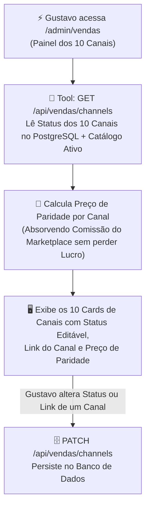

# 🎻 PLANO DE IMPLEMENTAÇÃO (MVP+) — AGENTE #15: GESTOR DOS 10 CANAIS

> **ID no Sistema:** `gestor_canais`  
> **Camada / Departamento:** `05 · Vendas & Canais (Titular: Gustavo)`  
> **Status no Painel:** `🟡 Em Prontidão` ➔ Passará a `🟢 Em Atividade`  
> **Missão:** Gerenciar o status operacional, comissões, precificação específica e sincronização de catálogo dos **10 Canais de Venda Nacionais** (Vitrine Oficial AVA, Instagram Shopping, WhatsApp Concierge VIP, TikTok Shop, Mercado Livre, Shopee, Google Shopping, Pinterest Shopping, Amazon Brasil e SHEIN) tanto no painel [`/admin/vendas`](file:///home/artz/Documentos/Antigravity/Ava-Vitoria/src/app/admin/vendas/page.tsx) quanto na vitrine pública ([`SalesChannelsSection.tsx`](file:///home/artz/Documentos/Antigravity/Ava-Vitoria/src/app/components/SalesChannelsSection.tsx)).

---

## 🧠 1. Modelo (Motor de Raciocínio & Decisão)
* **Natureza do Motor:** Motor Determinístico de Governança Multicanal & Cálculo de Markup de Marketplace (TypeScript + PostgreSQL).
* **Lógica Central:**
  1. Mantém o cadastro vivo dos 10 canais no PostgreSQL (`SiteSettings: sales_channels_10`), permitindo que Gustavo atualize o status de ativação de cada canal (`ATIVO`, `EM_HOMOLOGACAO`, `PLANEJADO_LTDA`), o link oficial da loja da AVA naquele canal e a comissão real cobrada pelo marketplace.
  2. Calcula automaticamente o **Preço Sugerido por Canal** (compensando a comissão de 12% a 20% do Mercado Livre/Shopee/Amazon/SHEIN para que a AVA receba exatamente o mesmo lucro líquido por peça da Vitrine Oficial).

---

## 📜 2. Instruções e Persona (System Prompt & Regras de Comportamento)
* **Persona:** Diretor Comercial Multicanal e Especialista em Marketplaces de Moda.
* **Regras Inegociáveis (Guardrails):**
  1. **Proteção de Lucro nos Marketplaces:** Alertar quanto deve ser o preço de venda em cada marketplace com comissão alta para não corroer a margem da AVA.
  2. **Sincronia com o Feed Meta XML e Bling ERP:** Validar quantos produtos ativos estão prontos para exportação multicanal (`/api/catalog/meta`).

---

## 🧰 3. Ferramentas (`Tools` / Conectores & Ações)
1. **`tool_manage_sales_channels` (`GET` & `PATCH /api/vendas/channels`):**
   * Lê e atualiza no PostgreSQL (`SiteSettings: sales_channels_10`) o status, comissão, URL da loja oficial no canal e notas de relacionamento de cada um dos 10 canais.
2. **`tool_calculate_channel_price_parity` (Integrado à API `/api/vendas/channels`):**
   * Dado o preço base da Vitrine Oficial (ex.: `R$ 169,75`), calcula o preço equivalente necessário em cada um dos 10 canais conforme sua taxa de comissão para preservar o lucro líquido da peça.

---

## 🗄️ 4. Memória e Contexto (Persistência & Base de Conhecimento)
1. **Registro `sales_channels_10` em `SiteSettings` (`site_settings` no PostgreSQL):**
   * Lista persistida dos 10 canais com: `id`, `name`, `category`, `commissionPercent`, `commissionLabel`, `status`, `storeUrl`, `trafficShare`, `relationshipNote`.
2. **Rota `/api/catalog/meta`:** Feed XML RSS 2.0 que abastece os canais de Social Commerce e Google Shopping.

---

## ⚡ 5. Gatilhos & Human-in-the-Loop (Orquestração)
* **Gatilho de Entrada:** Acesso ao painel [`/admin/vendas`](file:///home/artz/Documentos/Antigravity/Ava-Vitoria/src/app/admin/vendas/page.tsx).
* **Human-in-the-Loop:** Gustavo atualiza o status de cada canal conforme as contas vão sendo aprovadas (Onda 1, Onda 2 e Onda 3) e consulta a tabela de paridade de preços por canal.

---

## 🔄 6. Fluxograma do Processo (BPMN)

---

## 🛠️ 7. Roteiro Cirúrgico de Implementação (Do Estado Atual para Funcional MVP+)

1. **Passo 1 (Diagnóstico do Gap Atual em [`/admin/vendas/page.tsx`](file:///home/artz/Documentos/Antigravity/Ava-Vitoria/src/app/admin/vendas/page.tsx)):**
   * Hoje a lista `CHANNELS_10` (linhas 18 a 109) é uma constante estática no código: Gustavo não consegue mudar o status de um canal de `"Em Preparação"` para `"Ativo"` nem salvar o link da loja ou ver o cálculo de paridade de preço para absorver a comissão do marketplace.
2. **Passo 2 (`src/app/api/vendas/channels/route.ts`):** Criar a API `GET` e `PATCH` que persiste os 10 canais no PostgreSQL (`SiteSettings`) e calcula o preço de paridade por canal.
3. **Passo 3 (`src/app/admin/vendas/page.tsx`):** Tornar os 10 cards de canais interativos e persistidos no banco, permitindo alterar status, editar observações comerciais e visualizar o preço sugerido para cada marketplace.
