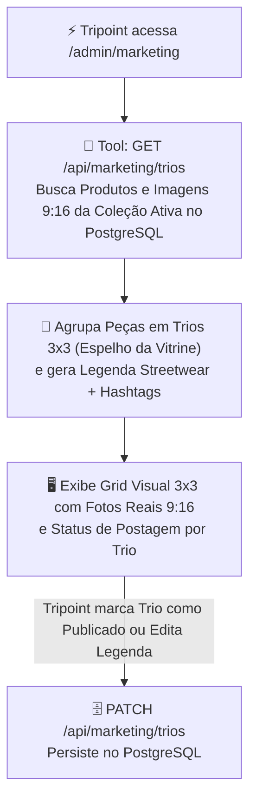

# 🎻 PLANO DE IMPLEMENTAÇÃO (MVP+) — AGENTE #16: TRIOS 3X3 BALENCIAGA

> **ID no Sistema:** `trios_balenciaga`  
> **Camada / Departamento:** `06 · Marketing & Branding (Titular: Tripoint)`  
> **Status no Painel:** `🟡 Em Prontidão` ➔ Passará a `🟢 Em Atividade`  
> **Missão:** Planejar e montar automaticamente a grade de publicações do Instagram em **Trios 3x3 (Proporção 9:16 — Padrão Balenciaga)** espelhando exatamente as linhas de 3 produtos da **Coleção Ativa da Vitrine** no PostgreSQL, gerando as legendas e a ordem de postagem para o sócio Tripoint em [`/admin/marketing`](file:///home/artz/Documentos/Antigravity/Ava-Vitoria/src/app/admin/marketing/page.tsx).

---

## 🧠 1. Modelo (Motor de Raciocínio & Decisão)
* **Natureza do Motor:** Motor Determinístico de Espelhamento de Grid 3x3 (TypeScript + PostgreSQL) + Gerador de Copy de Feed.
* **Lógica Central:**
  1. Lê no PostgreSQL a coleção marcada como **`★ Vitrine Ativa da Loja`** (`active_collection_id` em `SiteSettings`) e busca todos os seus produtos ordenados por `display_order` com suas imagens 9:16 (`ProductImage`).
  2. Agrupa os produtos reais em **Linhas/Trios de 3 peças (`Trio #01`, `Trio #02`, `Trio #03`...)** exatamente como aparecem no site, ou monta o **Trio de Peça Única** (*Post 1: Foto Lookbook Modelo* + *Post 2: Close Estampa Silk HD* + *Post 3: Conceito/Costas*).
  3. Permite que Tripoint marque quais Trios já foram publicados no Instagram (`AGENDADO`, `PUBLICADO`, `RASCUNHO`), mantendo o feed do Instagram 100% sincronizado com a vitrine do site.

---

## 📜 2. Instruções e Persona (System Prompt & Regras de Comportamento)
* **Persona:** Diretor de Arte de Social Media e Curador de Feed Balenciaga 9:16.
* **Regras Inegociáveis (Guardrails):**
  1. **Nunca Quebrar o Alinhamento de 3 Colunas:** Toda publicação no feed do Instagram deve ser planejada em múltiplos de 3 (um Trio completo por vez).
  2. **Espelho Real da Vitrine:** O planejador em `/admin/marketing` deve puxar as fotos reais 9:16 dos produtos da coleção ativa no banco, em vez de mostrar apenas 3 caixinhas cinzas vazias.

---

## 🧰 3. Ferramentas (`Tools` / Conectores & Ações)
1. **`tool_build_instagram_trios` (`GET` & `PATCH /api/marketing/trios`):**
   * Lê os produtos e imagens 9:16 da Coleção Ativa no PostgreSQL;
   * Monta os Trios 3x3 reais com miniatura da foto, título da peça, legenda sugerida e status de publicação persistido em `SiteSettings` (`instagram_trios_schedule`).

---

## 🗄️ 4. Memória e Contexto (Persistência & Base de Conhecimento)
1. **Tabelas `Collection`, `Product` e `ProductImage` (`schema.prisma`):** Fotos reais 9:16 e ordem do grid da vitrine.
2. **Registro `instagram_trios_schedule` em `SiteSettings` (`site_settings` no PostgreSQL):** Guarda o status (`PLANEJADO`, `PUBLICADO_NO_IG`), data e legenda de cada Trio 3x3.

---

## ⚡ 5. Gatilhos & Human-in-the-Loop (Orquestração)
* **Gatilho de Entrada:** Acesso ao painel [`/admin/marketing`](file:///home/artz/Documentos/Antigravity/Ava-Vitoria/src/app/admin/marketing/page.tsx) ou mudança da Coleção Ativa no Atelier.
* **Human-in-the-Loop:** Tripoint visualiza o preview real dos Trios 3x3 com as fotos da coleção ativa, copia as legendas/baixa as mídias e marca o Trio como publicado.

---

## 🔄 6. Fluxograma do Processo (BPMN)

---

## 🛠️ 7. Roteiro Cirúrgico de Implementação (Do Estado Atual para Funcional MVP+)

1. **Passo 1 (Diagnóstico do Gap Atual em [`/admin/marketing/page.tsx`](file:///home/artz/Documentos/Antigravity/Ava-Vitoria/src/app/admin/marketing/page.tsx#L46-L56)):**
   * Hoje o card de Trios 3x3 exibe apenas 3 retângulos cinzas estáticos (`Post 1`, `Post 2`, `Post 3`) sem carregar nenhuma foto real da vitrine do banco de dados.
2. **Passo 2 (`src/app/api/marketing/trios/route.ts`):** Criar a API que busca os produtos da coleção ativa no PostgreSQL, organiza em Trios 3x3 reais e salva o status de postagem de cada Trio.
3. **Passo 3 (`src/app/admin/marketing/page.tsx`):** Renderizar o planejador visual dos Trios 3x3 com as fotos 9:16 reais da coleção ativa, gerador de legenda e controle de publicação persistido no banco.
