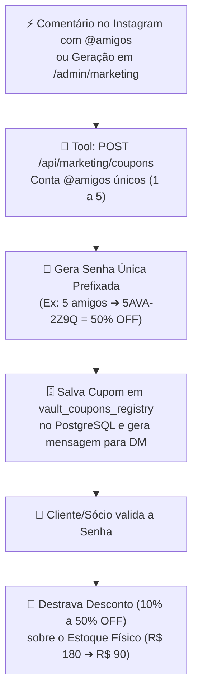

# 🎻 PLANO DE IMPLEMENTAÇÃO (MVP+) — AGENTE #17: VAULT COUPON (MOTOR "EU TENHO CUPOM!")

> **ID no Sistema:** `vault_coupon`  
> **Camada / Departamento:** `06 · Marketing & Branding (Titular: Tripoint)`  
> **Status no Painel:** `🟡 Em Prontidão` ➔ Passará a `🟢 Em Atividade`  
> **Missão:** Gerar, persistir no banco de dados e validar as **Senhas Únicas Prefixadas (`1...` = 10% OFF até `5...` = 50% OFF)** da campanha viral **`"EU TENHO CUPOM!"`**, destravando o acesso à **Vitrine Secreta do Estoque Físico** sem desvalorizar a Nova Coleção PoD na vitrine principal.

---

## 🧠 1. Modelo (Motor de Raciocínio & Decisão)
* **Natureza do Motor:** Motor Determinístico de Geração e Validação Criptográfica/Prefixada de Cupons (TypeScript + PostgreSQL).
* **Lógica Central:**
  1. Conta quantos `@amigos` distintos foram marcados (1 a 5) ou recebe o nível desejado pelo sócio Tripoint no gerador de cupons em `/admin/marketing`.
  2. Gera um código único no padrão `[1-5]AVA-[HASH4]` (ex.: `5AVA-9K2M` para 5 amigos = `50% OFF`) e grava no PostgreSQL (`SiteSettings: vault_coupons_registry`).
  3. Quando validado pelo cliente (ou testado no painel), verifica a autenticidade do cupom no banco, retorna o percentual exato de desconto (`10%`, `20%`, `30%`, `40%` ou `50%`) e os produtos do estoque físico com o preço recalculado (`R$ 180,00 ➔ R$ 90,00` no nível 5).

---

## 📜 2. Instruções e Persona (System Prompt & Regras de Comportamento)
* **Persona:** Engenheiro de Growth Viral e Guardião do Cofre do Acervo Físico AVA.
* **Regras Inegociáveis (Guardrails):**
  1. **Separação Estrita de Vitrines:** Os cupons de `10%` a `50% OFF` aplicam-se exclusivamente ao escoamento do **Estoque Físico Remanescente (Vitrine Secreta)**, protegendo a margem da Nova Coleção PoD.
  2. **Teto Máximo Inviolável de 50% OFF:** O prefixo é estritamente limitado entre `1` e `5` (`10%` a `50%`).
  3. **Rastreabilidade no Banco:** Registrar cada cupom emitido, para qual `@usuario_instagram` foi destinado e quantas vezes foi utilizado.

---

## 🧰 3. Ferramentas (`Tools` / Conectores & Ações)
1. **`tool_generate_vault_coupon` (`POST /api/marketing/coupons`):**
   * Recebe `{ instagramHandle, friendsCount }` (ou um comentário bruto contendo `@amigo1 @amigo2...`, contando automaticamente quantos `@` distintos existem!);
   * Gera a senha única prefixada (`1AVA-...` a `5AVA-...`), grava no PostgreSQL (`vault_coupons_registry`) e retorna o texto pronto para envio no Direct (DM) do cliente.
2. **`tool_validate_vault_coupon` (`GET` / `PUT /api/marketing/coupons`):**
   * Valida se a senha digitada existe e está ativa no banco, retornando a faixa de desconto (`10%` a `50%`) e a prévia dos preços do estoque físico com o desconto aplicado.

---

## 🗄️ 4. Memória e Contexto (Persistência & Base de Conhecimento)
1. **Registro `vault_coupons_registry` em `SiteSettings` (`site_settings` no PostgreSQL):**
   * Lista de cupons gerados com: `code` (ex.: `5AVA-8F2K`), `instagramHandle`, `friendsTaggedCount`, `discountPercent` (`10` a `50`), `isActive`, `usageCount`, `createdAt`.
2. **Documento Estratégico:** [`docs/REUNIAO/01_ESTRATEGIA_EU_TENHO_CUPOM_E_INAUGURACAO.md`](file:///home/artz/Documentos/Antigravity/Ava-Vitoria/docs/REUNIAO/01_ESTRATEGIA_EU_TENHO_CUPOM_E_INAUGURACAO.md).

---

## ⚡ 5. Gatilhos & Human-in-the-Loop (Orquestração)
* **Gatilho 1 (Em `/admin/marketing`):** Tripoint cola um comentário do Instagram com `@amigos` (ou seleciona de 1 a 5 amigos) para gerar e gravar o cupom no banco, ou testa um cupom existente.
* **Gatilho 2 (Webhook / Cliente):** Validação do código destravando o desconto correspondente.

---

## 🔄 6. Fluxograma do Processo (BPMN)

---

## 🛠️ 7. Roteiro Cirúrgico de Implementação (Do Estado Atual para Funcional MVP+)

1. **Passo 1 (Diagnóstico do Gap Atual em [`/admin/marketing/page.tsx`](file:///home/artz/Documentos/Antigravity/Ava-Vitoria/src/app/admin/marketing/page.tsx#L11-L19)):**
   * Hoje a função `testCoupon` apenas olha o primeiro caractere digitado na caixinha local, sem gerar cupons reais, sem contar `@amigos` de um comentário e sem gravar nem consultar os cupons emitidos no PostgreSQL.
2. **Passo 2 (`src/app/api/marketing/coupons/route.ts`):** Criar a API `GET`, `POST` e `PUT` que conta `@amigos` automaticamente, gera códigos únicos `[1-5]AVA-XXXX`, persiste no PostgreSQL e valida cupons existentes.
3. **Passo 3 (`src/app/admin/marketing/page.tsx`):** Adicionar o **Gerador & Contador Automático de `@amigos` + Tabela de Cupons Emitidos no Banco** ao painel do Depto 06.
