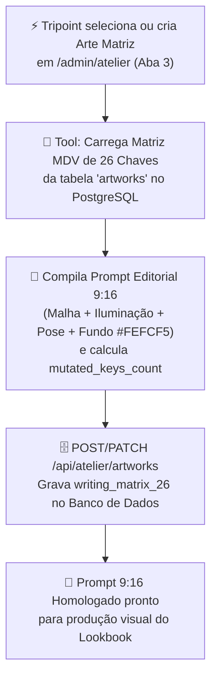

# 🎻 PLANO DE IMPLEMENTAÇÃO (MVP+) — AGENTE #18: LOOKBOOK 9:16 (DIRETOR DE FOTOGRAFIA IA)

> **ID no Sistema:** `lookbook_ia`  
> **Camada / Departamento:** `07 · Atelier Criativo & Mídias (Titular: Tripoint)`  
> **Status no Painel:** `🟡 Em Prontidão` ➔ Passará a `🟢 Em Atividade`  
> **Missão:** Estruturar e persistir os **Prompts Fotográficos Editoriais 9:16 baseados na Matriz de Escrita de 26 Chaves (MDV 26)**, garantindo que todas as fotos de modelos e lookbooks da AVA Sem Limites sigam a estética de galeria Balenciaga, iluminação controlada e fundo compatível com o marfim `#FEFCF5` (`mix-blend-mode: multiply`).

---

## 🧠 1. Modelo (Motor de Raciocínio & Decisão)
* **Natureza do Motor:** Motor Estruturador da Matriz Fotográfica de 26 Chaves (MDV 26 em TypeScript + JSONB no PostgreSQL) + Compilador de Prompt Editorial 9:16.
* **Lógica Central:**
  1. Mantém a estrutura canônica das **26 Chaves de Direção Fotográfica** (Enquadramento 9:16, Lente/Distância Focal, Iluminação de Estúdio/Urbana, Fundo `#FEFCF5` / Urbano Vitória, Caimento da Malha `Oversized 220g` / `Prime 180g`, Posição da Estampa, Textura da Fibra, Pose Editorial, etc.).
  2. Calcula quantas chaves foram mutadas em relação ao template-mestre (`mutated_keys_count`) e compila automaticamente o prompt final pronto para geração de imagem 9:16, salvando tudo na tabela `Artwork` do PostgreSQL.

---

## 📜 2. Instruções e Persona (System Prompt & Regras de Comportamento)
* **Persona:** Diretor de Fotografia de Moda High-End (Referência: Lookbooks Balenciaga / Fear of God / Off-White).
* **Regras Inegociáveis (Guardrails):**
  1. **Proporção Vertical 9:16 Estrita:** Todo prompt compilado inclui a trava de proporção `--ar 9:16` e enquadramento vertical de corpo inteiro ou plano americano com respiro para o grid de 3 colunas.
  2. **Fusão com o Fundo Marfim (`#FEFCF5`):** Quando o lookbook for de estúdio para card de produto, exigir fundo claro puro para fusão perfeita com `mix-blend-mode: multiply`.

---

## 🧰 3. Ferramentas (`Tools` / Conectores & Ações)
1. **`tool_compile_mdv26_lookbook_prompt` (`GET`, `POST` & `PATCH /api/atelier/artworks`):**
   * Lê e grava o JSON das **26 Chaves (`writing_matrix_26`)** na tabela `artworks` do PostgreSQL;
   * Conta automaticamente o número de chaves mutadas (`mutated_keys_count`);
   * Gera o prompt técnico consolidado em inglês/português para direção de fotografia 9:16.

---

## 🗄️ 4. Memória e Contexto (Persistência & Base de Conhecimento)
1. **Tabela `Artwork` (`artworks` no [`prisma/schema.prisma`](file:///home/artz/Documentos/Antigravity/Ava-Vitoria/prisma/schema.prisma#L138-L156)):**
   * Campos utilizados diretamente: `writing_matrix_26` (`JsonB`), `mutated_keys_count` (`Int`), `preview_image_url`.
2. **Manifesto de Referência:** [`docs/agentes/design-image-prompt-engineer.md`](file:///home/artz/Documentos/Antigravity/Ava-Vitoria/docs/agentes/design-image-prompt-engineer.md).

---

## ⚡ 5. Gatilhos & Human-in-the-Loop (Orquestração)
* **Gatilho de Entrada:** Acesso à Aba 3 (*Artes Matrizes 300 DPI & Prompts MDV 26*) em [`/admin/atelier`](file:///home/artz/Documentos/Antigravity/Ava-Vitoria/src/app/admin/atelier/page.tsx).
* **Human-in-the-Loop:** Tripoint (Diretor Criativo e de Vídeo IA) inspeciona, edita as chaves do prompt MDV 26, copia o prompt 9:16 compilado e salva a matriz no banco PostgreSQL.

---

## 🔄 6. Fluxograma do Processo (BPMN)

---

## 🛠️ 7. Roteiro Cirúrgico de Implementação (Do Estado Atual para Funcional MVP+)

1. **Passo 1 (Diagnóstico do Gap Atual em [`/admin/atelier/page.tsx`](file:///home/artz/Documentos/Antigravity/Ava-Vitoria/src/app/admin/atelier/page.tsx#L22-L67)):**
   * Embora a tabela `Artwork` já exista no PostgreSQL (`schema.prisma`), a página `/admin/atelier` hoje ignora o banco e usa uma constante fixa `SAMPLE_ARTWORKS` em memória local (`useState`), além de não exibir as 26 chaves do JSON `writing_matrix_26` nem permitir cadastrar novas artes/prompts no banco!
2. **Passo 2 (`src/app/api/atelier/artworks/route.ts`):** Criar a API `GET`, `POST` e `PATCH` que lê e grava registros reais na tabela `Artwork` do PostgreSQL (semeando as 3 artes iniciais com suas matrizes de 26 chaves completas caso a tabela esteja vazia).
3. **Passo 3 (`src/app/admin/atelier/page.tsx`):** Conectar a Aba 3 do Atelier à tabela `Artwork` real, adicionando o **Inspetor/Editor Interativo das 26 Chaves do Lookbook 9:16** e o formulário de cadastro de nova Matriz.
