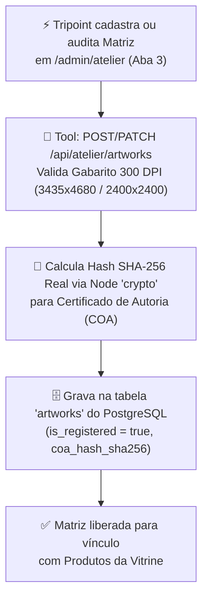

# 🎻 PLANO DE IMPLEMENTAÇÃO (MVP+) — AGENTE #19: CURADOR DE MATRIZES 300 DPI

> **ID no Sistema:** `curador_matrizes`  
> **Camada / Departamento:** `07 · Atelier Criativo & Mídias (Titular: Tripoint)`  
> **Status no Painel:** `🟡 Em Prontidão` ➔ Passará a `🟢 Em Atividade`  
> **Missão:** Validar as dimensões industriais exatas dos arquivos mestres PoD (**Dimona Silk HD `3435 × 4680 px` Frente/Costas**, **Selo/Boné `2400 × 2400 px`** e **Reserva INK `4200 × 4800 px`**), calcular o hash criptográfico real **SHA-256** de autoria da obra e gravar o Certificado de Registro na tabela `Artwork` do PostgreSQL.

---

## 🧠 1. Modelo (Motor de Raciocínio & Decisão)
* **Natureza do Motor:** Motor Determinístico Criptográfico (`crypto.createHash('sha256')` do Node.js) + Validador de Especificações Industriais 300 DPI.
* **Lógica Central:**
  1. Ao cadastrar ou auditar uma Arte Matriz em `/admin/atelier`, gera o hash **SHA-256** único a partir dos metadados/bytes da obra (`code + title + concept + supplier + master_print_dimona_url`), garantindo prova matemática de anterioridade e autoria (`coa_hash_sha256`).
  2. Verifica a conformidade dos gabaritos 300 DPI sem margem para o Studio 3D da Dimona (`3435 × 4680 px` para camisetas e `2400 × 2400 px` para bonés) e permite alternar o selo **`✓ Registrado / Homologado`** no banco de dados.

---

## 📜 2. Instruções e Persona (System Prompt & Regras de Comportamento)
* **Persona:** Engenheiro de Pré-Impressão Têxtil (300 DPI) e Tabelião de Propriedade Intelectual da AVA.
* **Regras Inegociáveis (Guardrails):**
  1. **Zero Margem no Gabarito Dimona (`3435 × 4680 px`):** Garantir encaixe automático 100% no tracejado da fábrica sem intervenção manual.
  2. **Hash SHA-256 Real:** Toda arte cadastrada recebe hash SHA-256 real gerado via módulo `crypto` do servidor e persistido na coluna `coa_hash_sha256` da tabela `artworks`.

---

## 🧰 3. Ferramentas (`Tools` / Conectores & Ações)
1. **`tool_register_artwork_sha256` (`POST` & `PATCH /api/atelier/artworks`):**
   * Calcula o hash SHA-256 real da matriz;
   * Valida o gabarito industrial selecionado (`DIMONA_3435x4680`, `DIMONA_BONE_2400x2400`, `RESERVA_4200x4800`);
   * Persiste na tabela `Artwork` do PostgreSQL (`is_registered`, `coa_hash_sha256`, `master_print_dimona_url`, `master_print_reserva_url`).

---

## 🗄️ 4. Memória e Contexto (Persistência & Base de Conhecimento)
1. **Tabela `Artwork` (`artworks` no [`prisma/schema.prisma`](file:///home/artz/Documentos/Antigravity/Ava-Vitoria/prisma/schema.prisma#L138-L156)):**
   * `id`, `code`, `title`, `concept`, `project_folder`, `is_registered`, `coa_hash_sha256`, `master_print_dimona_url`, `master_print_reserva_url`, `default_supplier`.
2. **Acervo de Gabaritos Físicos:** `docs/Fornecedores/Dimona/*_300dpi.png` e `public/imagens/AMOSTRAS/`.

---

## ⚡ 5. Gatilhos & Human-in-the-Loop (Orquestração)
* **Gatilho de Entrada:** Cadastro de nova Arte Matriz ou clique em **"🛡️ Homologar Gabarito 300 DPI & Gerar SHA-256"** em [`/admin/atelier`](file:///home/artz/Documentos/Antigravity/Ava-Vitoria/src/app/admin/atelier/page.tsx).
* **Human-in-the-Loop:** Tripoint e Armando conferem o gabarito 300 DPI e homologam o registro da matriz antes de vinculá-la a um produto da vitrine.

---

## 🔄 6. Fluxograma do Processo (BPMN)

---

## 🛠️ 7. Roteiro Cirúrgico de Implementação (Do Estado Atual para Funcional MVP+)

1. **Passo 1 (`src/app/api/atelier/artworks/route.ts`):** Implementar o gerador real de hash SHA-256 (`crypto.createHash('sha256')`), o validador de gabaritos 300 DPI e a gravação/atualização na tabela `Artwork` do PostgreSQL.
2. **Passo 2 (`src/app/admin/atelier/page.tsx`):** Permitir criar novas matrizes 300 DPI, alternar o status `✓ Registrado` e gerar/recalcular o certificado SHA-256 diretamente na Aba 3 do Atelier.
