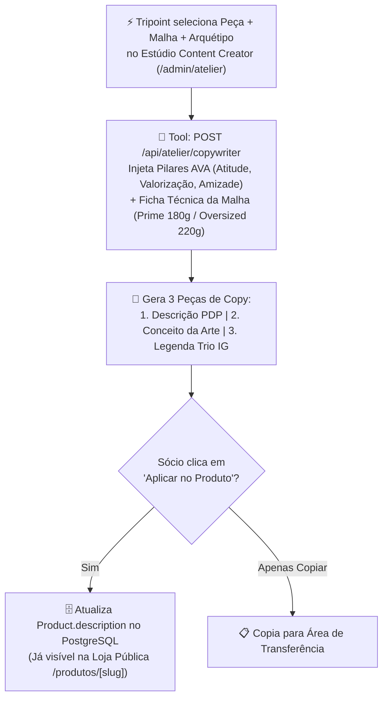

# 🎻 PLANO DE IMPLEMENTAÇÃO (MVP+) — AGENTE #20: CONTENT CREATOR (REDATOR & VOZ DA MARCA)

> **ID no Sistema:** `content_creator`  
> **Camada / Departamento:** `07 · Atelier Criativo & Mídias (Titular: Tripoint)`  
> **Status no Painel:** `🟡 Em Prontidão` ➔ Passará a `🟢 Em Atividade`  
> **Missão:** Redigir e aplicar automaticamente **Manifestos de Coleção, Descrições Sensoriais de Produtos Streetwear de Luxo (220g Oversized / 180g Prime Pele de Pêssego / Estonada 30.1) e Copies de Instagram**, calibrados nos **3 Pilares da AVA (Atitude, Valorização, Amizade)** e nos **4 Arquétipos (Explorador, Amante, Criador, Rebelde)**, gravando diretamente na tabela `Product` ou `Artwork` do PostgreSQL.

---

## 🧠 1. Modelo (Motor de Raciocínio & Decisão)
* **Natureza do Motor:** Híbrido (**Motor de Copywriting Arquetípico AVA** + **LLM `GEMINI_API_KEY` quando disponível**).
* **Lógica Central:**
  1. Recebe o nome da peça/arte, a malha escolhida (`OVERSIZED_220G`, `PRIME_180G`, `ESTONADA_30_1`, `QUALITY_165G`, `BONE`) e o conceito visual.
  2. Gera instantaneamente 3 entregáveis textuais:
     * **Descrição de Alta Costura para a Página do Produto (`/produtos/[slug]`):** Destacando toque da fibra, gramatura, estamparia Silk HD zero toque e conceito urbano de Vitória/ES.
     * **Manifesto Curto da Obra (`Artwork.concept`).**
     * **Legenda para Trio 3x3 do Instagram** com CTA para a vitrine e para a campanha `"EU TENHO CUPOM!"`.
  3. Permite com 1 clique aplicar o texto gerado diretamente na descrição de um produto real da tabela `Product` no PostgreSQL!

---

## 📜 2. Instruções e Persona (System Prompt & Regras de Comportamento)
* **Persona:** Diretor de Copywriting de Moda Streetwear de Luxo (Manifesto [`docs/estrutura/Alma/README.md`](file:///home/artz/Documentos/Antigravity/Ava-Vitoria/docs/estrutura/Alma/README.md)).
* **Regras Inegociáveis (Guardrails):**
  1. **Vocabulário Técnico Fiel:** Nunca mencionar DTF em camisetas; sempre exaltar o **Silk HD direto na fibra**, o **algodão penteado** e a **estética urbana autoral**.
  2. **Conexão Direta com o Banco:** O texto gerado não pode ficar solto; o sócio pode vinculá-lo e salvá-lo direto no produto do catálogo (`prisma.product.update`).

---

## 🧰 3. Ferramentas (`Tools` / Conectores & Ações)
1. **`tool_generate_streetwear_copy` (`POST /api/atelier/copywriter`):**
   * Recebe `{ title, fabricType, archetypeFocus, targetProductId }` e gera o pacote completo de copywriting da peça;
   * Se `targetProductId` for informado e o sócio clicar em **"💾 Aplicar Descrição no Produto"**, atualiza imediatamente `Product.description` no PostgreSQL.

---

## 🗄️ 4. Memória e Contexto (Persistência & Base de Conhecimento)
1. **Tabelas `Product` e `Artwork` (`schema.prisma`):** Destino onde as descrições e conceitos gerados são salvos.
2. **DNA da Marca:** [`docs/ava_vitoria_specification.md`](file:///home/artz/Documentos/Antigravity/Ava-Vitoria/docs/ava_vitoria_specification.md) (Pilares: *Atitude, Valorização, Amizade* | Arquétipos: *Explorador, Amante, Criador, Rebelde*).

---

## ⚡ 5. Gatilhos & Human-in-the-Loop (Orquestração)
* **Gatilho de Entrada:** Sócio Tripoint aciona o **Estúdio Copywriter (`Content Creator`)** dentro de [`/admin/atelier`](file:///home/artz/Documentos/Antigravity/Ava-Vitoria/src/app/admin/atelier/page.tsx).
* **Human-in-the-Loop:** Tripoint escolhe a peça do catálogo, gera ou refina o texto e salva no produto com 1 clique.

---

## 🔄 6. Fluxograma do Processo (BPMN)

---

## 🛠️ 7. Roteiro Cirúrgico de Implementação (Do Estado Atual para Funcional MVP+)

1. **Passo 1 (`src/app/api/atelier/copywriter/route.ts`):** Criar a API que gera descrições de produto, manifestos de arte e legendas de Instagram (com suporte a LLM + motor arquetípico da AVA) e permite gravar direto em `Product.description` no PostgreSQL.
2. **Passo 2 (`src/app/admin/atelier/page.tsx`):** Adicionar na Aba 3 do Atelier o módulo interativo do **Content Creator** conectado aos produtos reais do banco de dados.
