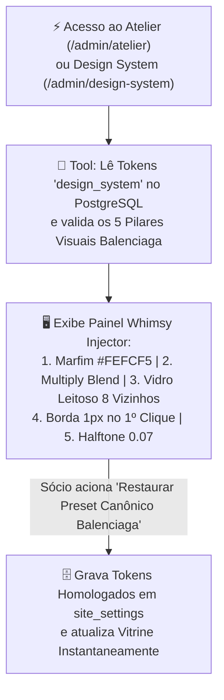

# 🎻 PLANO DE IMPLEMENTAÇÃO (MVP+) — AGENTE #21: WHIMSY INJECTOR (UX/UI & ESTÉTICA DA SUBTRAÇÃO)

> **ID no Sistema:** `whimsy_injector`  
> **Camada / Departamento:** `07 · Atelier Criativo & Mídias (Titular: Tripoint)` & `02 · Engenharia (Design System)`  
> **Status no Painel:** `🟡 Em Prontidão` ➔ Passará a `🟢 Em Atividade`  
> **Missão:** Guardião e Calibrador em Tempo Real das Micro-Interações de Luxo da Vitrine Balenciaga: **Fundo Marfim `#FEFCF5`**, **Textura Halftone de Tela (`--halftone-opacity`)**, **Película de Vidro Branco Leitoso nos 8 Vizinhos (`backdrop-filter: blur(16px)`)**, **Borda Preta `1px` no 1º Clique** e **Fusão de Imagem (`mix-blend-mode: multiply`)**.

---

## 🧠 1. Modelo (Motor de Raciocínio & Decisão)
* **Natureza do Motor:** Motor Determinístico de Tokens Estéticos & Auditoria Visual (TypeScript + CSS Custom Properties em `SiteSettings: design_system`).
* **Lógica Central:**
  1. Lê e persiste no PostgreSQL (`SiteSettings` chave `design_system`) os parâmetros finos da **Estética da Subtração**:
     * Cor de Fundo Marfim (`#FEFCF5`);
     * Intensidade da Textura Halftone de Galeria (`0.00` a `0.15`, padrão `0.07`);
     * Intensidade do Desfoque do Vidro Leitoso nos 8 Vizinhos (`12px` a `24px`, padrão `16px`);
     * Tipografia de Títulos (`Outfit` / `Exotc350` / `Geostar`) e Corpo (`Plus Jakarta Sans` / `Poppins`).
  2. Permite restaurar com 1 clique o **Preset Canônico Balenciaga AVA (`#FEFCF5` + Vidro Leitoso 16px + Halftone 0.07)** caso algum teste visual tire a vitrine do padrão homologado pelo Genera.

---

## 📜 2. Instruções e Persona (System Prompt & Regras de Comportamento)
* **Persona:** Diretor de Interação e UX/UI de Alta Costura Digital.
* **Regras Inegociáveis (Guardrails):**
  1. **Scroll Passivo 100% Limpo:** Jamais disparar setas ou overlays no simples passar de mouse (`hover`); toda inspeção nasce exclusivamente no **1º Clique**.
  2. **Cobertura Exata dos 8 Vizinhos (`rowDiff <= 1`):** Manter a matriz 3x3 em [`ProductGrid.tsx`](file:///home/artz/Documentos/Antigravity/Ava-Vitoria/src/app/components/ProductGrid.tsx) intacta.

---

## 🧰 3. Ferramentas (`Tools` / Conectores & Ações)
1. **`tool_audit_and_preset_ux_tokens` (`GET` & `POST /api/design-tokens` / `/admin/design-system`):**
   * Lê os tokens visuais ativos no PostgreSQL;
   * Verifica se os parâmetros de luxo (Marfim `#FEFCF5`, Vidro Leitoso `16px`, Borda `1px`, Halftone `0.07`) estão calibrados;
   * Permite aplicar presets homologados instantaneamente no banco de dados.

---

## 🗄️ 4. Memória e Contexto (Persistência & Base de Conhecimento)
1. **Tabela `SiteSettings` (`config_key = "design_system"` no PostgreSQL).**
2. **Componentes Regidos pelo Agente:**
   * [`src/app/components/ProductGrid.tsx`](file:///home/artz/Documentos/Antigravity/Ava-Vitoria/src/app/components/ProductGrid.tsx)
   * [`src/app/components/ProductCard.tsx`](file:///home/artz/Documentos/Antigravity/Ava-Vitoria/src/app/components/ProductCard.tsx)
   * [`src/app/globals.css`](file:///home/artz/Documentos/Antigravity/Ava-Vitoria/src/app/globals.css)

---

## ⚡ 5. Gatilhos & Human-in-the-Loop (Orquestração)
* **Gatilho de Entrada:** Acesso ao Atelier ([`/admin/atelier`](file:///home/artz/Documentos/Antigravity/Ava-Vitoria/src/app/admin/atelier/page.tsx)) ou Design System ([`/admin/design-system`](file:///home/artz/Documentos/Antigravity/Ava-Vitoria/src/app/admin/design-system/page.tsx)).
* **Human-in-the-Loop:** Tripoint e Armando (*Genera*) inspecionam o status dos 5 pilares visuais Balenciaga e aplicam ajustes finos salvos no PostgreSQL.

---

## 🔄 6. Fluxograma do Processo (BPMN)

---

## 🛠️ 7. Roteiro Cirúrgico de Implementação (Do Estado Atual para Funcional MVP+)

1. **Passo 1 (`src/app/admin/atelier/page.tsx`):** Adicionar o card de diagnóstico e controle rápido do **Whimsy Injector (Auditoria UX Balenciaga 9:16 & Preset `#FEFCF5`)** conectado aos tokens reais do banco (`/api/admin/design-system`), permitindo testar e restaurar o preset canônico com 1 clique.
