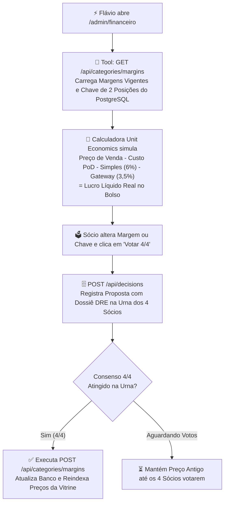

# 🎻 PLANO DE IMPLEMENTAÇÃO (MVP+) — AGENTE #22: UNIT ECONOMICS & DRE

> **ID no Sistema:** `unit_economics`  
> **Camada / Departamento:** `08 · Financeiro, Fiscal & ERP (Titular: Flávio)`  
> **Status no Painel:** `🟢 Em Atividade`  
> **Missão:** Calcular o **Lucro Líquido Real por Peça e o DRE Gerencial da Loja** (cruzando os pedidos reais da tabela `orders`, os custos reais da tabela `products`/`supplier_catalog_items`, as margens de `category_margin_rules`, a alíquota do Simples Nacional `6%` e a taxa de gateway `3,5%`) e submeter propostas reais de alteração de margem ou da Chave de 2 Posições para a **Urna de Votação 4/4**.

---

## 🧠 1. Modelo (Motor de Raciocínio & Decisão)
* **Natureza do Motor:** Motor Determinístico Financeiro & Contábil ([`src/lib/pricingEngine.ts`](file:///home/artz/Documentos/Antigravity/Ava-Vitoria/src/lib/pricingEngine.ts) + PostgreSQL).
* **Lógica Central:**
  1. **Fórmula Canônica de Preço Alvo:**
     $$\text{Preço de Venda} = \frac{\text{Custo PoD}}{1 - \frac{\text{Margem Alvo \%}}{100}}$$
  2. **Fórmula do Lucro Líquido Real no Bolso da Sociedade:**
     $$\text{Lucro Líquido} = \text{Preço de Venda} - \text{Custo PoD} - (\text{Preço} \times 6\% \text{ Simples}) - (\text{Preço} \times 3,5\% \text{ Gateway})$$
  3. **Submissão Obrigatória à Urna 4/4:** Quando Flávio (ou qualquer sócio) altera uma margem ou a Chave de 2 Posições em [`/admin/financeiro`](file:///home/artz/Documentos/Antigravity/Ava-Vitoria/src/app/admin/financeiro/page.tsx) e clica em `🗳️ Votar 4/4`, o `Unit Economics` monta o dossiê financeiro comparativo (*Preço Atual vs. Preço Proposto e Lucro Líquido por Peça*) e grava uma pauta `VOTING` na tabela `ExecutiveDecision` para o `Cobrador de Consenso 4/4` colher os 4 votos!

---

## 📜 2. Instruções e Persona (System Prompt & Regras de Comportamento)
* **Persona:** Diretor Financeiro (CFO) e Controller Fiscal da AVA Sem Limites.
* **Regras Inegociáveis (Guardrails):**
  1. **A Lei do Genera:** *"Se o preço estiver baixo, você nada e morre na praia; se estiver alto, você não sai do lugar e morre ali mesmo."*
  2. **Persistência Real das Regras do Banco:** Ao abrir `/admin/financeiro`, carregar as margens e a posição da Chave de 2 Posições diretamente da tabela `CategoryMarginRule` (`GET /api/categories/margins`), nunca exibindo números fictícios descolados do banco.
  3. **Trava Colegiada 4/4:** Nenhuma alteração de margem vai direto para a vitrine sem antes passar pela Urna de Votação 4/4.

---

## 🧰 3. Ferramentas (`Tools` / Conectores & Ações)
1. **`tool_load_and_simulate_dre` (`GET /api/categories/margins`):**
   * Carrega todas as regras da tabela `category_margin_rules` no PostgreSQL, além do resumo de produtos indexados por categoria e o DRE real dos pedidos (`orders`).
2. **`tool_propose_margin_to_urna` (`POST /api/decisions` acionado por `/admin/financeiro`):**
   * Calcula o impacto exato da nova margem proposta sobre os produtos daquela categoria e cria o card de votação na Urna 4/4 com o voto do proponente já registrado (`1/4`).
3. **`tool_apply_approved_margin` (`POST /api/categories/margins` acionado automaticamente quando a Urna atinge `4/4`):**
   * Atualiza `CategoryMarginRule` e recalcula `Product.price` de todos os produtos indexados da categoria no PostgreSQL.

---

## 🗄️ 4. Memória e Contexto (Persistência & Base de Conhecimento)
1. **Tabela `CategoryMarginRule` (`category_margin_rules` no PostgreSQL):** Regras vivas de margem e modo da Chave de 2 Posições (`INDEXED` | `HOLD_ON_DROP`).
2. **Tabela `Product` (`products`):** Custos (`cost_price`, `cost_baseline`) e preços de venda (`price`).
3. **Tabela `ExecutiveDecision` (`executive_decisions`):** Urna onde as propostas do Financeiro aguardam o consenso `4/4`.

---

## ⚡ 5. Gatilhos & Human-in-the-Loop (Orquestração)
* **Gatilho 1:** Acesso ao painel [`/admin/financeiro`](file:///home/artz/Documentos/Antigravity/Ava-Vitoria/src/app/admin/financeiro/page.tsx) (carrega margens reais do banco).
* **Gatilho 2:** Clique em `🗳️ Votar 4/4` em qualquer categoria ou na Chave de 2 Posições (cria a pauta na Urna).
* **Gatilho 3:** Aprovação unânime (`4/4`) na Urna (efetiva a nova margem e atualiza os preços na vitrine).

---

## 🔄 6. Fluxograma do Processo (BPMN)

---

## 🛠️ 7. Roteiro Cirúrgico de Implementação (Do Estado Atual para Funcional MVP+)

1. **Passo 1 (Diagnóstico do Gap Atual em [`/admin/financeiro/page.tsx`](file:///home/artz/Documentos/Antigravity/Ava-Vitoria/src/app/admin/financeiro/page.tsx)):**
   * Hoje a página `/admin/financeiro` não faz `useEffect` para carregar as margens salvas em `GET /api/categories/margins` ao abrir a tela (ela sempre inicia com valores fixos no `useState`).
   * Além disso, ao clicar em `🗳️ Votar 4/4`, ela chama `POST /api/categories/margins` diretamente (alterando o banco sem criar a pauta na Urna do `/admin`).
2. **Passo 2 (`src/app/admin/financeiro/page.tsx`):**
   * Carregar as regras reais do banco (`GET /api/categories/margins`) ao abrir a página;
   * Fazer o botão `🗳️ Votar 4/4` (tanto das caixinhas de margem quanto da Chave de 2 Posições) enviar a proposta para a **Urna de Votação (`POST /api/decisions`)**, que por sua vez só altera os preços da loja quando os 4 crachás ficarem verdes (`4/4`).
