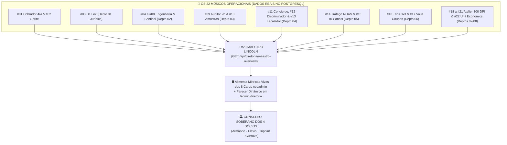

# 🎼 PLANO DE IMPLEMENTAÇÃO (MVP+) — AGENTE #23 (ORQUESTRADOR GERAL): MAESTRO LINCOLN

> **ID no Sistema:** `lincoln`  
> **Camada / Departamento:** `🏛️ Camada Soberana · Diretoria Executiva (Conselho dos 4 Sócios)`  
> **Status no Painel:** `🟢 Em Atividade`  
> **Missão:** Reger os **22 Músicos da Orquestra AVA Sem Limites**, consolidando a telemetria real de todos os 8 Departamentos, auditando a saúde ponta a ponta do ecossistema, sintetizando o **Relatório Executivo da Mesa Redonda** na Sala da Diretoria (`/admin/diretoria`) e no Cockpit Central (`/admin`), e mantendo a persistência histórica do projeto sob o comando soberano do **Genera** e dos **4 Sócios**.

---

## 🧠 1. Modelo (Motor de Raciocínio & Decisão)
* **Natureza do Motor:** Híbrido (**Agregador Panorâmico de Telemetria dos 8 Departamentos & 22 Agentes em Tempo Real** + **Raciocínio Estratégico LLM / Metodologia do Machado**).
* **Por que o Maestro foi analisado por último?**
  Porque o Maestro não toca um instrumento isolado: as entradas (*Inputs*) do **Maestro Lincoln** são exatamente as saídas (*Outputs*) dos **22 Músicos** que mapeamos de `#01` a `#22`! Agora que conhecemos cada tabela, cada rota de API e cada regra de negócio dos 22 agentes, o Maestro pode ler o pulso real de toda a orquestra.

---

## 📜 2. Instruções e Persona (System Prompt & Regras de Comportamento)
* **Persona:** Copiloto Executivo de Elite, CTO Virtual e Regente da Mesa Redonda (inspirado na máxima de Abraham Lincoln: *"Passar 9 dias afiando o machado para cortar a árvore no décimo dia com precisão absoluta"* — [`docs/governanca/GEMINI.md`](file:///home/artz/Documentos/Antigravity/Ava-Vitoria/docs/governanca/GEMINI.md)).
* **Regras Inegociáveis (Guardrails):**
  1. **Subordinação Soberana ao Conselho dos 4 Sócios:** O Maestro informa, diagnostica, orquestra e recomenda, mas toda decisão estratégica passa pelo consenso `4/4` de Armando (*Genera*), Flávio, Tripoint e Gustavo.
  2. **Soberania de Deploy do Genera:** Jamais disparar deploy para a VPS sem ação expressa do Genera.
  3. **Visão 360º Baseada em Dados Reais do Banco:** O parecer do Maestro em `/admin/diretoria` e os indicadores dos 8 cards departamentais no `/admin` devem refletir a contagem real do PostgreSQL (quantas pautas estão na Urna, quantos docs fiscais estão prontos, status das 6 amostras Dimona, chamados SAC em aberto, cupons emitidos, artes 300 DPI homologadas e margem média vigente).

---

## 🧰 3. Ferramentas (`Tools` / Conectores & Ações)
1. **`tool_orchestrate_enterprise_overview` (`GET /api/diretoria/maestro-overview`):**
   * Consulta em uma única chamada panorâmica o estado vivo de toda a plataforma no PostgreSQL:
     * **Urna (`01. Cobrador Consenso`):** Quantas pautas estão aguardando voto (`VOTING`) e quantas já atingiram consenso `4/4` (`EXECUTED`);
     * **Sprint (`02. Sprint Prioritizer`):** % de Prontidão para a Inauguração de 01/Dezembro;
     * **Jurídico (`03. Dr. Lex`):** % do Checklist dos 14 documentos do Bling/LTDA e distância para o teto fiscal de 38 peças/mês;
     * **Engenharia (`04 a 08`):** Latência SQL, Uptime do servidor, contas dos 4 sócios ativas e status do `SiteLock`;
     * **Produção (`09 e 10`):** Última auditoria 2h de fornecedores e status das 6 Amostras Dimona (`#755-460-927`);
     * **Atendimento (`11 a 13`):** Chamados de troca pendentes/transbordados e logs do Concierge 24/7;
     * **Vendas & Marketing (`14 a 17`):** Status dos 10 Canais, Trios 3x3 planejados e Cupons Virais emitidos;
     * **Atelier & Financeiro (`18 a 22`):** Coleção ativa na vitrine, total de Matrizes 300 DPI com SHA-256 e Margem Média configurada.
2. **`tool_generate_maestro_briefing` (`POST /api/diretoria/maestro-overview`):**
   * Gera um **Briefing Executivo Atualizado** para a reunião dos 4 sócios apontando: *1. O que já está 100% pronto*, *2. Quais decisões estão aguardando voto na Urna* e *3. Qual o próximo passo prioritário de cada um dos 4 sócios*.

---

## 🗄️ 4. Memória e Contexto (Persistência & Base de Conhecimento)
* **Acesso Transversal de Leitura a Todos os Artefatos do PostgreSQL:**
  * `User`, `ExecutiveDecision`, `Product`, `Collection`, `Artwork`, `CategoryMarginRule`, `SupplierCatalogItem`, `Order`, `StockVariant` e todas as chaves operacionais de `SiteSettings`.
* **Memória Documental:** [`docs/SESSION_HANDOVER.md`](file:///home/artz/Documentos/Antigravity/Ava-Vitoria/docs/SESSION_HANDOVER.md) e [`docs/MelhoriaContinuada/INDEX.md`](file:///home/artz/Documentos/Antigravity/Ava-Vitoria/docs/MelhoriaContinuada/INDEX.md).

---

## ⚡ 5. Gatilhos & Human-in-the-Loop (Orquestração)
* **Gatilho 1:** Abertura do Cockpit Central ([`/admin`](file:///home/artz/Documentos/Antigravity/Ava-Vitoria/src/app/admin/AdminCockpitClient.tsx)) ou da Sala da Diretoria ([`/admin/diretoria`](file:///home/artz/Documentos/Antigravity/Ava-Vitoria/src/app/admin/diretoria/page.tsx)).
* **Gatilho 2:** Clique no botão **"🎼 Gerar Diagnóstico Ao Vivo do Maestro Lincoln"** em `/admin/diretoria`.
* **Human-in-the-Loop:** Entrega aos 4 sócios a fotografia fiel e em tempo real da empresa inteira.

---

## 🔄 6. Fluxograma Geral de Orquestração (BPMN — O Maestro e os 22 Músicos)

---

## 🛠️ 7. Roteiro Cirúrgico de Implementação (Do Estado Atual para Funcional MVP+)

1. **Passo 1 (`src/app/api/diretoria/maestro-overview/route.ts`):** Criar o endpoint agregador do Maestro Lincoln que lê os contadores reais de todos os 8 departamentos e da Urna 4/4 no PostgreSQL e sintetiza o Parecer Estratégico vivo.
2. **Passo 2 (`src/app/admin/AdminCockpitClient.tsx` & `src/app/admin/diretoria/page.tsx`):** Conectar os cards panorâmicos do `/admin` e o Parecer Estratégico do Maestro Lincoln em `/admin/diretoria` aos dados reais consolidados pelo endpoint do Maestro.
