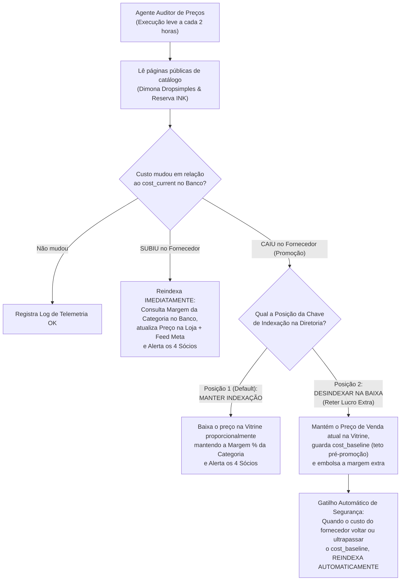

# 🏛️ PLANO MESTRE DE IMPLEMENTAÇÃO: 8 DEPARTAMENTOS & ARQUITETURA AGÊNTICA (STAR-INK ➔ AVA VITÓRIA)

> **Data de Consolidação:** 15 de Novembro de 2026  
> **Projetos Envolvidos:** `Star-Ink` (`www.star-ink.com.br`) ➔ `Ava-Vitoria / AVA Sem Limites` (`www.ava-vitoria.com.br` / `www.avasemlimites.com.br`)  
> **Governança Societária AVA:** Conselho de **4 Sócios** (Armando Sinkovitz / Genera + 3 Sócios, incluindo Diretor de Vídeo especialista em IA)  
> **Orquestrador Técnico:** Maestro Lincoln (Antigravity)  
> **Status:** Planejamento Consolidado e Homologado — Pronto para Execução a partir da próxima sessão 🎯

---

## 🎯 1. Objetivo Estratégico & Diretrizes Inegociáveis

Este documento consolida o diagnóstico comparativo entre os projetos **Star-Ink** e **Ava-Vitoria**, estabelecendo o roteiro cirúrgico para transplantar toda a infraestrutura dos **8 Departamentos Operacionais**, **19 Agentes de IA**, **Matriz Canônica Multicanal (10 Canais + Bling ERP v3)** e **Motor de Precificação Dinâmica Multi-Supplier** para o ecossistema **Ava-Vitoria**.

Como a **AVA Vitória** está migrando do modelo tradicional (estoque físico parado) para o paradigma **Print on Demand (PoD) Multi-Supplier + Multicanal**, o sistema completo servirá como **planta baixa viva** para que os **4 sócios** visualizem todas as demandas geradas pela operação e distribuam formalmente as funções e responsabilidades societárias.

### 🛡️ 1.1. Regras de Ouro da Engenharia (Sem Atalhos)
1. **100% CSS Modules Semântico (`.module.css`) e Zero Novas Dependências:**
   * **Proibido** instalar `tailwindcss`, `postcss`, `autoprefixer`, `framer-motion` ou `lucide-react` no [`package.json`](file:///home/artz/Documentos/Antigravity/Ava-Vitoria/package.json) do Ava-Vitoria.
   * Todos os módulos trazidos do Star-Ink terão sua camada visual escrita em **HTML semântico limpo + CSS Modules nativos (`.module.css`)**, consumindo as variáveis dinâmicas do Design System da AVA (`var(--color-bg)`, `var(--color-accent)`, `var(--color-border)`, `var(--font-title)`, `var(--font-body)`) e ícones em `<svg>` inline puros.
   * **Impacto Zero em Mídias (0% Overhead):** A Vitrine 9:16 mantém seu tempo de carregamento máximo, sem scripts ou folhas de estilo externas concorrendo com o `<Image />` do Next.js 16.
2. **Preservação Integral da Vitrine Balenciaga da AVA:**
   * A renderização **SSR (Server-Side Rendering)** da Home ([`src/app/page.tsx`](file:///home/artz/Documentos/Antigravity/Ava-Vitoria/src/app/page.tsx)), o Grid de 3 colunas com **1º clique de inspeção ativa** (borda preta `1px` + **Vidro Branco Leitoso** nos 8 vizinhos em [`ProductGrid.tsx`](file:///home/artz/Documentos/Antigravity/Ava-Vitoria/src/app/components/ProductGrid.tsx)), os slots vazios inteligentes (ocultos no mobile), a página dedicada `/produtos/[slug]` com `.unifiedGrid` e o chaveador dinâmico de coleção ativa (`★ Vitrine Ativa da Loja`) permanecem **100% intactos**.
3. **Soberania de Deploy:**
   * Toda codificação e validação ocorre estritamente no ambiente local. A execução do script [`scripts/deploy.sh`](file:///home/artz/Documentos/Antigravity/Ava-Vitoria/scripts/deploy.sh) para a VPS Contabo (`31.220.102.2`) é ato exclusivo do Genera.

---

## 🌸 2. Evoluções na Loja Pública da AVA (`/` e `/atendimento`)

Sem alterar o layout Balenciaga dos cards de produto, a loja pública receberá **3 incrementos cirúrgicos** extraídos do Star-Ink:

### 2.1. Textura Tátil de Tela (`Halftone / Canvas Overlay`)
* **Origem:** [`Star-Ink/src/app/globals.css`](file:///home/artz/Documentos/Antigravity/Star-Ink/src/app/globals.css#L34-L88).
* **Destino:** [`Ava-Vitoria/src/app/globals.css`](file:///home/artz/Documentos/Antigravity/Ava-Vitoria/src/app/globals.css) e [`DesignSystemForm.tsx`](file:///home/artz/Documentos/Antigravity/Ava-Vitoria/src/app/admin/design-system/DesignSystemForm.tsx).
* **Especificação:** Aplicação da camada `body::before` e classe utilitária com `radial-gradient(#000000 var(--halftone-dot-size), transparent var(--halftone-dot-size))` (`--halftone-dot-size: 0.8px`, `--halftone-grid-size: 3.5px`, `--halftone-opacity: 0.07`) sobre o fundo marfim off-white (`#FEFCF5`), conferindo textura de tela/galeria de arte.

### 2.2. Seção dos 10 Canais de Venda (`SalesChannelsSection`) — Autoridade Nacional
* **Origem:** [`Star-Ink/src/components/channels/SalesChannelsSection.tsx`](file:///home/artz/Documentos/Antigravity/Star-Ink/src/components/channels/SalesChannelsSection.tsx).
* **Destino:** `Ava-Vitoria/src/app/components/SalesChannelsSection.tsx` + `SalesChannels.module.css`, inserido em [`src/app/page.tsx`](file:///home/artz/Documentos/Antigravity/Ava-Vitoria/src/app/page.tsx) logo abaixo da Vitrine e antes do Rodapé.
* **Propósito Estratégico de Marketing:** Transferir credibilidade nacional imediata para visitantes de fora de Vitória/ES ao vincular visualmente a marca **AVA** aos 10 grandes canais onde seus produtos são distribuídos via Bling ERP:
  1. **Mercado Livre**
  2. **Amazon Brasil**
  3. **Google Shopping**
  4. **SHEIN**
  5. **Dafiti**
  6. **TikTok Shop**
  7. **Reserva**
  8. **Instagram Shopping**
  9. **Facebook Meta**
  10. **Shopee**

### 2.3. Botão de Menu "Atendimento" & Central Pública do Cliente (`/atendimento` e `/trocas`)
* **Origem:** [`AIAssistantSection.tsx`](file:///home/artz/Documentos/Antigravity/Star-Ink/src/components/ai/AIAssistantSection.tsx) + [`Star-Ink/src/app/trocas/page.tsx`](file:///home/artz/Documentos/Antigravity/Star-Ink/src/app/trocas/page.tsx) + Políticas Legais + [`Ava-Vitoria/src/app/contato/page.tsx`](file:///home/artz/Documentos/Antigravity/Ava-Vitoria/src/app/contato/page.tsx).
* **Destino:** Atualização do menu em [`Header.tsx`](file:///home/artz/Documentos/Antigravity/Ava-Vitoria/src/app/components/Header.tsx) incluindo o botão **Atendimento** (`/atendimento`), que reúne em uma interface limpa (fundo `#FEFCF5` e linhas `1px`):
  1. **Concierge IA 24/7 da AVA:** Chat inteligente treinado com as especificações das malhas, modelagens, prazos e história da marca.
  2. **Portal de Trocas, Devoluções & Acionamento de Garantia (`/trocas`):** Autoatendimento conectado ao **Agente Discriminador** (Depto 05), separando automaticamente *Troca de Tamanho/Arrependimento (Art. 49 CDC)* de *Defeito de Fabricação PoD*.
  3. **Formulário de Contato Direto & Dúvidas Frequentes (FAQ).**
  4. **Páginas Legais Obrigatórias:** `/politica-de-devolucao`, `/politica-de-privacidade` (LGPD) e `/termos-e-condicoes`.

---

## ⚙️ 3. Arquitetura Multi-Supplier & Motor de Precificação Dinâmica (Inspeção 2h)

O sistema **não ficará engessado em um único fornecedor**. Tanto a AVA quanto a Star-Ink operarão com maleabilidade total para escolher, peça a peça, o fornecedor com a melhor relação **qualidade × recursos técnicos × custo-benefício**.

### 3.1. Catálogo Homologado de Fornecedores (`src/lib/suppliers.ts`)
Lista dinâmica disponível em todos os seletores de Produto, Artes Matrizes, Amostras e Simulador Financeiro:

| Código | Fornecedor | Especialidade / Uso Ideal na AVA | Gabarito de Matriz (300 DPI) | Custos Base de Referência |
| :--- | :--- | :--- | :--- | :--- |
| `DIMONA` | **Dimona (Dropsimples Silk HD)** | Peças com **Frente + Costas**, linha *Prime 180g (Pele de Pêssego)*, *Oversized 220g*, *Estonada*, *Regatas* e *Bonés*. | `3435 × 4680 px` (Zero margem) `2400 × 2400 px` (Selo/Boné) | Quality: R$ 41,90 (1 est.) / R$ 59,90 (F+C) Prime: R$ 49,90 (1 est.) / R$ 67,90 (F+C) Estonada: R$ 55,00 (1 est.) / R$ 73,00 (F+C) Oversized: R$ 83,90 (1 est.) / R$ 101,90 (F+C) Bonés: R$ 33,00 (Amer.) / R$ 72,90 (Prime) |
| `RESERVA_INK` | **Reserva INK (DTG Kornit)** | Peças com **estampa apenas na Frente**, *Camiseta Classic*, *Algodão Peruano (Pima)*, *Moletons Crewneck e Canguru*. | `4200 × 4800 px` (PNG Transparente) | Camiseta Classic: ~R$ 49,00 a R$ 59,00 Moletons: conforme tabela vigente |
| `MONTINK` | **Montink PoD** | Linhas complementares e comparativos de malha. | `4200 × 4800 px` | Sob tabela sincronizada |
| `HOTPRINTI` | **Hotprinti** | Papelaria Fine Art A3, Ecobags e acessórios específicos. | `3508 × 4960 px` (A3) | Sob tabela sincronizada |
| `PRIVATE_LABEL` | **Private Label / Facção CMT** | Lotes especiais autorais ou serigrafia local em Vitória/ES. | Vetorial `.ai` / `.pdf` / `300 DPI` | Custo negociado por lote |
| `ESTOQUE_AVA` | **Estoque Físico Próprio AVA** | Peças remanescentes ou pronta-entrega local. | N/A | Custo histórico de aquisição |

---

### 3.2. Motor de Inspeção de Preços nos Sites Públicos (A cada 2 Horas) + Regra de Indexação
Como as APIs dos fornecedores não notificam reajustes de tabela nem promoções relâmpago, implementaremos o **Agente Auditor de Preços de Fornecedores** (`/api/production/suppliers/sync-prices`):

#### Detalhamento dos Controles no Painel (Depto 08 — Financeiro):
1. **Tabela de Regras de Margem por Categoria (`pricing_rules` no PostgreSQL):**
   * Caixinhas numéricas editáveis no Painel de Controle com efeito imediato no banco e na vitrine:
     * `Camisetas Quality / Prime`: ex. `60%`
     * `Camisetas Oversized`: ex. `55%`
     * `Camisetas Estonadas`: ex. `58%`
     * `Regatas`: ex. `60%`
     * `Moletons (Crewneck / Hoodie)`: ex. `50%`
     * `Bonés (Americano / Trucker Prime)`: ex. `45%`
   * **Ação Promocional Instantânea:** Se os 4 sócios quiserem fazer uma promoção em toda a linha de Camisetas, basta digitar a nova margem (ex: `45%`) na caixinha correspondente e salvar — todos os produtos vinculados são recalculados na hora.
   * **Exceção por Produto:** Cada produto pode herdar a margem da sua categoria ou ter uma margem individual sobrescrita no seu cadastro canônico.
2. **Chave Seletora de 2 Posições (Comportamento em Queda de Custo do Fornecedor):**
   * **Posição 1 (`INDEXADO — Padrão`):** Qualquer variação do fornecedor (para mais ou para menos) recalcula o preço de venda mantendo a margem percentual constante.
   * **Posição 2 (`DESINDEXAR NA BAIXA / RETER LUCRO EXTRA`):** Quando o fornecedor baixa o preço (`cost_current < cost_baseline`), o preço de venda na loja permanece congelado para aumentar o lucro líquido por peça. Assim que o preço do fornecedor encerrar a promoção e atingir ou superar o `cost_baseline` anterior, o sistema **religa a indexação automaticamente** e reajusta o preço de venda, disparando alerta na **Fila de Decisões Executivas dos 4 Sócios**.

---

## 🏛️ 4. Mapa Completo do Cockpit Admin (`/admin`) e dos 8 Departamentos na AVA

A rota principal `/admin` deixará de ser apenas a listagem de coleções (que irá para o **Depto 07 — Atelier**) e passará a ser o **Cockpit Central da AVA Sem Limites**, exibindo a telemetria dos **19 Agentes**, os **8 Cards Departamentais** e a **Fila de Decisões Executivas (Human-in-the-Loop)** para os **4 Sócios**.

| Depto | Rota no Ava-Vitoria | Componentes Fonte (Star-Ink + AVA) | Funcionalidades Principais no Ava-Vitoria |
| :--- | :--- | :--- | :--- |
| **HUB** | `/admin` | [`AdminHubHome.tsx`](file:///home/artz/Documentos/Antigravity/Star-Ink/src/components/admin/AdminHubHome.tsx) + `AdminHeader.tsx` | Visão panorâmica dos 8 Departamentos, inspeção de logs dos 19 Agentes e **Fila de Decisões Executivas de 1-Clique** (incluindo alertas de preço dos fornecedores para os 4 sócios). |
| **01** | `/admin/diretoria` | [`DiretoriaExecutivaModule.tsx`](file:///home/artz/Documentos/Antigravity/Star-Ink/src/components/admin/DiretoriaExecutivaModule.tsx) | Painel do **Conselho Societário (4 Sócios)**, Scorecard de Saúde do Negócio, Metas Comerciais, Simulador de Cenários e Auditoria Maestro Lincoln. |
| **02** | `/admin/juridico` | [`JuridicoComplianceModule.tsx`](file:///home/artz/Documentos/Antigravity/Star-Ink/src/components/admin/JuridicoComplianceModule.tsx) | Governança Societária (Contrato Social 4 Sócios), Registro de Marca INPI, Compliance Fiscal Simples Nacional, LGPD e Chat Consultivo **Dr. Lex**. |
| **03** | `/admin/engenharia` | [`EngenhariaTIModule.tsx`](file:///home/artz/Documentos/Antigravity/Star-Ink/src/components/admin/EngenhariaTIModule.tsx) + [`/admin/design-system`](file:///home/artz/Documentos/Antigravity/Ava-Vitoria/src/app/admin/design-system/page.tsx) | Telemetria da VPS Contabo (`31.220.102.2`), status PostgreSQL/Prisma, rota GEO `/llms.txt` + acesso integrado ao **Design System Dinâmico** (cores, fontes, textura halftone) e **Portaria da Loja (`SiteLockControl`)**. |
| **04** | `/admin/producao` | [`ProducaoModule.tsx`](file:///home/artz/Documentos/Antigravity/Star-Ink/src/components/admin/ProducaoModule.tsx) + [`/admin/stock`](file:///home/artz/Documentos/Antigravity/Ava-Vitoria/src/app/admin/stock/page.tsx) | **4 Abas Operacionais:** 1. *Kanban PoD (5 Etapas)* com filtro Multi-Supplier; 2. *Gestão & Comparativo de Amostras Físicas* (Dimona vs. Reserva INK com notas de avaliação de malha/estampa); 3. *Multi-Supplier Hub & Sincronizador 2h de Preços*; 4. *Estoque Físico Remanescente* (`StockClient`). |
| **05** | `/admin/atendimento` | [`AtendimentoModule.tsx`](file:///home/artz/Documentos/Antigravity/Star-Ink/src/components/admin/AtendimentoModule.tsx) | **Agente Discriminador** (triagem automática: Defeito de Fábrica roteado para garantia Dimona/Reserva INK vs. Troca de Tamanho AVA), gestão de chamados de `/trocas`, logs do **Concierge IA 24/7** e CRM de Clientes. |
| **06** | `/admin/marketing` | [`ShowcaseCatalogModule.tsx`](file:///home/artz/Documentos/Antigravity/Star-Ink/src/components/admin/ShowcaseCatalogModule.tsx) (Módulo Growth) | Gestão de Tráfego Pago (Meta Ads / Google Shopping), monitoramento de ROAS/CAC, status de sincronização do Feed XML da **Sacolinha do Instagram (`/api/catalog/meta`)** e calendário de publicações. |
| **07** | `/admin/atelier` | [`ArtworksProductionModule.tsx`](file:///home/artz/Documentos/Antigravity/Star-Ink/src/components/admin/ArtworksProductionModule.tsx) + [`MediaLibraryClient.tsx`](file:///home/artz/Documentos/Antigravity/Ava-Vitoria/src/app/admin/media/MediaLibraryClient.tsx) + [`DashboardClient.tsx`](file:///home/artz/Documentos/Antigravity/Ava-Vitoria/src/app/admin/DashboardClient.tsx) + [`GridManagerClient.tsx`](file:///home/artz/Documentos/Antigravity/Ava-Vitoria/src/app/admin/grid-manager/GridManagerClient.tsx) | **O Estúdio Criativo Unificado em 3 Abas** (abandono definitivo do antigo V-TON): • **Aba 1 — Artes Matrizes & Prompts (MDV 26 Chaves):** Cadastro de artes 300 DPI multi-gabarito (Dimona `3435×4680` / Reserva INK `4200×4800`), pastas-projeto, selo `Registrado? Sim/Não`, Hash SHA-256 e Inspetor das 26 Chaves do JSON de Escrita. • **Aba 2 — Biblioteca Geral de Mídias:** Grid uniforme de 9 colunas com Lightbox. • **Aba 3 — Projetos/Coleções & Grid Manager (Matriz Canônica):** Criação/chaveamento de coleções ativas na vitrine, ordenação de cards e editor de produto com as **4 Abas da Matriz Canônica**. |
| **08** | `/admin/financeiro` | [`FinanceiroModule.tsx`](file:///home/artz/Documentos/Antigravity/Star-Ink/src/components/admin/FinanceiroModule.tsx) | **Painel de Margens por Categoria (Caixinhas de efeito imediato)** + **Chave de 2 Posições de Indexação/Desindexação**, Calculadora de Unit Economics Multi-Supplier, DRE Gerencial, Conciliação Pix/Cartão e **Conector Bling ERP v3** (OAuth 1-Clique, NF-e e distribuição para os 10 Marketplaces). |

---

## 🗄️ 5. Evolução do Banco de Dados (`Ava-Vitoria/prisma/schema.prisma`)

Para sustentar todas essas funcionalidades sem quebrar nada do que já existe na AVA, faremos uma expansão aditiva no [`schema.prisma`](file:///home/artz/Documentos/Antigravity/Ava-Vitoria/prisma/schema.prisma):

1. **Evolução do model `Product` (Matriz Canônica + Precificação Indexada):**
   * `sku_master`: `String? @db.VarChar(100)`
   * `product_category`: `String @default("CAMISETA_PRIME") @db.VarChar(50)` *(vínculo com a tabela de margens)*
   * `supplier_provider`: `String @default("DIMONA") @db.VarChar(50)`
   * `supplier_item_code`: `String? @db.VarChar(100)` *(ex: `DIMONA_PRIME_FC`, `RESERVA_CLASSIC_F`)*
   * `cost_price`: `Decimal? @db.Decimal(10, 2)` *(Custo Atual `cost_current`)*
   * `cost_baseline`: `Decimal? @db.Decimal(10, 2)` *(Custo Base pré-promoção para o gatilho de reindexação automática)*
   * `target_margin_percent`: `Decimal? @db.Decimal(5, 2)` *(Permite margem customizada por produto ou herdar da categoria)*
   * `is_price_indexed`: `Boolean @default(true)`
   * `ncm`: `String? @default("6109.10.00") @db.VarChar(20)`
   * `weight_grams`: `Int? @default(180)`
   * `dimensions`: `Json? @db.JsonB`
   * `print_file_front_url`: `String? @db.VarChar(512)`
   * `print_file_back_url`: `String? @db.VarChar(512)`
   * `artwork_id`: `String? @db.Uuid`
2. **Novo model `Artwork` (Depto 07 — Atelier & MDV 26 Chaves):**
   * `id`, `code`, `title`, `concept`, `project_folder` (default `"Testes"`), `is_registered` (`Boolean`), `coa_hash_sha256`, `mutated_keys_count` (`Int`), `writing_matrix_26` (`JsonB`), `master_print_dimona_url`, `master_print_reserva_url`, `preview_image_url`, `default_supplier`.
3. **Novo model `CategoryMarginRule` (Depto 08 — Caixinhas de Margem & Chave de 2 Posições):**
   * `id`, `category_code` (`@unique` — ex: `CAMISETA_QUALITY`, `CAMISETA_PRIME`, `CAMISETA_OVERSIZED`, `CAMISETA_ESTONADA`, `REGATA`, `MOLETOM`, `BONE`), `category_label`, `target_margin_percent` (`Decimal`), `drop_indexing_mode` (`"INDEXED"` | `"HOLD_ON_DROP"`), `updated_at`.
4. **Novo model `SupplierCatalogItem` (Depto 04 & 08 — Tabela Sincronizada a cada 2h):**
   * `id`, `supplier_code` (`DIMONA`, `RESERVA_INK`, etc.), `item_code` (`@unique`), `item_name`, `print_mode` (`FRENTE`, `FRENTE_COSTAS`, `SELO_BONE`), `dimensions_px`, `cost_current` (`Decimal`), `cost_baseline` (`Decimal`), `public_source_url`, `last_checked_at`, `last_changed_at`.

---

## 🚀 6. Cronograma de Execução em 5 Fases (A partir da próxima sessão)

### Fase 1: Banco de Dados, Motor Multi-Supplier, Sincronizador 2h & APIs
1. Atualizar [`Ava-Vitoria/prisma/schema.prisma`](file:///home/artz/Documentos/Antigravity/Ava-Vitoria/prisma/schema.prisma) e rodar `npx prisma db push`.
2. Criar `src/lib/suppliers.ts` e `src/lib/pricingEngine.ts` com a tabela inicial da Dimona e Reserva INK, o cálculo de margem por categoria e a lógica da Chave de 2 Posições (`cost_current` vs. `cost_baseline`).
3. Criar os serviços `telemetry.ts`, `artworks.ts`, `production.ts`, `financials.ts`, `concierge.ts` e todas as rotas `/api/*` correspondentes (incluindo `/api/production/suppliers/sync`, Bling OAuth v3 e `/llms.txt`).

### Fase 2: Incrementos na Loja Pública da AVA (100% CSS Modules)
1. Adicionar a textura de tela (`halftone`) em [`Ava-Vitoria/src/app/globals.css`](file:///home/artz/Documentos/Antigravity/Ava-Vitoria/src/app/globals.css).
2. Construir `SalesChannelsSection.tsx` + `SalesChannels.module.css` (os 10 Canais de Venda) e posicionar na Home (`/`).
3. Adicionar o botão **Atendimento** no [`Header.tsx`](file:///home/artz/Documentos/Antigravity/Ava-Vitoria/src/app/components/Header.tsx) e criar a rota `/atendimento` (Concierge IA 24/7 + Portal de Trocas `/trocas` + FAQ + Contato + Políticas Legais).

### Fase 3: Cockpit Central (`/admin`) + Departamentos 01, 02, 03 e 06 (100% CSS Modules)
1. Criar a arquitetura visual unificada do Admin em CSS Modules (`src/app/admin/admin-cockpit.module.css` + `AdminHeader.tsx`).
2. Implementar a nova Home `/admin` com os 8 Departamentos, Telemetria dos 19 Agentes e Fila de Decisões Executivas dos 4 Sócios.
3. Implementar `/admin/diretoria` (Depto 01), `/admin/juridico` (Depto 02), `/admin/engenharia` (Depto 03 integrado ao `/admin/design-system`) e `/admin/marketing` (Depto 06).

### Fase 4: Departamento 07 — O Atelier Unificado de 3 Abas (`/admin/atelier`)
1. Construir o container de 3 Abas em `/admin/atelier`:
   * **Aba 1:** Artes Matrizes Multi-Gabarito (Dimona & Reserva INK) + Inspetor de Prompts MDV 26 Chaves.
   * **Aba 2:** Biblioteca Geral de Mídias (9 Colunas + Lightbox).
   * **Aba 3:** Projetos/Coleções & Grid Manager com o editor expandido da **Matriz Canônica (4 Abas)**.

### Fase 5: Departamentos 04 (Operações PoD & Amostras), 05 (SAC) e 08 (Financeiro & Bling)
1. Implementar `/admin/producao` (Depto 04) com Kanban PoD, **Gestão e Comparativo de Amostras (Dimona vs. Reserva INK)**, Hub Multi-Supplier com botão de inspeção de preços e aba de Estoque Físico.
2. Implementar `/admin/atendimento` (Depto 05 — Agente Discriminador e Concierge IA).
3. Implementar `/admin/financeiro` (Depto 08) com o **Painel de Caixinhas de Margem por Categoria**, a **Chave de 2 Posições (Indexação vs. Retenção de Lucro na Baixa c/ Reindexação Automática)**, Calculadora Unit Economics e Conector Bling ERP v3.
4. Executar validação final TypeScript (`tsc --noEmit`) e build local completo.
