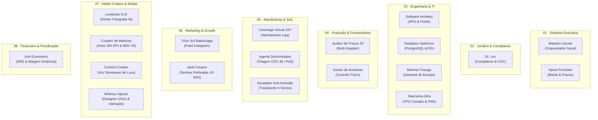

# 🤖 PLANO DE IMPLEMENTAÇÃO: TELEMETRIA ATIVA & DOSSIÊ INTERATIVO DOS 19 AGENTES DE IA

> **Data de Criação:** 18 de Novembro de 2026  
> **Destinatários:** Armando Sinkovitz (*Genera*) e Conselho dos 4 Sócios — AVA Sem Limites  
> **Orquestrador Técnico:** Maestro Lincoln (Antigravity)  
> **Status:** Planejamento Aprovado — Pronto para Execução 🎯  

---

## 🎯 1. Objetivo Estratégico & Filosofia Pedagógica

Este plano estrutura a transformação da seção de telemetria do Cockpit Administrativo ([`/admin`](file:///home/artz/Documentos/Antigravity/Ava-Vitoria/src/app/admin/page.tsx)) em uma **Central Interativa de Inteligência e Ajuda Operacional**.

O propósito central não é apenas exibir nomes de IA na tela, mas **educar e empoderar os 4 sócios**, permitindo que cada um compreenda com clareza matemática e operacional:
1. Quais tarefas a inteligência artificial assumiu na empresa.
2. Como a engrenagem roda de forma invisível 24 horas por dia.
3. **O quanto de tempo de vida, esforço manual e contratações externas esse exército de agentes está economizando para os fundadores.**

---

## 🚦 2. Sistema de Sinalização Visual (Luzes de Estado Aeronáutico)

Cada card de agente na Telemetria receberá um indicador luminoso dinâmico com três estados visuais:

| Luz | Estado | Significado Operacional | Comportamento na Interface |
| :---: | :--- | :--- | :--- |
| 🟡 | **Em Prontidão (Stand-by)** | O agente está vigilante, monitorando a base, ouvindo webhooks ou aguardando chamados da sua rotina periódica. | **Padrão:** Ponto amarelo âmbar suave e constante. |
| 🟢 | **Em Atividade (Processando)** | O agente está executando ativamente uma rotina de checagem, cálculo, triagem ou resposta. | Ponto verde esmeralda com pulso luminoso sutil (`pulse animation`). |
| 🔴 | **Atenção / Demanda na Fila** | O agente detectou uma anomalia ou gerou uma decisão pendente na **Fila de Decisões Executivas**. | Ponto vermelho com badge de contagem de alerta. |

---

## 📋 3. Estrutura Padrão do Dossiê do Agente (A Tríade de Ouro + O ROI Humano)

Ao clicar sobre qualquer um dos 19 agentes no Cockpit, abre-se uma gaveta ou modal de luxo em estilo galeria (`AgentDossierModal.tsx`), contendo 4 seções objetivas:

### 1. ⚙️ O que faz:
* Definição concisa da responsabilidade funcional na esteira da empresa (sem termos abstratos).

### 2. 🛡️ Por que faz (Justificativa Estratégica):
* O risco de negócio que ele neutraliza (evitar prejuízo de margem, evitar processo no Procon, evitar concorrência de estoque, garantir a estética Balenciaga).

### 3. 🧩 Como faz (Mecânica Técnica Simples):
* A tecnologia e os gatilhos acionados (rotas de API, cron jobs, prompts estruturados, leitura de DOM, cálculos ACID no PostgreSQL).

### 4. 💎 O que os Sócios Deixam de Fazer (O "Salário" Humano do Agente):
* A economia concreta de tempo, estresse e dinheiro: qual rotina manual chata os sócios **nunca mais precisarão executar manualmente** porque o agente assumiu.

---

## 🗺️ 4. Mapa dos 19 Agentes por Departamento

---

## 📑 5. Minuta das Fichas Técnicas dos 19 Agentes

### Depto 01 · Diretoria Executiva
1. **Maestro Lincoln (Orquestrador Geral Técnico):**
   * *O que faz:* Coordena a arquitetura técnica, audita o código, mantém o handover e comanda os demais agentes.
   * *Por que faz:* Para evitar divergência entre visão de negócios e código, garantindo a metodologia do "machado afiado".
   * *Como faz:* Inspeciona o repositório, valida builds e executa planos de engenharia cirúrgica sem quebras.
   * *O que os sócios deixam de fazer:* Não precisam atuar como gerentes de TI nem traduzir demandas para programadores externos.

2. **Sprint Prioritizer (Guardião de Metas e Prazos):**
   * *O que faz:* Controla o cronograma de inauguração (01/Dezembro) e a ordem das tarefas críticas.
   * *Por que faz:* Evita dispersão e perda de foco em funcionalidades supérfluas antes do lançamento.
   * *Como faz:* Confronta o status das entregas com o calendário e alerta gargalos na Fila de Decisões.
   * *O que os sócios deixam de fazer:* Não perdem reuniões criando cronogramas em planilhas que ninguém atualiza.

### Depto 02 · Jurídico & Compliance
3. **Dr. Lex (Consultor Jurídico & Tributário):**
   * *O que faz:* Orienta a governança do Contrato Social dos 4 sócios, transição MEI ➔ LTDA, registro no INPI e conformidade com o CDC e LGPD.
   * *Por que faz:* Protege o patrimônio pessoal dos 4 sócios contra multas tributárias e processos trabalhistas ou de consumo.
   * *Como faz:* Consulta as bases legais vigentes de e-commerce e responde dúvidas jurídicas no painel `/admin/juridico`.
   * *O que os sócios deixam de fazer:* Economizam consultas jurídicas avulsas para dúvidas básicas de rotina de e-commerce.

### Depto 03 · Engenharia & TI
4. **Software Architect (Arquiteto de Contratos & APIs):**
   * *O que faz:* Desenha e valida os fluxos de dados entre a Loja, o Bling ERP, a Meta e as rotas `/api/*`.
   * *Por que faz:* Impede que integrações externas quebrem a vitrine ou vazem dados de clientes.
   * *Como faz:* Padroniza respostas em JSON, tipagem estrita TypeScript e feeds XML homologados.
   * *O que os sócios deixam de fazer:* Não precisam se preocupar com documentações de APIs de terceiros.

5. **Database Optimizer (Guardião da Integridade ACID):**
   * *O que faz:* Mantém o PostgreSQL e o Prisma ORM sem concorrência de estoque e sem duplicidade de registros.
   * *Por que faz:* Impede overselling (vender a mesma peça para dois clientes no mesmo segundo).
   * *Como faz:* Utiliza transações ACID e consultas otimizadas com `@prisma/adapter-pg`.
   * *O que os sócios deixam de fazer:* Não precisam reconciliar estoque manualmente no final do dia.

6. **Minimal Change Engineer (Auditor de Escopo Cirúrgico):**
   * *O que faz:* Audita cada linha de código alterada para garantir que nada além do estritamente necessário seja tocado.
   * *Por que faz:* Impede que uma melhoria em uma página estrague o funcionamento de outra (zero regressão).
   * *Como faz:* Analisa os diffs de arquivos e proíbe refatorações não autorizadas.
   * *O que os sócios deixam de fazer:* Não passam pela dor de cabeça de "consertar uma coisa e quebrar três".

7. **Telemetria de Infraestrutura (Vigia da VPS & PM2):**
   * *O que faz:* Monitora o status da VPS Contabo (`31.220.102.2`), certificado SSL Certbot e o processo PM2 `ava-vitoria`.
   * *Por que faz:* Garante que a loja nunca fique fora do ar em campanhas de tráfego pago.
   * *Como faz:* Checa a porta 3000, o Nginx e heartbeat do sistema a cada ciclo.
   * *O que os sócios deixam de fazer:* Não precisam acessar terminal SSH na tela preta do Linux para saber se o servidor está funcionando.

### Depto 04 · Produção & Fornecedores
8. **Auditor de Preços Multi-Supplier (Inspeção 2h):**
   * *O que faz:* Lê os catálogos públicos da Dimona e Reserva a cada 2 horas e audita variações de custo.
   * *Por que faz:* Se o custo da malha ou estampa subir, a margem da AVA é protegida imediatamente.
   * *Como faz:* Executa rotina em `/api/production/suppliers/sync-prices` e aciona a Chave de 2 Posições.
   * *O que os sócios deixam de fazer:* Nenhum sócio precisa conferir tabelas de preços de fornecedores todo dia.

9. **Gestor de Amostras Físicas PoD:**
   * *O que faz:* Registra os lotes de amostras (como o pedido `#755-460-927`), prazos e checklist de malha e estampa.
   * *Por que faz:* Assegura que nenhum produto vá para a vitrine oficial sem prévia homologação de toque e lavagem.
   * *Como faz:* Centraliza notas, fotos de conferência e status de fábrica no `/admin/producao`.
   * *O que os sócios deixam de fazer:* Não perdem informações de pedidos de amostras em conversas soltas de WhatsApp.

### Depto 05 · Atendimento & SAC
10. **Concierge Virtual 24/7:**
    * *O que faz:* Responde dúvidas instantâneas dos clientes na loja sobre modelagens (Oversized, Prime, Estonada), prazos e lavagem.
    * *Por que faz:* Converte visitantes em compradores na hora, sem deixar o cliente no vácuo de madrugada ou finais de semana.
    * *Como faz:* Assistente inteligente treinado integrado na rota `/atendimento`.
    * *O que os sócios deixam de fazer:* Não precisam ficar de plantão no Direct ou WhatsApp respondendo perguntas repetidas de medidas.

11. **Agente Discriminador (Triagem CDC 49 vs Garantia):**
    * *O que faz:* Separa solicitações de troca por arrependimento/tamanho de defeitos de fabricação que acionam garantia PoD.
    * *Por que faz:* O defeito é cobrado da fábrica (Dimona), enquanto a troca de tamanho é absorvida pela empresa conforme o CDC.
    * *Como faz:* Valida a data da entrega, número do pedido e exige 2 fotos de ângulo para defeitos.
    * *O que os sócios deixam de fazer:* Não gastam horas tentando entender o que o cliente quis dizer; recebem o dossiê pronto.

12. **Escalador Anti-Omissão (Transbordo aos 4 Sócios):**
    * *O que faz:* Monitora o SLA de resposta (máximo 2h/4h) e transborda o chamado para os outros sócios caso o titular não responda.
    * *Por que faz:* Aplica a "Filosofia do Zagueiro-Artilheiro" para blindar a marca contra reclamações no Reclame Aqui.
    * *Como faz:* Dispara notificações e deep links de 1 clique via mensageria.
    * *O que os sócios deixam de fazer:* Não deixam prazos legais expirarem por esquecimento ou sobrecarga de um sócio.

### Depto 06 · Marketing & Growth
13. **Trios 3x3 Balenciaga (Growth de Feed):**
    * *O que faz:* Organiza o calendário e a estética de postagem do Instagram em blocos de 3 fotos simultâneas 9:16.
    * *Por que faz:* Transforma o perfil do Instagram no espelho da vitrine do site, aumentando a percepção de ultra-luxo.
    * *Como faz:* Mapeia as 3 variações (Lookbook Modelo + Close Silk HD + Conceito/Grafite).
    * *O que os sócios deixam de fazer:* Não postam fotos avulsas desordenadas que destroem a harmonia do feed.

14. **Vault Coupon (Motor de Senhas Prefixadas 10% a 50%):**
    * *O que faz:* Lê a contagem de `@amigos` nos comentários e gera senhas únicas cujo primeiro dígito destrava a Vitrine Secreta.
    * *Por que faz:* Escoa o estoque físico parado sem desvalorizar a Nova Coleção PoD na vitrine principal.
    * *Como faz:* Valida o prefixo `1` a `5` e recalcula os preços em tempo real no carrinho.
    * *O que os sócios deixam de fazer:* Não precisam criar dezenas de cupons manuais um por um na plataforma.

### Depto 07 · Atelier Criativo & Mídias
15. **Lookbook 9:16 (Diretor de Fotografia IA):**
    * *O que faz:* Define o enquadramento vertical de alta costura e a iluminação das peças em manequins e modelos virtuais.
    * *Por que faz:* Elimina a necessidade de estúdios fotográficos caros para cada variação de cor.
    * *Como faz:* Parametriza prompts editoriais no formato Stories/Reels (9:16).
    * *O que os sócios deixam de fazer:* Economizam milhares de reais com contratação de modelos, estúdios e fotógrafos para protótipos.

16. **Curador de Matrizes 300 DPI (MDV 26 Chaves):**
    * *O que faz:* Valida os gabaritos industriais (Dimona `3435×4680` e Reserva `4200×4800`) e gera a hash SHA-256 de autoria.
    * *Por que faz:* Evita peças rejeitadas na máquina da estamparia por baixa resolução e resguarda o direito autoral do design.
    * *Como faz:* Analisa dimensões em pixels, densidade de 300 DPI e gera o Certificado de Autoria (COA).
    * *O que os sócios deixam de fazer:* Não precisam abrir Photoshop/Illustrator para inspecionar gabaritos milimétricos na hora do pedido.

17. **Content Creator (Voz da Marca Streetwear):**
    * *O que faz:* Redige manifestos, descrições de produtos, conceitos das coleções e microtextos com a tônica do luxo urbano.
    * *Por que faz:* Mantém a coerência da marca AVA Vitória em todas as páginas, e-mails e embalagens.
    * *Como faz:* Aplica os 3 pilares da AVA (Atitude, Valorização, Amizade) e os 4 arquétipos da marca.
    * *O que os sócios deixam de fazer:* Não sofrem com "bloqueio criativo" na hora de escrever textos comerciais.

18. **Whimsy Injector (Designer de Interação UX/UI):**
    * *O que faz:* Desenha as interações elegantes da loja (inspeção ativa por 1º clique, vidro leitoso nos 8 vizinhos, carrossel limpo).
    * *Por que faz:* Garante que a loja ofereça uma experiência de navegação memorável e única no mercado brasileiro.
    * *Como faz:* Implementa animações nativas em CSS sem bibliotecas pesadas de terceiros.
    * *O que os sócios deixam de fazer:* Não precisam contratar agências caras de UX/UI para desenhar protótipos de tela.

### Depto 08 · Financeiro & Precificação
19. **Unit Economics (DRE & Margem Dinâmica):**
    * *O que faz:* Calcula o lucro líquido real de cada peça deduzindo insumos PoD, imposto Simples Nacional (~6%) e taxa de cartão (3.5%).
    * *Por que faz:* Evita a "ilusão do faturamento" e assegura que a empresa gere caixa real positivo em toda venda.
    * *Como faz:* Integra as caixinhas de margem por categoria com simulação em tempo real no `/admin/financeiro`.
    * *O que os sócios deixam de fazer:* Não precisam preencher planilhas financeiras complexas de custo unitário.

---

## 🛠️ 6. Roteiro de Execução Técnica

1. **Fase 1 (Design & Estados Visuais na Telemetria):**
   * Atualizar `AdminCockpitClient.tsx` e `admin-cockpit.module.css` para exibir as luzes de status (amarelo âmbar por padrão, verde pulsante nos agentes com rotinas ativas).
2. **Fase 2 (Componente Modal / Drawer do Dossiê):**
   * Criar `AgentDossierModal.tsx` em 100% CSS Modules nativos, com abertura suave ao clicar em qualquer um dos 19 agentes.
   * Renderizar as 4 seções (*O que faz*, *Por que faz*, *Como faz* e *O que os Sócios deixam de fazer*).
3. **Fase 3 (Homologação & Deploy):**
   * Checagem TypeScript (`tsc --noEmit`), compilação Next.js (`npm run build`) e atualização do handover.
