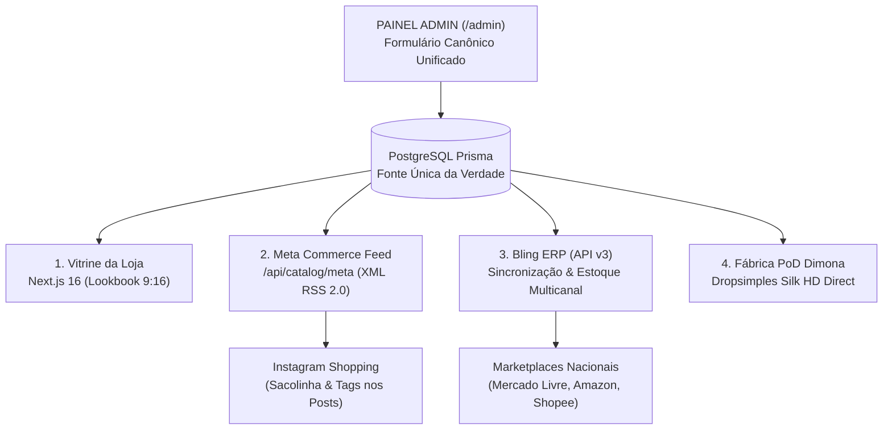

# 🚀 Plano Estratégico & Técnico: Matriz Canônica Multicanal — AVA Vitória

> **Documento de Engenharia & Apresentação Executiva**  
> **Data de Elaboração:** 11 de Novembro de 2026  
> **Objetivo:** Cadastrar o produto uma única vez no painel administrativo e distribuir automaticamente para a Vitrine Oficial (Balenciaga Lookbook 9:16), Meta Commerce (Instagram/Facebook Shopping), Bling ERP (Hub de 10 Marketplaces) e Fábrica PoD (Dimona Dropsimples).  
> **Status:** Pronto para Implementação (Fase de Planejamento Concluída) 🎯  

---

## 🏛️ 1. A Tese da Matriz Canônica (Single Source of Truth)

Atualmente, operações tradicionais de e-commerce sofrem com **redundância e erro operacional**: o operador cadastra o produto no site, depois entra no Bling para cadastrar estoque e NCM, depois vai ao Meta Commerce cadastrar a sacolinha do Instagram e depois cria o post manualmente.

A **Matriz Canônica da AVA Vitória** unifica essas 4 pontas em um único formulário de alta fidelidade:

---

## 📋 2. Dicionário da Matriz Canônica (4 Blocos de Dados)

### Bloco A: Identificação & Narrativa de Marca (Vitrine & Instagram)
*   **Nome Comercial:** Ex: *T-Shirt Oversized Altinha Addict*
*   **Slug URL:** Gerado automaticamente (ex: `/produtos/t-shirt-oversized-altinha-addict`)
*   **Coleção Vinculada:** Associação direta com a coleção ativa (ex: *Ava Nova Era* ou *Sem Limites*)
*   **Descrição Editorial / Storytelling:** Texto do conceito urbano da peça para a página de produto e legenda base da Meta.
*   **Gênero:** *Unissex*, *Masculino*, *Feminino*.
*   **Tipo de Card no Grid:** Tipo 1 (Padrão 9:16), Tipo 2 (Destaque), Tipo 3 (Lookbook Editorial).

### Bloco B: Mídias & Arquivos de Produção (Site & Dimona PoD)
*   **Galeria Lookbook 9:16:** Fotos de modelos vestindo a peça (1ª foto = capa da vitrine e imagem primária da Meta; fotos 2 a 10 = carrossel da vitrine e imagens secundárias do feed).
*   **Mockup Flat / Detalhes:** Fotos de detalhes de gola, costura e estampa.
*   **Arquivo Mestre PoD (300 DPI):** URL ou registro do gabarito padronizado sem margem pronto para o Studio 3D da Dimona (`3435 × 4680 px`).

### Bloco C: Financeiro, Custo & Fiscal (Bling ERP & Rentabilidade)
*   **Preço de Venda ao Consumidor (Retail):** Ex: `R$ 180,00`
*   **Custo de Fabricação PoD (Dropsimples Dimona):** Ex: `R$ 67,90` (Silk HD Frente + Costas)
*   **Margem Bruta Calculada (Display em tempo real):** `R$ 112,10 (62.2%)`
*   **Código NCM:** `6109.10.00` (Camisetas de malha de algodão)
*   **Origem da Mercadoria:** `0 - Nacional`
*   **Regime Tributário:** `Simples Nacional`

### Bloco D: Grade de Tamanhos, Logística & SKUs (Bling & Estoque)
*   **SKU Mestre:** Ex: `AVA-TSHIRT-ALTINHA-01`
*   **Grade Ativa:** `P`, `M`, `G`, `GG`, `XGG` (com SKUs derivados automáticos: `AVA-TSHIRT-ALTINHA-01-M-PR`)
*   **Cores Homologadas:** Preto, Off-White, Branco, Estonado, Marrom.
*   **Peso do Produto:** `220g` (Oversized) / `180g` (Prime) / `165g` (Quality).
*   **Dimensões da Embalagem:** Largura: `25 cm` | Altura: `5 cm` | Comprimento: `35 cm`.

---

## 🛠️ 3. Roteiro Passo a Passo de Implementação (Para Amanhã)

### Etapa 1: Atualização do Banco de Dados (`schema.prisma`)
*   Evoluir a tabela `Product` adicionando:
    *   `sku_master`: `String? @db.VarChar(100)`
    *   `cost_price`: `Decimal? @db.Decimal(10, 2)`
    *   `ncm`: `String? @default("6109.10.00") @db.VarChar(20)`
    *   `weight_grams`: `Int? @default(220)`
    *   `dimensions`: `Json? @db.JsonB`
*   Executar migração `npx prisma db push` (sem perda de dados existentes).

### Etapa 2: Expansão do Editor de Produto (`GridManagerClient.tsx`)
*   Refatorar o painel lateral direito de edição de produto para exibir **Abas Limpas**:
    *   **Aba 1: Visual & Vitrine** (Nome, Preço, Descrição, Mídias 9:16 e Tipo de Card)
    *   **Aba 2: Grade & Estoque** (Tamanhos, Cores e Quantidades)
    *   **Aba 3: Fiscal & Custos** (SKU, NCM, Custo Dimona e Margem Calculada)
    *   **Aba 4: Publicação Multicanal** (Status no Feed da Meta e Conexão Bling)

### Etapa 3: Aperfeiçoamento do Feed Meta Commerce (`/api/catalog/meta`)
*   O endpoint já funciona, mas será enriquecido para incluir os novos campos:
    *   `<g:mpn>` e `<g:sku>` derivados do SKU mestre
    *   `<g:shipping_weight>` com o peso em gramas
    *   `<g:cost_of_goods_sold>` (opcional para relatórios de ROAS da Meta)

### Etapa 4: Conector Bling ERP API v3 (Importado do Star-Ink)
*   Aproveitar as rotas OAuth já validadas no projeto Star-Ink:
    *   `/api/auth/bling/authorize`
    *   `/api/auth/bling/callback`
*   Ao salvar um produto canônico, enviar payload para cadastrar produto pai e variações no Bling para faturamento e emissão de NF-e.

---

## 💼 4. Argumento de Ouro para a Reunião com os Sócios (Quinta-feira)

> *"Com a Matriz Canônica da AVA, nós não somos apenas uma loja virtual bonita: nós temos uma infraestrutura de tecnologia de nível enterprise.  
> Cada peça criada entra em uma fonte única da verdade que alimenta na mesma hora a Vitrine Balenciaga, o Instagram Shopping dos sócios, a fábrica da Dimona sob demanda sem estoque parado, e o Bling ERP para distribuição em todos os marketplaces do Brasil."*
