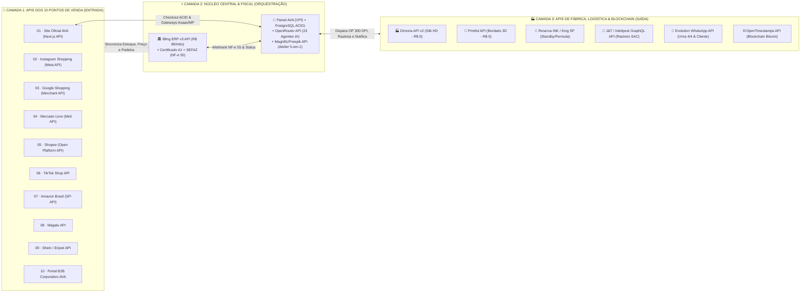

# 🌐 03 · PLATAFORMA AGÊNTICA UNIFICADA (OPENROUTER), MATRIZ DEMOCRÁTICA DE APIS POR DEPARTAMENTO E PLANO DE CUSTOS FIXOS (MEI)

> **Diretor Estratégico & Arquiteto:** Armando Sinkovitz (*Genera*)  
> **Orquestração Técnica:** Maestro Lincoln  
> **Data de Referência:** Novembro de 2026 (Pauta de Reunião Executiva — Segunda-feira)  
> **Destinatários:** Conselho Societário AVA Sem Limites (**Armando, Tripoint, Flávio e Gustavo**)  
> **Objetivo (Pauta #1 da Reunião):** Homologar a arquitetura da **Plataforma Agêntica Unificada via OpenRouter** + **APIs Operacionais (Bling ERP, 10 Pontos de Venda, Fornecedores PoD e Infraestrutura)** distribuídas democraticamente entre os **4 Sócios e seus 8 Departamentos**, pavimentando a inclusão desta estrutura como custo fixo operacional na **Pauta #2 (Minuta do Acordo Societário / Contrato Social Pré-LTDA Registrado em Blockchain)**.

---

## 🎯 1. A Premissa de Equilíbrio Societário (Equidade de Aportes)

Na fundação da **AVA Vitória / AVA Sem Limites**, a parceria entre os 4 sócios parte de um equilíbrio justo, maduro e sem dívidas retroativas:

1. **Expertise Comercial & de Mercado (Tripoint, Flávio e Gustavo):** Entram com **20 anos de prática, bagagem criativa, conhecimento de produto e vivência de mercado**.
2. **Estrutura Tecnológica & Plataforma Agêntica (Armando / *Genera*):** Entra com toda a **arquitetura do E-commerce, o Painel Administrativo de 8 Departamentos, a Sala de Reuniões, o Motor MDV de 26 Chaves e a engenharia dos 23 Agentes de IA** prontos e construídos, **sem exigir ressarcimento pelo investimento de tempo e desenvolvimento da plataforma**.
3. **O Combustível Operacional (Daqui para Frente = Custo Fixo da Empresa):** Uma vez que a máquina está construída e entregue à sociedade, o "combustível" mensal que mantém os **23 Agentes de IA**, a **Emissão de Notas Fiscais (Bling)**, o **Servidor (VPS)** e as **APIs de Criação, Produção e 10 Pontos de Venda** funcionando passa a ser **Custo Fixo Operacional da Empresa (PJ)** — onde **todos os 4 sócios usufruem igualmente em seus departamentos e todos ganham**.

---

## 🧠 2. Por que o OpenRouter (`openrouter.ai`) é o Coração da Nossa Plataforma Agêntica?

Uma empresa moderna com **8 Departamentos e 23 Agentes Especializados** não pode depender de um único modelo de Inteligência Artificial, pois **a IA que cria ou decompõe uma estampa no Atelier não é a mesma que calcula impostos no Financeiro ou que atende um cliente no SAC às 3h da manhã**.

Se assinássemos separadamente OpenAI (ChatGPT Plus), Anthropic (Claude Pro), Google (Gemini Advanced) e Perplexity para cada função, gastaríamos mais de **R$ 600,00/mês apenas em assinaturas engessadas**.

### A Solução: 1 Conta Institucional na OpenRouter = Acesso a +300 Modelos de IA
* **Como funciona:** A **OpenRouter** é o maior roteador corporativo de APIs de IA do mundo. Em vez de mensalidade fixa perdida, a empresa mantém um **Pool Único de Créditos Pré-Pagos (Pay-As-You-Go)** com trava de segurança (ex: **US$ 25,00/mês ≈ R$ 145,00/mês**).
* **Especialização por Departamento com 1 Única Chave (`OPENROUTER_API_KEY`):**
  1. **Modelos de Visão Computacional & Direção Criativa (`Gemini 2.5 Pro Vision` / `Claude 3.7 Sonnet Vision` / `GPT-4o`):** Usados pelo **Tripoint** nos `Deptos 07 e 08` para ler a **Imagem de Referência**, decompor matematicamente as **26 Chaves do JSON**, redigir a **Carta Conceitual dos 4 Pilares** e compilar os *Prompts to Image*.
  2. **Modelos de Raciocínio Lógico, Jurídico e Contábil (`Claude 3.7 Sonnet` / `DeepSeek R1`):** Usados pelo **Flávio** nos `Deptos 01 e 02` (Agentes *Dr. Lex* e *Unit Economics*) para contratos, Reforma Tributária (LC 214/2025 `NCM × cClassTrib`), DRE e Relatório #1 da Diretoria.
  3. **Modelos de Engenharia, Código e Auditoria (`Claude Sonnet` / `Gemini 2.5 Pro`):** Usados pelo **Armando** nos `Deptos 03 e 04` (Agentes *Maestro Lincoln*, *Software Architect* e *Auditor de Preços*) para manter a loja blindada e auditar os catálogos das fábricas.
  4. **Modelos Ultra-Rápidos de Tempo Real e Tráfego (`Gemini 2.5 Flash` / `Llama 3.3 70B`):** Usados pelo **Gustavo** nos `Deptos 05 e 06` (Agentes *Concierge 24/7 Sofia*, *Discriminador SAC* e *Analista de Tráfego ROAS*) para responder clientes em 2 segundos e cruzar o Relatório #2 da Diretoria (*Mais Vendido / Menos Vendido*).

---

## 🏛️ 3. Distribuição Democrática: Quais Agentes e Quais APIs Alimentam Cada Sócio e Departamento?

Cruzando o **[`05_ESPELHO_FLUXO_GERAL_DE_PROCESSOS.pdf`](file:///home/artz/Documentos/Antigravity/Ava-Vitoria/docs/REUNIAO/05_ESPELHO_FLUXO_GERAL_DE_PROCESSOS.pdf)** (da **Fase 0** até o **Fechamento na Diretoria**), veja como **todos os 8 Departamentos** são alimentados pelas APIs da empresa:

---

### 🎨 SÓCIO 1: TRIPOINT (`07 · Marketing de Produto` & `08 · Atelier Criativo & Mídias`)

| Departamento & Fase do Fluxo | Agentes Alocados ao Tripoint (7 Agentes) | APIs & Motores Utilizados | Custo Mensal / Modelo |
| :--- | :--- | :--- | :--- |
| **`07 · Marketing de Produto`** *(Fase 0: Os 4 Pilares da Coleção · Fase 2: Vitrine Canônica 3x3 & Trios Instagram)* | 1. **`Content Creator`** *(Redige a Carta Conceitual: 1. Nome, 2. Tema/Tendência, 3. Estética, 4. Mensagem A·V·A)* 2. **`Trios 3x3 Balenciaga`** *(Visual Merchandising da Vitrine e Feed 9:16)* 3. **`Vault Coupon`** *(Motor da campanha viral `"EU TENHO CUPOM!"` 10% a 50% OFF)* | • **OpenRouter API** *(Modelos: Claude 3.7 Sonnet / GPT-4o para conceitos de coleção, storytelling streetwear e engenharia de campanhas)* • **Meta / Instagram Graph API** *(Sincronização de catálogo e Trios 3x3)* | • **OpenRouter:** *Incluso no Pool Central da Empresa (~R$ 25/mês de consumo estimado)* • **Meta API:** **R$ 0,00** |
| **`08 · Atelier Criativo & Mídias`** *(Fase 1: Busca/Entrada da Imagem de Referência ➔ Decomposição no JSON de 26 Chaves ➔ Prompt to Image ➔ Upscale 300 DPI + Fundo Transparente & Hash SHA-256)* | 4. **`Curador de Matrizes 300 DPI & MDV 26`** *(Analisa a Imagem de Referência, extrai as 26 Chaves com >=7 mutações e gera o Hash SHA-256)* 5. **`Creative Director (Atelier)`** *(Compilador Prompt-to-Image)* 6. **`Lookbook 9:16 / Mockup Studio 3D`** *(Fotografia e vídeo virtual de modelos)* 7. **`Whimsy Injector`** *(UX/UI da Vitrine)* | • **OpenRouter Vision API** *(Gemini 2.5 Pro Vision / GPT-4o Vision para Decomposição Visual da Imagem de Referência no JSON de 26 Chaves)* • **Scanner Matemático Local `mdv_scanner.py`** *(NumPy/Pillow rodando na nossa VPS)* • **Magnific / Freepik Unified API ("All Magnific, but in code") — 5 Motores em 1 API dentro do Painel `/admin/atelier`:**   1. **`Stock Content API`:** Janela buscadora do acervo Freepik dentro do Painel para escolher a **Imagem de Referência** com 1 clique!   2. **`Image Generation API`:** Gera a nova estampa (Mystic 2.5 / Flux / Ideogram) direto do Prompt Compilado.   3. **`Upscaler API (Magnific)`:** Amplia a arte para **300 DPI (`3435×4680px`)** para Silk HD.   4. **`Image Editing API`:** Remove o fundo (`PNG Transparente`) para estamparia.   5. **`Video Generation API`:** Gera vídeos 9:16 de Lookbook. • **Vectorizer.ai API** *(Vetorização SVG/EPS quando necessário)* | • **OpenRouter Vision + Scanner MDV:** *Incluso no Pool Central (~R$ 35/mês)* • **Magnific / Freepik API (Pay-As-You-Go 5-em-1):** **~R$ 115,00/mês** *(US$ 20 pré-pago — substitui até R$ 487/mês de Midjourney + Magnific Web + Freepik separados!)* • **Vectorizer.ai:** **R$ 58,00/mês** *(US$ 9,99)* |

---

### ⚖️ SÓCIO 2: FLÁVIO (`01 · Jurídico & Compliance` & `02 · Financeiro, Fiscal & ERP`)

| Departamento & Fase do Fluxo | Agentes Alocados ao Flávio (4 Agentes) | APIs & Motores Utilizados | Custo Mensal / Modelo |
| :--- | :--- | :--- | :--- |
| **`01 · Jurídico & Compliance`** *(Fase 1 · Etapa 2: Registro Blockchain `.ots` do JSON 26 Chaves & Acordo Societário + Reforma Tributária LC 214/2025)* | 1. **`Dr. Lex`** *(Consultor Jurídico Societário, INPI, CDC, LGPD e Reforma Tributária CBS/IBS)* 2. **`Tax & Compliance Guard`** *(Auditoria da Trava Fiscal `REG-011`: `NCM 6109.10.00 × cClassTrib`)* | • **OpenTimestamps API (Blockchain Bitcoin `.ots`)** *(Ancora o Hash SHA-256 das artes aprovadas pelo Tripoint e do nosso Contrato Social na Blockchain do Bitcoin)* • **OpenRouter API** *(Modelos: DeepSeek R1 / Claude 3.7 Sonnet para pareceres jurídicos e fiscais)* | • **OpenTimestamps Blockchain:** **R$ 0,00 (100% Gratuito e Perpétuo)** • **OpenRouter Jurídico:** *Incluso no Pool Central (~R$ 20/mês)* |
| **`02 · Financeiro, Fiscal & ERP`** *(Fase 2: Unit Economics p/ Urna 4/4 · Fase 3: Emissão NF-e 55 / `"Vale uma NF-e"` · Fechamento: Relatório #1 da Diretoria)* | 3. **`Unit Economics & DRE`** *(Calcula custo PoD + Imposto + Taxa, Chave de 2 Posições e envia preço à Urna 4/4)* 4. **`Chief Financial Officer (CFO IA)`** *(Conciliação de pedidos, Despesas P&D `#755-460-927` e Relatório #1)* | • **Bling ERP v3 API (Plano Mercúrio)** *(Fora da OpenRouter: Emissão de NF-e Modelo 55 no MEI com IE ativa e integração com os 10 canais)* • **Certificado Digital e-CNPJ A1 (ICP-Brasil)** *(Assinatura automática de XML na SEFAZ)* • **Gateways Asaas & Mercado Pago API** *(Liquidação de PIX e Cartão)* • **OpenRouter API** *(Auditoria DRE e inteligência financeira)* | • **Bling ERP v3:** **R$ 89,00/mês** • **Certificado A1:** **R$ 16,58/mês** *(R$ 199/ano)* • **Gateways PIX/Cartão:** **R$ 0,00 fixo** *(taxa apenas sobre venda)* • **OpenRouter Finanças:** *Incluso no Pool Central (~R$ 15/mês)* |

---

### 📐 SÓCIO 3: ARMANDO / *GENERA* (`03 · Arquitetura & TI` & `04 · Produção & Fornecedores`)

| Departamento & Fase do Fluxo | Agentes Alocados ao Armando (8 Agentes) | APIs & Motores Utilizados | Custo Mensal / Modelo |
| :--- | :--- | :--- | :--- |
| **`03 · Arquitetura & TI`** *(Fase 3 · Etapa 7: Checkout ACID, Servidor VPS, Banco PostgreSQL e Segurança)* | 1. **`Software Architect`** *(Contratos de API e Webhooks)* 2. **`Database Optimizer`** *(Trava ACID PostgreSQL anti-overselling)* 3. **`Minimal Change Engineer`** *(Estabilidade cirúrgica do código)* 4. **`Sentinel Security`** *(Portaria Digital, Senhas Nível 1/2 e LGPD)* 5. **`Telemetria de Infraestrutura`** *(Monitor da VPS `31.220.102.2` e PM2)* | • **Contabo Cloud VPS** *(Fora da OpenRouter: Hospeda o Site, o Painel `/admin`, o PostgreSQL, a Sala de Reuniões e o Docker do WhatsApp)* • **Registro.br & Cloudflare API** *(Domínio oficial, DNS, SSL e escudo anti-DDoS)* • **OpenRouter API** *(Diagnóstico de logs e arquitetura)* | • **Contabo VPS:** **R$ 48,00/mês** *(€ 7,50)* • **Registro.br:** **R$ 3,33/mês** *(R$ 40/ano)* • **Cloudflare:** **R$ 0,00 (Free)** • **OpenRouter TI:** *Incluso no Pool Central (~R$ 15/mês)* |
| **`04 · Produção & Fornecedores`** *(Fase 4 · Etapa 9: Esteira Fabril PoD até a fronteira `4. Pronto na Doca / Aguardando Coleta`)* | 6. **`Auditor de Preços Multi-Supplier`** *(Vigia custos de insumos nas fábricas a cada 2h)* 7. **`Gestor de Amostras Físicas PoD`** *(Rastreio e laudos do lote `#755-460-927`)* 8. **`Factory Dispatcher`** *(Disparo de OPs em 300 DPI para as fábricas)* | • **Dimona API REST v2** *(Homologada e Ativa — Silk HD Kornit, status fabril e Danfe Olist)* • **Printful Brasil API REST** *(Homologada e Ativa — Bonés Bordado 3D e malhas Ring-Spun)* • **Reserva INK API** *(Em Standby — ver Seção 4 sobre o custo seletivo de R$ 799/mês)* • **Parceria Fábrica King SP** *(Hub próprio em negociação de permuta tecnológica)* | • **Dimona API v2:** **R$ 0,00 fixo** *(paga só a peça vendida)* • **Printful API:** **R$ 0,00 fixo** *(paga só a peça vendida)* • **Reserva INK API:** **R$ 0,00 (Em Standby)** |

---

### 🎧 SÓCIO 4: GUSTAVO (`05 · SAC` & `06 · Marketing de Vendas`)

| Departamento & Fase do Fluxo | Agentes Alocados ao Gustavo (5 Agentes) | APIs & Motores Utilizados | Custo Mensal / Modelo |
| :--- | :--- | :--- | :--- |
| **`05 · SAC`** *(Fase 4 · Etapa 10: Torre Logística Pós-Coleta `COLETADO` ➔ Entrega Final ➔ Arquivamento na Diretoria + Gatilho BPO)* | 1. **`Concierge Virtual 24/7 (Sofia)`** *(Atende clientes de madrugada/fim de semana sobre medidas, tecidos e pedidos)* 2. **`Agente Discriminador SAC`** *(Triagem CDC Art. 49 7 dias vs. Defeito Fabril 90 dias)* 3. **`Escalador Anti-Omissão`** *(Zagueiro-Artilheiro: transborda aos sócios se passar de 2h)* | • **Intelipost / J&T Express GraphQL API** *(Rastreamento rodoviário Pós-Coleta em tempo real)* • **Evolution API (WhatsApp Gateway)** *(Auto-hospedado na nossa VPS: envia avisos proativos ao cliente)* • **OpenRouter API** *(Modelos rápidos Gemini 2.5 Flash / GPT-4o-mini para responder clientes 24/7 e analisar fotos de trocas)* | • **API GraphQL J&T/Intelipost:** **R$ 0,00** • **Evolution API WhatsApp:** **R$ 0,00** *(roda na nossa VPS, economizando R$ 99/mês de Z-API)* • **OpenRouter SAC 24/7:** *Incluso no Pool Central (~R$ 20/mês)* |
| **`06 · Marketing de Vendas`** *(Fase 3 · Etapa 6 & Fechamento: Recebe Relatório #2 da Diretoria `Mais Vendido / Menos Vendido` e gira o Ciclo PDCA de Tráfego)* | 4. **`Analista de Tráfego & ROAS`** *(Cruza o Relatório #2 da Diretoria com o custo por clique e indica onde escalar ou pausar verba)* 5. **`Gestor dos 10 Canais`** *(Monitora catálogo e vendas nos 10 canais integrados)* | • **OpenRouter API** *(Análise preditiva de ROAS, funil de conversão e relatórios de tráfego)* • **APIs dos 10 Canais via Bling Hub** *(Site Próprio, Instagram, TikTok Shop, Mercado Livre, Shopee, Amazon, etc.)* | • **APIs dos 10 Canais:** **R$ 0,00 fixo** *(comissão apenas quando vende)* • **OpenRouter ROAS:** *Incluso no Pool Central (~R$ 15/mês)* |

---

### 🏛️ DIRETORIA EXECUTIVA (Conselho dos 4 Sócios — Uso Coletivo)

* **Agentes da Mesa Redonda (3 Agentes Coletivos):**
  1. **`Maestro Lincoln`** *(Orquestrador Técnico Geral & Copiloto)*
  2. **`Cobrador de Consenso 4/4`** *(Urna de Votação + Régua automática de WhatsApp/E-mail)*
  3. **`Sprint Prioritizer / Agente Porteiro`** *(Protocolo de documentos na Sala de Reuniões, como o `"Vale uma NF-e"`, e guardião de metas)*
* **APIs Utilizadas:** **OpenRouter API** + **Evolution API (WhatsApp na VPS — R$ 0,00)**.

---

## 🔍 4. Análise Crítica das APIs "Fora da OpenRouter": A Descoberta da Magnific/Freepik API (5-em-1) vs. O Caso Reserva INK

Na Pauta #1 da nossa reunião, temos duas descobertas estratégicas sobre as APIs especializadas:

### 4.1. A Mina de Ouro no Atelier: API Unificada Magnific + Freepik (*"All Magnific, but in code"*)
A Freepik adquiriu a Magnific AI e unificou todo o ecossistema gráfico deles em **uma única API Pay-As-You-Go (paga por uso, exatamente como a OpenRouter)**.
Em vez de pagarmos 3 assinaturas web isoladas e caras (*Midjourney US$ 30 + Magnific Web US$ 39 + Freepik Premium US$ 15 = ~R$ 487,00/mês fixos*), **1 única chave da Magnific API integrada ao nosso Painel `/admin/atelier`** entrega **5 motores direto na tela do Tripoint**:

1. **`Stock Content API` (Janela Buscadora do Acervo Freepik dentro do Painel `/admin/atelier`):**
   * O ponto de partida do processo criativo da AVA é encontrar uma **Imagem de Referência** para decompor no JSON de 26 Chaves.
   * Com o endpoint `GET https://api.freepik.com/v1/resources`, criamos uma **Janela Visual de Busca dentro do Painel `/admin/atelier`**. O Tripoint digita o tema da coleção (ex: *"Op-Art Geometric 3D"*), visualiza a grade de imagens de alta resolução da Freepik na tela do nosso Painel e clica em **`[ 🎯 Usar como Imagem de Referência ]`** para alimentar automaticamente o Decompositor JSON de 26 Chaves!
2. **`Image Generation API` (Mystic 2.5, FLUX.1 Pro, Ideogram):**
   * Lê o **Prompt Compilado** das 26 Chaves do JSON e gera a nova arte inédita direto dentro do Painel (sem precisar abrir o Discord do Midjourney).
3. **`Upscaler API — Magnific` (Ampliação Generativa para 300 DPI):**
   * Multiplica a resolução da arte aprovada até `3435 × 4680px` (**300 DPI reais**), reconstruindo micro-detalhes e traços de `1px a 3px` para o gabarito industrial da máquina Kornit Silk HD da Dimona.
4. **`Image Editing API` (Remoção Automática de Fundo PNG):**
   * Remove o fundo com 1 clique (`remove-background`), gerando o arquivo **PNG com transparência Alpha perfeita** exigido para estamparia em camisetas escuras.
5. **`Video Generation API` (Lookbooks 9:16 em Movimento):**
   * Transforma fotos estáticas de modelos em vídeos verticais 9:16 de alta costura para a Vitrine Canônica (`/`) e para os Trios 3x3 do Instagram/TikTok.

### 4.2. O Caso Reserva INK: Por que a API deles custa quase R$ 900,00/mês?
Conforme auditado no documento oficial [`01_Planos_Assinatura_ReservaINK.pdf`](file:///home/artz/Documentos/Antigravity/Ava-Vitoria/docs/INTEGRACOES/FORNECEDORES/RESERVA_INK/01_Planos_Assinatura_ReservaINK.pdf):
* A **Reserva INK** cresceu tanto que se tornou **altamente seletiva**:
  * O *Plano Experimente (R$ 39,90/mês)* bloqueia as modelagens Oversized e Algodão Peruano e limita a 20 peças/mês (sem API).
  * O *Plano Básico (R$ 159,00/mês)* e o *Plano Aceleração (R$ 499,00/mês)* liberam o catálogo manual no painel deles, mas **NÃO liberam a API nem os Webhooks**.
  * **Para ter acesso à API e Webhooks da Reserva INK**, eles exigem o **Plano INKrível**, que custa **R$ 799,00/mês** (quase **R$ 900,00/mês** com impostos/taxas).
* **A Filosofia da Reserva:** *"Quem quer usar automação via API é operação profissional de grande escala; pague, portanto, um preço profissional."*
* **Nossa Decisão Estratégica (Custo R$ 0,00 agora):**
  * **Não vamos pagar R$ 799,00/mês para a Reserva INK na largada.** A documentação técnica da API deles (`api-1.yaml`) já foi mapeada e deixada pronta em **`STANDBY`** no nosso sistema.
  * Para o varejo B2C imediato, já temos **2 gigantes com API 100% GRATUITA (R$ 0,00/mês) e já conectadas ao nosso Painel**:
    1. **Dimona API REST v2 (R$ 0,00/mês):** Fábrica principal de Camisetas Silk HD Kornit (Frente+Costas). Ao cadastrarmos o nosso **CNPJ MEI com Inscrição Estadual ativa** no canal B2B Corporate da Dimona, destravamos a **Tabela de Lojista/Atacado (custo de fábrica real de R$ 38 a R$ 58)** sem pagar 1 centavo de mensalidade!
    2. **Printful Brasil API REST (R$ 0,00/mês):** Já homologada com Token ativo para Bonés Estruturados com Bordado 3D Puff e linha internacional.
  * Só ativaremos a Reserva INK quando fecharmos um **contrato B2B de Uniformes Corporativos** (escolas, empresas, agências) cujo lucro de um único lote pague o ano inteiro da assinatura!

---

## 🛒 5. As APIs dos 10 Pontos de Venda & O "Emaranhado Invisível" de 20+ Integrações

Para quem olha apenas a vitrine da loja por fora, um e-commerce parece apenas "uma página bonita com fotos de camisetas". Na realidade, para que a **AVA Sem Limites** venda simultaneamente em **10 Pontos de Venda** sem nunca vender a mesma peça duas vezes e sem trabalho manual, existe um **emaranhado de mais de 20 APIs e Webhooks conversando em tempo real (em menos de 3 segundos por pedido)**.

### 5.1. Radiografia das APIs dos 10 Pontos de Venda (São todas Grátis?)
A conexão técnica via API com os **10 Canais de Venda** tem **custo fixo de API `R$ 0,00/mês`** (eles ganham apenas comissão percentual quando a venda acontece — *Take Rate*, com exceção opcional do plano Pro da Amazon):

| # | Ponto de Venda (Canal) | Mensalidade da API | Comissão por Venda (*Só paga se vender*) | Como a API Conecta ao Nosso Ecossistema? |
| :-: | :--- | :---: | :---: | :--- |
| **01** | **Loja Oficial AVA (`ava-vitoria.com.br`)** | **R$ 0,00** *(Código Próprio Next.js 16)* | **0% de comissão** *(apenas ~0,99% PIX ou 3,49% Cartão do Gateway Asaas/MP)* | **API Nativa Própria (`/api/checkout` + Webhooks Asaas/MP + PostgreSQL ACID)** |
| **02** | **Instagram Shopping & Meta Catalog** | **R$ 0,00** *(Meta Graph API)* | **0% de comissão** *(direciona para checkout no Site #01)* | **Feed XML/API Automático** sincronizado com a nossa Vitrine Canônica 3x3 |
| **03** | **Google Shopping (Merchant Center)** | **R$ 0,00** *(Content API for Shopping)* | **0% de comissão** *(direciona para checkout no Site #01)* | **Feed API Automático** sincronizado com nosso banco PostgreSQL |
| **04** | **Mercado Livre** | **R$ 0,00** *(API Meli Developers)* | **12% a 17%** sobre a venda concluída | **API OAuth2 via Hub Bling ERP v3** *(Sincroniza estoque, preço, pedido e NF-e)* |
| **05** | **Shopee Brasil** | **R$ 0,00** *(Shopee Open Platform API)* | **14% a 20% + R$ 4,00/item** vendido | **API via Hub Bling ERP v3** *(Puxa pedido, emite NF-e e devolve etiqueta)* |
| **06** | **TikTok Shop** | **R$ 0,00** *(TikTok Shop Partner API)* | **5% a 8%** sobre a venda concluída | **API via Hub Bling / Conector Meta** |
| **07** | **Amazon Brasil** | **R$ 0,00** *(Plano Individual)* ou **R$ 19,00/mês** *(Plano Pro c/ **SP-API** completa)* | **15%** sobre a venda concluída | **Amazon Selling Partner API (SP-API) via Hub Bling ERP v3** |
| **08** | **Magalu Marketplace** | **R$ 0,00** *(API IntegraCommerce)* | **16%** sobre a venda concluída | **API via Hub Bling ERP v3** |
| **09** | **Shein Brasil / Enjoei Pro** | **R$ 0,00** *(Open API p/ CNPJ)* | **16% a 20%** sobre a venda concluída | **API via Hub Bling ERP v3** |
| **10** | **Portal B2B Corporativo AVA (Atacado)** | **R$ 0,00** *(Simulador Nativo em `/admin/producao`)* | **0% de comissão** *(50% Sinal PIX + 50% Faturado direto na Conta PJ)* | **Motor Próprio AVA + Bling NF-e + Fábricas (Dimona / King / Reserva)** |

### 5.2. Como Domamos esse Emaranhado? (A Arquitetura Hub Estrela em 3 Camadas)
Se tivéssemos que programar e manter **10 pontes isoladas** direto com Mercado Livre, Shopee, Amazon, Magalu, Shein, TikTok e a Receita Estadual (SEFAZ), precisaríamos de uma equipe de TI custando **R$ 10.000/mês**.
Para resolver isso com custo mínimo, o **Depto 03 · Arquitetura & TI (Armando)** desenhou uma **Arquitetura Centralizada em 3 Camadas**:

* **Por que essa engenharia economiza milhares de reais por mês?**
  1. O **Bling ERP v3 (`R$ 89,00/mês`)** atua como o "para-choque" fiscal e de marketplaces: ele absorve as APIs dos 10 canais de venda e conversa com a **SEFAZ** (via **Certificado A1**) para emitir a **NF-e Modelo 55** no nosso MEI com Inscrição Estadual ativa.
  2. O **OpenRouter (`~R$ 145,00/mês`)** atua como o "cérebro unificado": 1 única API alimenta os **23 Agentes de IA** em todos os 8 Departamentos.
  3. A **Magnific / Freepik API (`~R$ 115,00/mês` por consumo)** atua como o "estúdio gráfico 5-em-1" embutido no `/admin/atelier`: entrega Busca de Imagens de Referência (Freepik Stock), Geração de Estampa, Upscale 300 DPI, Remoção de Fundo Transparente e Vídeo 9:16 numa única chave.
  4. A **Contabo VPS (`R$ 48,00/mês`)** hospeda o nosso site, o Painel `/admin`, o banco de dados PostgreSQL, o Scanner Matemático MDV e o servidor próprio de WhatsApp (`Evolution API`), que conecta as fábricas (**Dimona API v2** e **Printful API**), a transportadora (**J&T GraphQL API**) e a **Blockchain do Bitcoin (`OpenTimestamps API`)**.

---

## 💰 6. Resumo Financeiro Consolidado: Quanto Custa Manter Toda a Empresa, as 20+ APIs e os 23 Agentes Rodando?

Substituindo assinaturas isoladas de IA e de ferramentas gráficas pelos **2 Pools Unificados de API (OpenRouter + Magnific/Freepik API)**, veja como o custo fixo mensal da empresa cai ainda mais e entrega muito mais poder:

### Tabela Oficial de Custos Fixos Mensais da Empresa (Operação Ativa)

| # | Serviço / API | Onde Atua (Departamentos Beneficiados) | Custo Mensal (R$) | Natureza da Cobrança |
| :-: | :--- | :--- | :---: | :--- |
| **1** | **OpenRouter API (Pool Corporativo de IA Cognitiva)** | **TODOS OS 8 DEPARTAMENTOS + DIRETORIA** *(Alimenta os 23 Agentes: Texto, Visão MDV 26 Chaves, Jurídico, DRE, SAC 24/7 e ROAS)* | **~R$ 145,00** *(US$ 25 pré-pago c/ teto)* | Custo Fixo da Empresa (Consumo controlado) |
| **2** | **Contabo Cloud VPS + Registro.br + Cloudflare** | **TODOS OS 8 DEPARTAMENTOS + VITRINE (`/`)** *(Servidor Linux, Banco PostgreSQL, Painel `/admin`, Sala de Reuniões e WhatsApp Evolution)* | **R$ 51,33** *(R$ 48,00 + R$ 3,33)* | Custo Fixo de Infraestrutura |
| **3** | **Bling ERP v3 (Plano Mercúrio) + Certificado e-CNPJ A1** | **`02 · Financeiro`, `04 · Produção` e `06 · Mkt de Vendas`** *(Emissão de NF-e 55 no MEI c/ IE ativa, SEFAZ e Hub das APIs dos 10 Canais)* | **R$ 105,58** *(R$ 89,00 + R$ 16,58)* | Custo Fixo Fiscal & Hub 10 Canais |
| **4** | **APIs dos 10 Canais, Fábricas, Logística, Blockchain e WhatsApp** *(10 Marketplaces, Dimona API v2, Printful API, J&T GraphQL, OpenTimestamps `.ots` e Evolution API)* | **`01 · Jurídico`, `04 · Produção`, `05 · SAC`, `06 · Vendas` e `Diretoria`** | **R$ 0,00** | **100% Gratuitas / Auto-hospedadas na nossa VPS** |
| — | **SUBTOTAL 1: NÚCLEO OPERACIONAL & AGÊNTICO COMPLETO** | **Loja + 10 Canais + 8 Deptos + 23 Agentes + ERP Fiscal + Fábricas + Blockchain** | **R$ 301,91 / mês** | *Equivale ao lucro de ~3 camisetas vendidas no mês!* |
| **5** | **Magnific / Freepik API 5-em-1 + Vectorizer.ai (`08 · Atelier`)** • *Magnific/Freepik API Premium (20.000 créditos/mês: Stock 250M+ + Geração Mystic + Upscale 300 DPI + Fundo PNG): **R$ 80,00/mês** (ou **R$ 59,00/mês** no anual)* • *Vectorizer.ai API (Vetor SVG/EPS): R$ 58,00 (US$ 9,99)* | **`08 · Atelier Criativo & Mídias` (Tripoint)** *(Substitui ~R$ 487/mês de Midjourney + Magnific Web + Freepik separados por 1 única API já homologada e integrada ao Painel)* | **R$ 138,00** *(ou R$ 117,00 no anual)* | Custo do Atelier via API *(Economia de R$ 349/mês!)* |
| — | **TOTAL GERAL MENSAL (NÚCLEO + ATELIER 100% VIA API)** | **Ecossistema Integral AVA Sem Limites** | **~R$ 439,91 / mês** | *(Sendo ~R$ 109,97 por sócio caso rateado, ou 100% pago pelo caixa das vendas com apenas 4 camisetas/mês)* |

*(Nota: Caso o Tripoint deseje manter também a assinatura web avulsa do Midjourney Standard [R$ 175/mês], ou no futuro ativar a Reserva INK API [R$ 799/mês no plano INKrível — hoje em Standby], qualquer adição passa pela deliberação 4/4 na Urna da Diretoria).*

---

## 🤝 7. Roteiro de Deliberação em 2 Pautas para a Reunião de Segunda-Feira

Com esta arquitetura clara, a condução da reunião segue uma sequência lógica irrefutável:

### ☑️ PAUTA #1 — Aprovação da Plataforma Agêntica (OpenRouter + Magnific/Freepik API) e Matriz de APIs como Custo Fixo da Empresa
1. **Todos usam, todos ganham:** Fica demonstrado que nenhum departamento trabalha "no braço". O Tripoint tem IA de Visão, Busca de Referências Freepik, Geração e Upscale 300 DPI via Magnific API nos Deptos 07/08; o Flávio tem IA Jurídica, Blockchain e Bling ERP nos Deptos 01/02; o Armando tem IA de Arquitetura e APIs de Fábrica nos Deptos 03/04; e o Gustavo tem IA de SAC 24/7, Rastreio J&T, Analista de ROAS e as APIs dos 10 Canais nos Deptos 05/06.
2. **Aprovação dos Pools de API (OpenRouter + Magnific API + Bling ERP + Infra VPS):** O Conselho aprova que o pacote operacional completo (**~R$ 474,91/mês** para toda a empresa) constitui o **Custo Fixo Oficial da Empresa**, a ser custeado pelo caixa da operação (CNPJ MEI).
3. **Política para APIs Seletivas de Alto Custo (Ex: Reserva INK R$ 799/mês):** Fica estabelecido que nenhuma assinatura extra será contratada sem antes passar pela **Urna de Votação 4/4** mediante comprovação de retorno financeiro.

### ☑️ PAUTA #2 — Aprovação da Minuta do Contrato Social / Acordo Societário Igualitário Registrado em Blockchain
1. **Segurança Jurídica Imediata Sem Custos de Junta Comercial Agora:** Mantemos a operação comercial rodando no **CNPJ MEI com Inscrição Estadual ativa** para validar vendas rapidamente e sem burocracia contábil cara.
2. **Igualdade Plena 4/4 Formalizada:** Assinamos o **Acordo Societário Pré-Constitutivo (Minuta Idêntica ao Contrato Social da futura LTDA)**, declarando que a marca, a operação e os direitos/deveres pertencem igualmente aos **4 sócios**, com a descrição exata das responsabilidades dos **8 Departamentos (2 por sócio)** e a cláusula de manutenção da **Plataforma Agêntica (OpenRouter & APIs)** aprovada na Pauta #1.
3. **Blindagem Perpétua no `Depto 01 · Jurídico`:** O documento assinado pelos 4 sócios gera um código criptográfico **SHA-256** e é registrado ao vivo na **Blockchain do Bitcoin (`.ots` OpenTimestamps)** dentro do nosso próprio Painel Administrativo. Quando o faturamento exigir a mudança contábil de MEI para LTDA, nada muda entre os sócios: basta levar o texto já assinado à Junta Comercial.
